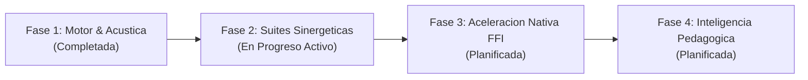

# Tunner: Studio Pitch, Real-Time Acoustic Lab and Sheet Music Engine

[](LICENSE)
[](https://github.com/Nicolas11Leon/Tunner/actions/workflows/ci.yml)
[]()
[]()
[]()
[]()
[]()
[]()
[]()
[](CONTRIBUTING.md)

> **Tunner** es una estación de trabajo acústica, de edición musical, síntesis procedural y pedagogía de código abierto de grado conservatorio. Diseñada para dotar al ecosistema libre del software musical más preciso, riguroso y transparente del mundo, combina en un único ejecutable local: afinación estroboscópica virtual de ultra precisión ($\pm 0.1\text{ cents}$), algoritmo McLeod Pitch Method (MPM con NSDF) resistente a saltos de octava, afinador inteligente con reconocimiento multivariado de instrumentos y adaptación acústica de micrófonos, suite vocal con Auto-Tune en tiempo real, grabación multipista con metadata dual y edición microtonal en pentagrama (modo Melodyne), catálogo canónico de tareas de práctica (TTC) con navegación modal instantánea ($O(1)$) y conmutación rápida (`J`), entrenador auditivo de intervalos a ciegas (*Blind Ear Pitch Trainer*), motor vectorial de partituras SMuFL a 60/120 FPS, sintetizador en memoria de tablas de ondas SoundFont SF2, rack de estudio modular interactivo con manipulación drag-and-drop, consola central de transporte sincronizado con atajos de DAWs profesionales, bus reactivo de señales por identificadores de puerto, taxonomía universal de instrumentos (Hornbostel-Sachs y General MIDI), motor de micro-desafinación acústica por tecla o cuerda, emulador universal de teclado y secuenciador de estrofas, consola mezcladora multicanal de stems, importador/exportador universal bidireccional (MusicXML 3.1 y MIDI SMF Formato 0), metrónomo determinista en Isolate, grabador de práctica de alta fidelidad con auto-escucha, analítica pedagógica 4D, persistencia atómica offline y personalización estética avanzada.

---

## 1. Filosofía y Principios Arquitectónicos

Tunner se distribuye como un bien público abierto bajo licencia **GNU AGPLv3** con una visión inquebrantable: **democratizar la educación musical de alto rendimiento y el software de audio profesional, eliminando barreras económicas, suscripciones forzosas y dependencia de servidores remotos.**

* **100% Offline-First:** Todo el procesamiento digital de señales (DSP), estimación de tono, decodificación y serialización binaria, síntesis procedural y SoundFont SF2, grabación, almacenamiento atómico y renderizado vectorial se ejecuta localmente en el dispositivo. Cero telemetría invasiva, cero latencia de red y cero dependencia de la nube.
* **Clean Architecture y Monolito Modular:** Separación estricta entre Dominio (Dart puro sin dependencias de interfaces gráficas ni plugins), Datos/Infraestructura (códecs binarios, streams PCM, Isolates, persistencia local) y Presentación (Flutter reactivo con ViewModels e Inversión de Dependencias).
* **Disciplina de Audio y Hardware:** Ausencia absoluta de bucles de espera activa (*zero busy-waiting*). Los hilos secundarios e Isolates ceden tiempo de CPU al sistema operativo mediante temporizadores de alta resolución. Latencia objetivo sub-10ms entre captura acústica y actualización visual.
* **Extensibilidad In-Process de Bajo Nivel:** La arquitectura modular monolítica prevé el uso de **`dart:ffi` con C, C++ o Rust** para cómputo DSP en bloque de bare-metal dentro del mismo binario local, rechazando microservicios sobre la red para preservar la latencia cero.

---

## 2. Mapa de Capacidades del Sistema

```mermaid
graph TD
    classDef core fill:#0D0D14,stroke:#00E676,stroke-width:2px,color:#fff;
    classDef tuner fill:#161622,stroke:#38BDF8,stroke-width:2px,color:#fff;
    classDef audio fill:#1A1024,stroke:#A855F7,stroke-width:2px,color:#fff;
    classDef sheet fill:#181310,stroke:#F59E0B,stroke-width:2px,color:#fff;
    classDef storage fill:#0C1E18,stroke:#10B981,stroke-width:2px,color:#fff;

    A["Tunner Studio Core"]:::core --> B["Laboratorio de Afinacion & Pitch"]:::tuner
    A --> C["Motor de Notacion SMuFL & Pentagrama"]:::sheet
    A --> D["Rack de Estudio Modular & Multitarea"]:::core
    A --> E["Taxonomia de Instrumentos & Sintesis SF2"]:::audio
    A --> F["Estudio Vocal & Grabacion Multipista"]:::audio
    A --> G["Importador & Exportador Universal"]:::sheet
    A --> H["Evaluacion Pedagogica 4D & TTC"]:::tuner
    A --> I["Consola Mezcladora de Stems"]:::audio
    A --> J["Persistencia Local Atomica Offline"]:::storage
    A --> K["Consola DJ Virtual & Performance FX"]:::audio
    A --> L["Tutor de Entonacion Armonica (Just Intonation)"]:::tuner

    B --> B1["Afinador Estroboscopico Virtual (±0.1 Cents)"]:::tuner
    B --> B2["Afinador Inteligente & Reconocimiento Timbrico"]:::tuner
    B --> B3["Estimador McLeod Pitch Method (NSDF)"]:::tuner
    B --> B4["Calibracion A4 (415-466 Hz) & 8 Temperamentos"]:::tuner

    C --> C1["Renderizado Vectorial SMuFL 60/120 FPS"]:::sheet
    C --> C2["Playhead en Tiempo Real por Sub-Ticks"]:::sheet
    C --> C3["Transcripcion de Microfono a Partitura en Vivo"]:::sheet
    C --> C4["Editor de Partituras con Historial Memento"]:::sheet

    D --> D1["Lienzo Modular Reordenable Drag and Drop"]:::core
    D --> D2["Consola Multitarea de Transporte Sincronizado"]:::core
    D --> D3["Bus de Senales y Ruteo por IDs (Punto a Punto / Broadcast)"]:::core

    E --> E1["Clasificacion Hornbostel-Sachs & General MIDI"]:::audio
    E --> E2["Sintetizador SoundFont SF2 & Procedural ADSR"]:::audio
    E --> E3["Desafinacion Microtonal por Tecla o Cuerda"]:::audio
    E --> E4["Teclado Maestro Universal & Secuenciador"]:::audio

    F --> F1["Suite Vocal con Auto-Tune en Tiempo Real"]:::audio
    F --> F2["Grabacion Multipista con Metadata Dual de Tono"]:::audio
    F --> F3["Edicion Microtonal en Pentagrama (Modo Melodyne)"]:::audio

    G --> G1["Parser & Exportador MusicXML 3.1 (W3C)"]:::sheet
    G --> G2["Parser & Serializador Binario MIDI SMF 0"]:::sheet

    H --> H1["Deteccion de Rushing vs Dragging"]:::tuner
    H --> H2["Catalogo de Tareas de Practica (TTC) & Salto 'J'"]:::tuner
    H --> H3["Reporte de Desempeno y Grados S, A, B, C, D"]:::tuner

    K --> K1["Mapeo Ergonomico QWERTY / MIDI"]:::audio
    K --> K2["Crossfader Curvo & Jog Wheels Vectoriales"]:::audio
    K --> K3["Filtro Bipolar Sweep & Delay Sincronizado"]:::audio
    K --> K4["Beat Tracker Onset & Grabador Master WAV"]:::audio

    L --> L1["Deteccion Dinamica de Rol Armonico"]:::tuner
    L --> L2["Calculo de Diana Pura (5-Limit & 7-Limit)"]:::tuner
    L --> L3["Medidor Vectorial de Batimiento Acustico"]:::tuner
    L --> L4["Dron Armonico de Ensamble Puro"]:::tuner
```



---

## 3. Especificación Técnica de Funcionalidades

### 3.1 Afinador Estroboscópico Virtual de Ultra Alta Precisión
* **Espectro Completo de Cobertura:** Soporta desde el sub-bajo $27.50\text{ Hz}$ ($A_0$) hasta el soprano extremo $4186.01\text{ Hz}$ ($C_8$).
* **Física Estroboscópica Real:** Bandas cilíndricas vectoriales cuya velocidad angular y dirección de rotación son matemáticamente proporcionales al error microtonal ($\pm 50.0\text{ cents}$).
* **Bloqueo Óptico de Conservatorio:** Indicador lumínico de tolerancia cuando la desviación entra en el rango milimétrico de $\pm 3.0\text{ cents}$.
* **Filtrado RMS y Puerta de Ruido:** Supresión inteligente de ruido ambiental (*Noise Gate*) que aísla la fundamental pura en instrumentos acústicos y voces.

### 3.2 Estimador de Tono McLeod (McLeod Pitch Method - MPM)
* **Función de Diferencia Cuadrada Normalizada (NSDF):** Resuelve los problemas de duplicación de octava inherentes a la autocorrelación estándar:
  $$r_t(\tau) = \frac{2 \sum_{j=t}^{t+W-1} x_j x_{j+\tau}}{\sum_{j=t}^{t+W-1} (x_j^2 + x_{j+\tau}^2)}$$
* **Selección de Pico con Umbral Dinámico:** Detecta el primer máximo relevante que supera el factor de claridad $k = 0.85 \cdot \text{maxPeak}$, garantizando fidelidad ante ataques rápidos y timbres complejos.
* **Interpolación Parabólica Sub-Muestral:** Corrección fraccional del lag $\delta$:
  $$\delta = \frac{\alpha - \gamma}{2(\alpha - 2\beta + \gamma)}$$
  proporcionando resolución centesimal sin sobrecargar el hilo de renderizado.

### 3.3 Afinador Inteligente con Reconocimiento Tímbrico Multivariado
* **Clasificador Acústico Cuatridimensional:** Combina rango de frecuencias fundamentales ($35\%$), similitud coseno de armónicos $H_1\dots H_8$ ($35\%$), fracción de armónicos impares ($15\%$) y centroide espectral ($15\%$).
* **Adaptación Automática de Filtros:** Ajusta en tiempo real los filtros de paso de banda del micrófono y selecciona el timbre SoundFont SF2 idéntico al instrumento identificado (Flauta, Clarinete, Guitarra, Violín, Trompeta, etc.).

### 3.4 Suite Vocal, Auto-Tune en Tiempo Real y Modo Melodyne
* **Corrección Tonal Instantánea:** Cuantiza la fundamental detectada hacia la escala musical seleccionada (Mayor, Menor, Pentatónica, Dórica, Maqam, etc.) con tiempo de retuning y tracking de formantes configurable.
* **Grabación Multipista con Metadata Dual:** Registra de manera simultánea el tono natural emitido (`rawPitchHz`) y el tono procesado (`correctedPitchHz`).
* **Edición de Afinación en Pentagrama:** Convierte tomas vocales en notas cuantizadas sobre el pentagrama vectorial SMuFL, permitiendo ajustes microtonales nota por nota o cuantización a escala con 1 toque (*Snap to Scale*).

### 3.5 Calibración de Concierto A4 y 8 Temperamentos Históricos
* **Calibración Fina de Tono:** Selector continuo de 415 a 466 Hz (440 Hz ISO 16, 442 Hz orquestal, 432 Hz Verdi, 415 Hz Barroco).
* **Recálculo Exponencial Integral:**
  $$f(n) = f_{\text{ref}} \cdot 2^{\frac{n - 69}{12}}$$
* **8 Temperamentos de Conservatorio:** Temperamento Igual (12-EDO), Pitagórico, Entonación Justa (5-Limit), Mesotónico de 1/4 de Coma, Werckmeister III, Kirnberger III, Vallotti y Young.

### 3.6 Motor Vectorial de Partituras SMuFL y Transcripción en Vivo
* **Pintor Vectorial SMuFL 60/120 FPS:** Renderizado de pentagramas, claves (Sol, Fa, Do), armaduras, figuras rítmicas, ligaduras y alteraciones bajo el estándar abierto Bravura.
* **Transcripción en Vivo (Mic-to-Score):** Cuantización rítmica automática de audio captado a notas de partitura.
* **Editor con Patrón Memento:** Deshacer/Rehacer ilimitado y de alto rendimiento basado en instantáneas inmutables.

### 3.7 Síntesis SoundFont SF2, Procedural ADSR y Luthería Virtual
* **Sintetizador SoundFont 2.04:** Parser binario de chunks RIFF en memoria para reproducción de instrumentos de muestra PCM con loops y filtros de articulación.
* **Síntesis Procedural ADSR:** Oscilador armónico con generador de envolvente de 4 etapas (Attack, Decay, Sustain, Release).
* **Desafinación Microtonal Individual:** Ajuste micrométrico por tecla o cuerda con curvas de Railsback, guitarras de 12 cuerdas y cuartos de tono orientales.

---

## 4. El Futuro de Tunner: Hoja de Ruta (Roadmap 2026-2027)

El desarrollo de Tunner se estructura en fases secuenciales orientadas por metas rigurosas:



### 4.1 Fase 1: Motor Fundamental y Acústica de Precisión (Completada)
* [x] Algoritmo McLeod Pitch Method (MPM) con NSDF e interpolación parabólica.
* [x] Afinador estroboscópico virtual con visualización de armónicos $H_1\dots H_8$.
* [x] 8 Temperamentos históricos y calibración continua de $A_4$ (415–466 Hz).
* [x] Renderizador vectorial SMuFL y editor interactivo con patrón Memento.
* [x] Importador/Exportador MusicXML 3.1 y serializador binario MIDI SMF 0.
* [x] 549 pruebas automatizadas passing y 0 lints en análisis estático.

### 4.2 Fase 2: Suites Sinergéticas y Multitarea Profesional (En Progreso Activo)
* [x] **Afinador Inteligente:** Detección de timbre y adaptación de micrófono ([PR #15](https://github.com/Nicolas11Leon/Tunner/pull/15)).
* [x] **Suite Vocal & Modo Melodyne:** Auto-Tune en tiempo real, grabación dual y edición en pentagrama ([PR #16](https://github.com/Nicolas11Leon/Tunner/pull/16)).
* [x] **Catálogo Canónico TTC:** Taxonomía de tareas de práctica y salto rápido modal `J`.
* [x] **Descomponedor de Partituras & Ensamble "Minus-One":** Descomposición de partituras multitrack, silenciamiento del instrumento del usuario, síntesis del acompañamiento con SoundFont SF2 y evaluación simultánea de la interpretación en vivo ([PR #19](https://github.com/Nicolas11Leon/Tunner/pull/19)).
* [x] **Transcripción Polifónica Mic-to-Score:** Separación espectral de acordes complejos captados por micrófono y transcripción polifónica directa a partitura ([PR #22](https://github.com/Nicolas11Leon/Tunner/pull/22)).
* [x] **Consola DJ Virtual & Performance FX:** Dual-deck virtual DJ console, mapeo universal QWERTY, skins de hardware Pioneer DDJ-FLX4 / CDJ-3000 / Traktor Kontrol S4, mapeo de mandos Xbox/PS, filtro bipolar sweep, delay sincronizado, beat tracking y grabador máster WAV ([PR #24](https://github.com/Nicolas11Leon/Tunner/pull/24), [PR #25](https://github.com/Nicolas11Leon/Tunner/pull/25), [PR #27](https://github.com/Nicolas11Leon/Tunner/pull/27)).
* [x] **Tutor de Afinación Justa Dinámica:** Ajuste interactivo de afinación en tiempo real según el rol armónico de la nota en el acorde ejecutado por un ensamble ([PR #26](https://github.com/Nicolas11Leon/Tunner/pull/26)).

### 4.3 Fase 3: Aceleración FFI Nativa y Expansión de Sonidos (Planificada)
* [ ] **Motor DSP Nativo (`tunner_dsp_engine`):** Procesamiento de audio por bloques en C++ o Rust enlazado vía `dart:ffi` para alcanzar latencias deterministas $\le 3\text{ ms}$.
* [ ] **SoundFonts de Alta Definición y Formato SFZ:** Soporte de bancos orquestales multicapa con conmutación por velocidad (velocity switching) y *round-robin*.
* [ ] **Arquitectura de Efectos de Audio Modulares:** Reverb convolutiva basada en respuestas de impulso (IR) locales y modelado acústico de recintos.

### 4.4 Fase 4: Pedagogía Aumentada y Analítica Local Privada (Planificada)
* [ ] **Currículum Adaptativo de Conservatorio:** Detección automática de debilidades de ejecución (ritmo, afinación, estabilidad y articulación) con generación de ejercicios de práctica personalizados.
* [ ] **Modo Práctica a Ciegas Extendido:** Entrenamiento auditivo de micro-intervalos ($< 25\text{ cents}$) y reconocimiento instantáneo de timbres orquestales.

---

## 5. Cómo Colaborar en Tunner (Call for Contributors)

¡Tunner es un proyecto impulsado por la comunidad para la comunidad! Creemos firmemente que la mejor tecnología musical nace de la intersección entre músicos, científicos de audio y artesanos del software.

### ¿Quiénes pueden colaborar?
| Perfil | Áreas de Impacto en Tunner |
| :--- | :--- |
| **Músicos y Educadores** | Diseñar ejercicios de estudio, afinar curvas de temperamentos históricos, validar instrumentos y proponer afinaciones alternativas. |
| **Ingenieros de Audio y DSP** | Investigar algoritmos de detección de tono polifónico, optimizar filtros acústicos digitales y expandir la síntesis SoundFont/SFZ. |
| **Desarrolladores Flutter y Dart** | Optimizar el rendimiento gráfico del lienzo SMuFL a 60/120 FPS, mejorar la interfaz y atajos DAW, y enriquecer el Rack Modular. |
| **Desarrolladores C++ y Rust** | Colaborar en el futuro motor DSP nativo de ultra baja latencia con `dart:ffi` y optimizaciones SIMD. |
| **Traductores y Diseñadores** | Traducir Tunner a más idiomas (i18n), diseñar temas accesibles de alto contraste y redactar guías de usuario. |

### Cómo empezar en 4 pasos
1. **Lee nuestra [Guía de Contribución](CONTRIBUTING.md)** y la constitución técnica del proyecto en [AGENTS.md](AGENTS.md).
2. **Haz un Fork y Clona el repositorio:**
   ```bash
   git clone https://github.com/TU_USUARIO/Tunner.git
   cd Tunner
   flutter pub get
   ```
3. **Explora los "Good First Issues" sugeridos en [CONTRIBUTING.md](CONTRIBUTING.md)**:
   * Nuevos temperamentos históricos (`lib/features/tuner/domain/temperaments.dart`).
   * Ampliación de presets de instrumentos en `UniversalInstrumentCatalog`.
   * Mejoras de accesibilidad y temas de color en `TunnerThemePalette`.
4. **Envía tu Pull Request** asegurando que `flutter analyze` reporte 0 advertencias y `flutter test` pase al 100%.

---

## 6. Arquitectura de Software y Estructura del Repositorio

El proyecto implementa la arquitectura **Monolito Modular Feature-First con Clean Architecture** ([ADR-0004](docs/04_adrs/0004_modular_monolith_feature_first_clean_architecture.md)):

```
tunner/
├── lib/
│   ├── core/
│   │   └── theme/                  # Tokens semanticos de diseno y paletas de color
│   ├── features/
│   │   ├── modular_rack/           # Rack de estudio drag-and-drop, SignalBus y consola multitarea
│   │   ├── instrument/             # Taxonomia universal HS, SoundFont SF2, lutheria microtonal
│   │   ├── tuner/                  # Estimador McLeod MPM (NSDF), temperamentos historicos y NoteEntity
│   │   ├── metronome/              # Reloj determinista en Isolate, sub-ticks y Tap Tempo
│   │   ├── sheet_music/            # Renderizador vectorial SMuFL y arbol jerarquico de partitura
│   │   ├── score_editor/           # Editor interactivo, paleta ritmica y patron Memento
│   │   ├── transcription/          # Transcripcion de microfono a partitura en tiempo real
│   │   ├── practice_recorder/      # Grabador multipista AAC/WAV, comparador espectral y auto-escucha
│   │   ├── practice_evaluator/     # Analitica pedagogica 4D (rushing, dragging, entonacion)
│   │   ├── universal_importer/     # Codecs bidireccionales MusicXML 3.1 y MIDI SMF Formato 0
│   │   ├── acoustic_lab/           # Espectrograma de armonicos FFT y centroide timbrico
│   │   ├── ear_training/           # Entrenador auditivo de intervalos a ciegas (Blind Mode)
│   │   ├── chord_analyzer/         # Analizador polifonico y visualizador armonico H1-H8
│   │   ├── exercise_generator/     # Generador procedural de escalas y arpegios
│   │   ├── mixer/                  # Consola mezcladora multicanal de stems
│   │   ├── dj_console/             # Consola DJ Virtual: Dual-deck, FX bipolar/delay, beat tracking y grabador WAV
│   │   ├── harmonic_tutor/         # Tutor de afinacion justa, rol armonico y cancelacion de batimientos
│   │   ├── song_library/           # Descompositor pedagogico y repertorio
│   │   ├── vocal_autotune/         # Suite vocal: Auto-Tune en vivo y convertidor a pentagrama
│   │   ├── persistence/            # Persistencia atomica offline (.tmp + rename seguro)
│   │   ├── navigation/             # MainAppShell, Quick Action Dock y atajos DAW
│   │   ├── tuner_viewmodel.dart    # Orquestador principal con Inversion de Dependencias
│   │   └── tuner_screen.dart       # Pantalla tradicional unificada del laboratorio acustico
│   └── main.dart                   # Punto de entrada de la aplicacion
├── test/                           # 634 pruebas unitarias, de integracion y de widgets
├── docs/                           # 68 Casos de Uso, 62 ADRs, 66 Planes de Implementacion
└── CONTRIBUTING.md                  # Guia detallada para colaboradores del proyecto
```

---

## 7. Compilación, Pruebas y Puesta en Marcha

### Requisitos Previos
* **Flutter SDK:** Canal estable (`^3.11.5` o superior).
* **Dart SDK:** (`^3.11.5` o superior).
* Micrófono habilitado en el sistema operativo.

### Instalación y Verificación
```bash
# 1. Clonar el repositorio
git clone https://github.com/Nicolas11Leon/Tunner.git
cd Tunner

# 2. Descargar dependencias locales
flutter pub get

# 3. Analisis estatico de codigo (0 advertencias garantizadas)
flutter analyze

# 4. Ejecucion de la suite completa de pruebas (617 pruebas passing)
flutter test
```

### Ejecución en Plataformas Compatibles
```bash
# Linux Desktop (Nativo)
flutter run -d linux

# Android (Dispositivo fisico o emulador)
flutter run -d android

# macOS Desktop
flutter run -d macos

# Windows Desktop
flutter run -d windows

# iOS (Requiere entorno macOS y Xcode)
flutter run -d ios
```

---

## 8. Licencia y Créditos

### 8.1 Licencia de Software Libre y Garantía Copyleft
**Tunner** se distribuye como un bien público abierto bajo los términos de la **GNU Affero General Public License v3.0 (AGPLv3)**. Consultar el archivo [LICENSE](LICENSE) para la declaración legal completa.

Bajo los principios fundamentales de la licencia AGPLv3:
* **Libertad de Uso y Ejecución:** Cualquier músico, estudiante, docente, investigador o institución educativa puede utilizar Tunner de forma totalmente libre y sin restricciones comerciales o académicas.
* **Libertad de Inspección y Modificación:** El código fuente es 100% abierto y transparente para ser auditado, adaptado, optimizado y evolucionado.
* **Garantía Copyleft Fuerte:** Cualquier trabajo derivado, bifurcación (*fork*) o servicio alojado en red debe distribuirse bajo la misma licencia AGPLv3, garantizando que las mejoras de ingeniería reviertan permanentemente a la comunidad musical.
* **Compromiso Offline-First:** Tunner garantiza que el núcleo de procesamiento de señales, análisis espectral, afinación y pedagogía funcionará siempre de manera local y autónoma, sin telemetría invasiva, muros de pago ni dependencia de servidores remotos.

### 8.2 Autoría y Dirección de Arquitectura
* **Autor Original y Arquitecto del Sistema:** **Nicolás León** ([@Nicolas11Leon](https://github.com/Nicolas11Leon)).
* **Constitución de Desarrollo:** Toda la arquitectura, el diseño de clases y la disciplina de latencia sub-10ms se rigen estrictamente bajo los mandatos no negociables de [AGENTS.md](AGENTS.md).

### 8.3 Agradecimientos y Créditos Científicos y Tecnológicos
El desarrollo de Tunner se fundamenta en investigaciones acústicas seminales, estándares abiertos de la industria musical y tecnologías de sistemas de alto rendimiento:

1. **Estimación Fundamental de Tono (DSP & MPM):**
   * **Philip McLeod & Geoff Wyvill** (Universidad de Otago, Nueva Zelanda, 2005) por la formulación y publicación del algoritmo *McLeod Pitch Method (MPM)* y la función de diferencia cuadrada normalizada (*Normalized Square Difference Function - NSDF*), núcleo del detector monofónico de alta precisión de Tunner resistente a saltos de octava.
2. **Tipografía Musical y Notación Vectorial (SMuFL):**
   * **W3C Music Notation Community Group** por la especificación abierta **SMuFL** (*Standard Music Font Layout*) y a los diseñadores de la fuente abierta *Bravura* (Steinberg Media Technologies), cuyos mapas glíficos normalizados rigen el renderizado vectorial de cabezas de nota, plicas, silencios y armaduras en el lienzo a 60/120 FPS.
3. **Síntesis Acústica por Tablas de Ondas (SoundFont SF2):**
   * **Creative Technology Ltd. & E-mu Systems** por la especificación técnica abierta de **SoundFont 2.04**, estándar industrial implementado en el parser binario RIFF y sintetizador SF2 en memoria de Tunner para reproducir instrumentos acústicos de referencia con latencia determinista.
4. **Organología y Clasificación Universal de Instrumentos:**
   * **Erich Moritz von Hornbostel & Curt Sachs** (1914) por la clasificación taxonómica Hornbostel-Sachs (aerófonos, cordófonos, idiófonos, membranófonos y electrófonos).
   * **The MIDI Association (AMEI / MMA)** por las especificaciones de General MIDI Nivel 1 y 2, utilizadas para la asignación canónica de patches, controladores continuos (CC) y transposición orquestal.
5. **Metodología de Corrección Tonal y Edición Visual:**
   * A las tecnologías pioneras de **Antares Audio Technologies** (Auto-Tune) y **Celemony Software** (Melodyne), cuyas metodologías de cuantización a escalas modales y edición gráfica de notas sobre partitura inspiraron la Suite Vocal y el Melodyne Mode de Tunner.
6. **Ecosistema de Ejecución y Runtime:**
   * Al equipo de ingeniería de **Google Flutter & Dart** por proveer un runtime multiplataforma reactivo de ultra baja latencia con soporte nativo de Isolates multihilo y compilación AOT (Ahead-of-Time) hacia código de máquina nativo.
