# Tunner: Studio Pitch, Real-Time Acoustic Lab and Sheet Music Engine

[](LICENSE)
[]()
[]()
[]()
[]()

> **Tunner** es una estación de trabajo acústica, de edición musical, síntesis procedural y pedagogía de código abierto de grado conservatorio. Diseñada para dotar al ecosistema libre del software musical más preciso y riguroso, combina en un único ejecutable local: afinación estroboscópica virtual de ultra precisión ($\pm 0.1\text{ cents}$), algoritmo McLeod Pitch Method (MPM con NSDF) resistente a saltos de octava, calibración de tono de concierto ($A_4$ ajustable de 415 a 466 Hz), motor vectorial de partituras SMuFL a 60/120 FPS, rack de estudio modular interactivo con manipulación drag-and-drop, consola central multitarea de transporte sincronizado, bus reactivo de señales por identificadores de puerto, taxonomía universal de instrumentos (Hornbostel-Sachs y General MIDI), motor de micro-desafinación acústica por tecla o cuerda, emulador universal de teclado y secuenciador de estrofas melódicas, motor de síntesis procedural en memoria con envolvente ADSR, consola mezcladora multicanal de stems, importador/exportador universal bidireccional (MusicXML 3.1 y MIDI SMF Formato 0), metrónomo determinista en Isolate, grabador de práctica de alta fidelidad con auto-escucha, analítica pedagógica 4D, persistencia atómica offline y personalización estética avanzada.

---

## 1. Filosofia y Principios Arquitectonicos

Tunner se distribuye como un bien publico abierto bajo licencia **GNU AGPLv3**.
* **100% Offline First:** Todo el procesamiento digital de señales (DSP), estimacion de tono, decodificacion y serializacion binaria, sintesis procedural, grabacion, almacenamiento atómico y renderizado vectorial se ejecuta localmente en el dispositivo. Cero telemetria invasiva, cero latencia de red y cero dependencia de servidores en la nube.
* **Clean Architecture y Monolito Modular:** Separacion estricta entre Dominio (Dart puro sin dependencias de interfaces graficas), Datos/Infraestructura (codecs binarios, streams PCM, Isolates, persistencia local) y Presentacion (Flutter reactivo con ViewModels e Inversion de Dependencias).
* **Disciplina de Audio y Hardware:** Ausencia absoluta de bucles de espera activa (*zero busy-waiting*). Los hilos secundarios e Isolates ceden tiempo de CPU al sistema operativo mediante temporizadores de alta resolucion. Latencia objetivo sub-10ms entre captura acustica y actualizacion visual.

---

## 2. Mapa de Capacidades del Sistema

```mermaid
graph TD
    classDef core fill:#0D0D14,stroke:#00E676,stroke-width:2px,color:#fff;
    classDef tuner fill:#161622,stroke:#38BDF8,stroke-width:2px,color:#fff;
    classDef audio fill:#1A1024,stroke:#A855F7,stroke-width:2px,color:#fff;
    classDef sheet fill:#181310,stroke:#F59E0B,stroke-width:2px,color:#fff;
    classDef storage fill:#0C1E18,stroke:#10B981,stroke-width:2px,color:#fff;

    A["Tunner Studio Core"]:::core --> B["Laboratorio de Afinacion & Pitch"]:::tuner
    A --> C["Motor de Notacion SMuFL & Pentagrama"]:::sheet
    A --> D["Rack de Estudio Modular & Multitarea"]:::core
    A --> E["Taxonomia Universal de Instrumentos"]:::audio
    A --> F["Estudio de Grabacion & Auto-Escucha"]:::audio
    A --> G["Importador & Exportador Universal"]:::sheet
    A --> H["Evaluacion Pedagogica 4D"]:::tuner
    A --> I["Consola Mezcladora de Stems"]:::audio
    A --> J["Persistencia Local Atomica Offline"]:::storage

    B --> B1["Afinador Estroboscopico Virtual (±0.1 Cents)"]:::tuner
    B --> B2["Calibracion A4 (415 Hz Barroco - 466 Hz)"]:::tuner
    B --> B3["Estimador McLeod Pitch Method (NSDF)"]:::tuner
    B --> B4["Temperamentos Historicos (8 Sistemas)"]:::tuner

    C --> C1["Renderizado Vectorial SMuFL 60/120 FPS"]:::sheet
    C --> C2["Playhead en Tiempo Real por Sub-Ticks"]:::sheet
    C --> C3["Transcripcion de Microfono a Partitura en Vivo"]:::sheet
    C --> C4["Editor de Partituras con Historial Memento"]:::sheet

    D --> D1["Lienzo Modular Reordenable Drag and Drop"]:::core
    D --> D2["Consola Multitarea de Transporte Global"]:::core
    D --> D3["Bus de Senales y Ruteo por IDs (Punto a Punto / Broadcast)"]:::core

    E --> E1["Clasificacion Hornbostel-Sachs & General MIDI"]:::audio
    E --> E2["Sintesis Procedural con Envolvente ADSR"]:::audio
    E --> E3["Desafinacion Microtonal por Tecla o Cuerda"]:::audio
    E --> E4["Teclado Maestro Universal & Emulador de Estrofas"]:::audio

    F --> F1["Grabacion AAC / WAV de Alta Fidelidad"]:::audio
    F --> F2["Visualizador de Onda Sonora Dinamica"]:::audio
    F --> F3["Reproductor Loopback con Velocidad Variable"]:::audio

    G --> G1["Parser & Exportador MusicXML 3.1 (W3C)"]:::sheet
    G --> G2["Parser & Serializador Binario MIDI SMF 0"]:::sheet

    H --> H1["Deteccion de Rushing vs Dragging"]:::tuner
    H --> H2["Modo Smart Wait de Entonacion"]:::tuner
    H --> H3["Reporte de Desempeno y Grados S, A, B, C, D"]:::tuner
```



---

## 3. Especificacion Tecnica de Funcionalidades

### 3.1 Afinador Estroboscopico Virtual de Ultra Alta Precision
* **Espectro Completo de Cobertura:** Soporta desde el sub-bajo $27.50\text{ Hz}$ ($A_0$) hasta el soprano extremo $4186.01\text{ Hz}$ ($C_8$).
* **Fisica Estroboscopica Real:** Bandas cilindricas vectoriales cuya velocidad angular y direccion de rotacion son matematicamente proporcionales al error microtonal ($\pm 50.0\text{ cents}$).
* **Bloqueo Optico de Conservatorio:** Indicador luminico de tolerancia cuando la desviacion entra en el rango milimetrico de $\pm 3.0\text{ cents}$.
* **Filtrado RMS y Condicionamiento de Senal:** Algoritmo de supresion de ruido ambiental (Noise Gate) que descarta senales espurias y aisla la fundamental pura en instrumentos acusticos y electronicos.

### 3.2 Estimador de Tono McLeod (McLeod Pitch Method - MPM)
* **Funcion de Diferencia Cuadrada Normalizada (NSDF):** Resuelve los problemas de duplicacion de octava inherentes a la autocorrelacion estandar (ACF) y la transformada de Fourier de baja resolucion:
  $$r_t(\tau) = \frac{2 \sum_{j=t}^{t+W-1} x_j x_{j+\tau}}{\sum_{j=t}^{t+W-1} (x_j^2 + x_{j+\tau}^2)}$$
* **Seleccion de Pico con Umbral Dinamico:** Detecta el primer maximo relevante que supera el factor de claridad $k = 0.85 \cdot \text{maxPeak}$, garantizando fidelidad ante ataques rapidos y dinamicas complejas.
* **Interpolacion Parabolica Sub-Muestral:** Correccion fraccional del lag $\delta$:
  $$\delta = \frac{\alpha - \gamma}{2(\alpha - 2\beta + \gamma)}$$
  proporcionando resolucion centesimal sin sobrecargar el hilo de renderizado.

### 3.3 Calibracion de Concierto A4 y Temperamentos Historicos
* **Calibracion Fina de Tono:** Selector de referencia continua de 415 a 466 Hz con presets historicos y modernos:
  * 440 Hz: Estandar Internacional ISO 16.
  * 442 Hz: Afinacion Sinfonica de Concierto Europea y Norteamericana.
  * 444 Hz: Solistas de Brillo y Ensambles de Viento.
  * 432 Hz: Afinacion Cientifica / Tono de Verdi.
  * 415 Hz: Afinacion Barroca Historica (Bach, Handel, Telemann).
* **Recalculo Exponencial Integral:**
  $$f(n) = f_{\text{ref}} \cdot 2^{\frac{n - 69}{12}}$$
* **8 Sistemas de Temperamento de Conservatorio:** Temperamento Igual (12-EDO), Pitagorico, Entonacion Justa (5-Limit), Mesotonico de 1/4 de Coma, Werckmeister III, Kirnberger III, Vallotti y Young.

### 3.4 Rack de Estudio Modular Interactivo (Drag & Drop)
* **Lienzo de Trabajo Configurable:** Cada funcionalidad reside en una unidad modular estandarizada (*RackUnitCard*). El usuario puede arrastrar, reordenar verticalmente, expandir para ajuste detallado o colapsar en vista compacta.
* **Gestion de Unidades Activas:** Encendido y apagado selectivo de modulos en reposo para optimizar el consumo energetico de la bateria y liberar ciclos de procesamiento.
* **Bandeja de Herramientas (Rack Library):** Drawer interactivo para agregar o retirar modulos al instante (Afinador Estroboscopico, Metronomo, Pentagrama, Grabador, Autotune, Dron Armonico, Espectrograma FFT, Analizador de Acordes, Lecciones Guiadas).

### 3.5 Consola Multitarea Central y Bus de Ruteo por IDs
* **Transporte Maestro Sincronizado:** Control global de Play, Pause, Rec y Stop que coordina concurrentemente el metronomo, la grabacion y la transcripcion sin desfases temporales.
* **Bus de Senales Desacoplado (SignalBus):** Enrutamiento reactivo en memoria local gobernado por identificadores inmutables de puerto (`PortId`):
  * `audioPcm`: Flujo continuo de muestras de audio en coma flotante.
  * `pitchEvents`: Despacho de eventos de tono (Hz, nota, cents, amplitud).
  * `musicalNotes`: Transmision de estructuras de partitura.
  * `temporalClock`: Pulsos y sub-ticks deterministas de metronomo.
* **Topologia de Enlace:** Soporte para conexiones punto a punto exclusivas o difusion global (Broadcast) con desconexion en caliente (*hot-swapping*).

### 3.6 Taxonomia Universal de Instrumentos Musicales
* **Clasificacion Cientifica Hornbostel-Sachs (HS) y General MIDI:** Estructura jerarquica estandarizada `[HS.subfamilia.codigo]`:
  * Aerofonos: Vientos maderas (flautas, oboes, clarinetes, fagotes, saxofones) y metales (trompetas, cornos, trombones, tubas).
  * Cordofonos: Cuerdas frotadas (violin, viola, cello, contrabajo), cuerdas pulsadas (guitarra clasica, electrica, bajo, ukelele) y teclados de cuerda (piano de cola, clavecin).
  * Idiofonos: Percusion afinada de laminas (marimba de concierto, vibrafono, glockenspiel).
  * Membranofonos: Bateria acustica estandar (Canal 10 MIDI), timbales sinfonicos, congas y percusion latina.
  * Electrofonos: Sintetizadores analogicos y bajos sintetizados.
  * Voz Humana: Registros soprano, tenor, baritono y bajo con diagrama de formantes.

### 3.7 Motor de Desafinacion Microtonal y Lutheria Virtual
* **Desafinacion Individual por Cuerda o Tecla:** Ajuste micrometrico en cents ($\pm 100.0\text{ cents}$) por nota MIDI o cuerda:
  $$f_{\text{final}} = f_{\text{ref}} \cdot 2^{\frac{n - 69}{12} + \frac{\Delta c_{\text{temperamento}} + \Delta c_{\text{custom}}}{1200}}$$
* **Presets Acusticos Canonicos:**
  * Curva de Railsback: Afinacion estirada de concierto que compensa la inharmonicidad fisica de cuerdas percutidas.
  * Piano Honky-Tonk / Ragtime: Desafinacion alternada de $\pm 8\text{ cents}$ para emular unísonos batientes de epoca.
  * Guitarra 12 Cuerdas: Batimento microtonal de cuerdas dobles ($\pm 5\text{ cents}$).
  * Maqamat Orientales: Cuartos de tono precisos ($-50\text{ cents}$ en notas seleccionadas).

### 3.8 Teclado Maestro Universal y Secuenciador de Estrofas
* **Teclado Cromatico Polifonico:** Interfaz tactil con cambio rapido de octavas ($C_1 \dots C_8$), sensibilidad dinamica y sintesis continua.
* **Reproductor de Estrofas Musicales:** Modulo que sintetiza y ejecuta secuencias melodicas y armonicas en cualquier instrumento emulado:
  * Arpegio Mayor de Concierto.
  * Motivo de Preludio en Do (J.S. Bach BWV 846).
  * Melodia Pentatonica Andina.
  * Linea de Bajo Funk Sincopada.
  * Estrofa Maqam Bayati Microtonal.

### 3.9 Motor Vectorial de Partituras SMuFL y Transcripcion en Vivo
* **Pintor Vectorial SMuFL 60/120 FPS:** Renderizado de pentagramas, claves (Sol, Fa, Do), armaduras, figuras ritmicas, ligaduras y alteraciones sin caidas de cuadros.
* **Transcripcion Acustica en Vivo (Mic-to-Score):** Cuantizacion ritmica automatica que traduce la interpretacion instrumental o vocal directamente a la partitura.
* **Editor Interactivo con Patron Memento:** Pila de Deshacer (Undo) y Rehacer (Redo) de alto rendimiento basada en snapshots inmutables del arbol jerarquico.

### 3.10 Codecs Universales MusicXML 3.1 y MIDI SMF Formato 0
* **Importador / Exportador W3C MusicXML 3.1:** Compatibilidad total de intercambio con Finale, Sibelius, MuseScore y Dorico.
* **Serializador Binario MIDI SMF Formato 0:** Lectura y escritura de bajo nivel de chunks `MThd` y `MTrk` con codificacion de enteros de longitud variable (VLQ) y meta-eventos de tempo para DAWs profesionales.

---

## 4. Arquitectura de Software y Estructura del Repositorio

El proyecto implementa la arquitectura **Monolito Modular Feature-First con Clean Architecture** ([ADR-0004](docs/04_adrs/0004_modular_monolith_feature_first_clean_architecture.md)):

```
tunner/
├── lib/
│   ├── core/
│   │   └── theme/                  # Tokens semanticos de diseno y paletas de color
│   ├── features/
│   │   ├── modular_rack/           # Rack de estudio drag-and-drop, SignalBus y consola multitarea
│   │   │   ├── domain/             # SignalType, PortId, ModuleConnection, SignalBus, RackModuleEntity
│   │   │   └── presentation/       # ModularStudioRackView, MultitaskMasterConsoleWidget, RackUnitCard
│   │   ├── instrument/             # Taxonomia universal HS, perfiles timbricos ADSR, lutheria microtonal
│   │   │   ├── domain/             # UniversalInstrumentDefinition, PerNoteDetuningProfile, MusicalPhraseEntity
│   │   │   ├── data/               # ProceduralInstrumentSynthesizer (sintesis aditiva y estrofas)
│   │   │   └── presentation/       # Fretboard, Keybed, DrumPads y Teclado Maestro Universal
│   │   ├── tuner/                  # Estimador McLeod MPM (NSDF), temperamentos historicos y NoteEntity
│   │   ├── metronome/              # Reloj determinista en Isolate, sub-ticks y Tap Tempo
│   │   ├── sheet_music/            # Renderizador vectorial SMuFL y arbol jerarquico de partitura
│   │   ├── score_editor/           # Editor interactivo, paleta ritmica y patron Memento
│   │   ├── transcription/          # Transcripcion de microfono a partitura en tiempo real
│   │   ├── practice_recorder/      # Grabador AAC/WAV, comparador espectral y auto-escucha
│   │   ├── practice_evaluator/     # Analitica pedagogica 4D (rushing, dragging, entonacion)
│   │   ├── universal_importer/     # Codecs bidireccionales MusicXML 3.1 y MIDI SMF Formato 0
│   │   ├── acoustic_lab/           # Espectrograma de armonicos FFT y centroide timbrico
│   │   ├── exercise_generator/     # Generador procedural de escalas y arpegios
│   │   ├── mixer/                  # Consola mezcladora multicanal de stems
│   │   ├── song_library/           # Descompositor pedagogico y repertorio
│   │   ├── vocal_autotune/         # Corrector de afinacion DSP vocal en tiempo real
│   │   ├── persistence/            # Persistencia atomica offline (.tmp + rename seguro)
│   │   ├── navigation/             # MainAppShell y Dashboard de navegacion universal
│   │   ├── tuner_viewmodel.dart    # Orquestador principal con Inversion de Dependencias
│   │   └── tuner_screen.dart       # Pantalla tradicional unificada del laboratorio acustico
│   └── main.dart                   # Punto de entrada de la aplicacion
├── test/                           # 445 pruebas unitarias, de integracion y de widgets
└── docs/                           # Casos de Uso (Mermaid), ADRs y Especificaciones Tecnicas
```

---

## 5. Compilacion, Pruebas y Puesta en Marcha

### Requisitos Previos
* **Flutter SDK:** Canal estable (`^3.11.5` o superior).
* **Dart SDK:** (`^3.11.5` o superior).
* Microfono habilitado en el sistema operativo.

### Instalacion y Verificacion
```bash
# 1. Clonar el repositorio
git clone https://github.com/Nicolas11Leon/Tunner.git
cd Tunner

# 2. Descargar dependencias locales
flutter pub get

# 3. Analisis estatico de codigo (0 advertencias)
flutter analyze

# 4. Ejecucion de la suite completa de pruebas (445 pruebas passing)
flutter test
```

### Ejecucion en Plataformas Compatibles
```bash
# Linux Desktop (Nativo)
flutter run -d linux

# Android (Dispositivo fisico o emulador)
flutter run -d android

# macOS Desktop
flutter run -d macos

# Windows Desktop
flutter run -d windows

# iOS (Requiere entorno macOS y Xcode)
flutter run -d ios
```

---

## 6. Licencia y Creditos

* **Licencia:** Distribuido bajo los terminos de la licencia **GNU Affero General Public License v3.0 (AGPLv3)**. Consultar el archivo [LICENSE](LICENSE) para la declaracion legal completa.
* **Autor y Arquitectura:** Creado y mantenido por **Nicolas Leon** ([@Nicolas11Leon](https://github.com/Nicolas11Leon)).
* **Estandar de Ingenieria:** Construido bajo los principios no negociables de la constitucion de desarrollo de [AGENTS.md](AGENTS.md).
