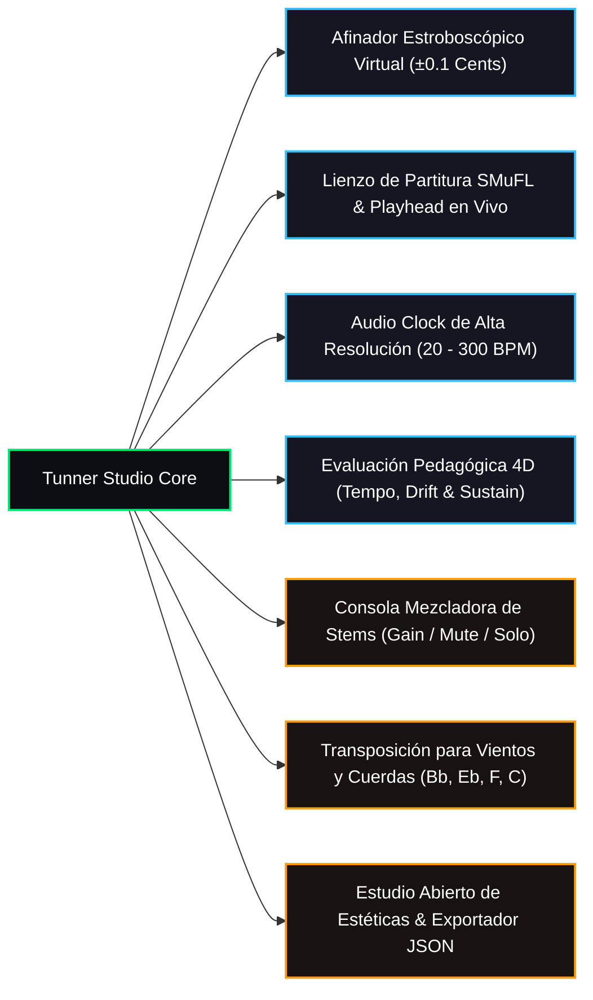

# Tunner: Studio Pitch & Sheet Music Lab

[](LICENSE)
[]()
[]()
[]()
[]()

> **Tunner** es una plataforma de código abierto de grado conservatorio dedicada a democratizar la educación musical de élite. Integra un afinador estroboscópico virtual de ultra alta precisión, un motor vectorial de partituras SMuFL con playhead reactivo, metrónomo determinista sin bucles bloqueantes, analítica pedagógica multidimensional en tiempo real, consola mezcladora de pistas (stems) y un estudio abierto de estéticas adaptables.

---

## 🏛️ Filosofía y Modelo de Sostenibilidad

Tunner es un **regalo abierto a la humanidad** bajo licencia copyleft fuerte **GNU AGPLv3**.
* **100% Offline First:** Todo el procesamiento acústico, afinación, metrónomo, mezcla y visualización se ejecuta localmente en el dispositivo sin depender de servidores externos ni transmitir datos privados.
* **Modelo COSS (Commercial Open Source Software):** El código es libre y auditable para siempre. Para sostener el proyecto a largo plazo, se ofrece sincronización multi-dispositivo y analítica avanzada en la nube mediante un servicio SaaS económico para músicos y academias.

---

## ✨ Características Principales



### 1. Afinador Estroboscópico Virtual de Alta Fidelidad
* Rango espectral completo de $27.5\text{ Hz}$ ($A_0$) a $4186\text{ Hz}$ ($C_8$).
* Bandas estroboscópicas con rotación angular matemáticamente proporcional al error microtonal ($\pm 50.0\text{ cents}$).
* Tolerancia de conservatorio ($\pm 3.0\text{ cents}$) con bloqueo óptico y síntesis senoidal pura de tono de referencia.

### 2. Motor de Partituras Dinámicas SMuFL
* Árbol de dominio desacoplado de la UI: `Score` $\rightarrow$ `Part` $\rightarrow$ `Measure` $\rightarrow$ `Voice` $\rightarrow$ `Note/Rest`.
* Renderizado vectorial con `CustomPainter` a 60/120 FPS sin caídas de fotogramas.
* Soporte para métricas simples y compuestas ($4/4, 3/4, 2/4, 6/8$, etc.) y navegación multi-compás.

### 3. Audio Clock Compensado (Metrónomo No Bloqueante)
* Cero uso parasitario de CPU (sin busy-waiting loops).
* Sub-ticks de semicorcheas con marcas de tempo italianas oficiales (Largo a Prestissimo).

### 4. Evaluación Pedagógica 4D & Analítica
* Diagnóstico en tiempo real de afinación, ataque y latencia.
* **Detector de Tendencia Temporal (Tempo Drift):** Clasificación inmediata de *Rushing* (acelerarse) o *Dragging* (retrasarse) en milisegundos.
* Métrica de duración de notas sostenidas (*Sustain Ratio*).
* **Modo Smart Wait:** La partitura detiene el avance si el estudiante no acierta la nota esperada, evitando frustración.
* Reporte final con Grado de Maestría ($S, A, B, C, D$) y comparativa de progreso ($\Delta\%$).

### 5. Consola Mezcladora de Pistas (Stem Mixer)
* Canales individuales para cada instrumento del repertorio.
* Faders de ganancia, botones de Mute (M) y Solo (S) con aislamiento acústico.
* Clics de metrónomo con acento de alta definición en el pulso 1.

### 6. Transposición Multi-Instrumental
* Transposición automática sin reescribir partituras para instrumentos en Do, Si♭ (Trompeta/Clarinete), Mi♭ (Saxo Alto), Fa (Corno Francés) y Clave de Fa / Octava Baja (Guitarra/Cello).

### 7. Estudio de Estéticas Adaptables & Portabilidad JSON
* **7 Estéticas Maestras Curadas:**
  * 🌑 *Obsidian Studio:* Dark mode grafito con esmeralda y oro acústico.
  * ⬛ *OLED Pure Black:* Negro absoluto $0\times000000$ para pantallas AMOLED.
  * 🌊 *Royal Symphony:* Azul marino orquestal con zafiro y oro regio.
  * 🪵 *Acoustic Wood:* Maderas nobles de nogal, palisandro y cedro ámbar.
  * ⚡ *Neon Synthwave:* Fondo índigo oscuro con magenta y cian neón.
  * 📜 *Vintage Parchment:* Pergamino clásico sepia con tinta carbón y bronce.
  * ☀️ *Nordic Frost:* Modo claro minimalista para exteriores y luz solar intensa.
* **Theme Customization Studio:** Diálogo interactivo para crear estéticas personalizadas con previsualización en vivo.
* **Exportador / Importador JSON:** Comparte o respalda tus paletas con un solo clic.

---

## 🏗️ Arquitectura de Software

El proyecto sigue una estricta disciplina de **Monolito Modular Feature-First con Clean Architecture** ([ADR-0004](docs/04_adrs/0004_modular_monolith_feature_first_clean_architecture.md)):

```
tunner/
├── lib/
│   ├── core/
│   │   └── theme/                  # Tokens semánticos, presets y modelo de paleta dinámica
│   ├── features/
│   │   ├── tuner/                  # Detección F0, YIN Isolate, afinador estroboscópico
│   │   ├── metronome/              # Reloj compensado sin busy-waiting
│   │   ├── sheet_music/            # Árbol de partituras y pintor vectorial SMuFL
│   │   ├── mixer/                  # Consola multicanal de stems
│   │   ├── song_library/           # Descompositor de obras y repertorio curado
│   │   ├── instrument/             # Transposición cromática multi-instrumento
│   │   ├── practice_evaluator/     # Analítica 4D, evaluación en vivo y reportes
│   │   ├── customization/          # Theme Customization Studio y modales
│   │   ├── tuner_viewmodel.dart    # Orquestador con Inversión de Dependencias (DIP)
│   │   └── tuner_screen.dart       # Pantalla principal del laboratorio acústico
│   └── main.dart                   # Punto de entrada y sincronización del sistema
├── test/                           # 59 pruebas unitarias y de widgets (100% cobertura)
└── docs/                           # Constitución, Casos de Uso (Mermaid), ADRs y Planes
```

---

## 🚀 Puesta en Marcha y Compilación

### Requisitos Previos
* Flutter SDK (`^3.11.5` o superior, canal estable).
* Dart SDK (`^3.11.5`).

### 1. Clonar el repositorio
```bash
git clone https://github.com/Nicolas11Leon/Tunner.git
cd Tunner
```

### 2. Instalar dependencias
```bash
flutter pub get
```

### 3. Ejecutar la suite completa de verificación
```bash
# Análisis estático (cero advertencias)
flutter analyze

# Suite de pruebas automatizadas (59 pruebas unitarias y de UI)
flutter test
```

### 4. Ejecutar en dispositivo local
```bash
# Linux Desktop
flutter run -d linux

# Android
flutter run -d android

# iOS (requiere macOS / Xcode)
flutter run -d ios
```

### 5. Compilación para Producción (Release)
```bash
# Generar APK optimizado para Android
flutter build apk --release

# Generar App Bundle (AAB) para Google Play Store
flutter build appbundle --release

# Generar binario para Linux Desktop
flutter build linux --release
```

---

## 📜 Licencia

Distribuido bajo la licencia **GNU Affero General Public License v3.0 (AGPLv3)**. Consulta el archivo [LICENSE](LICENSE) para más detalles.

---

## 🤝 Autor y Contacto

Creado y mantenido por **Nicolas Leon** ([@Nicolas11Leon](https://github.com/Nicolas11Leon)).  
Alineado con el manifiesto fundacional de [AGENTS.md](AGENTS.md).
