# Tunner: Studio Pitch, Real-Time Acoustic Lab & Sheet Music Engine

[](LICENSE)
[]()
[]()
[]()
[]()

> **Tunner** es una estación de trabajo acústica y pedagógica de código abierto de grado conservatorio. Diseñada para democratizar la formación musical de élite, combina en un único ejecutable local: afinación estroboscópica virtual de ultra precisión ($\pm 0.1\text{ cents}$), calibración de concierto ($A_4$ ajustable de 415 a 466 Hz), motor vectorial de partituras SMuFL a 60/120 FPS, metrónomo determinista en Isolate, grabador de práctica de alta fidelidad con auto-escucha, analítica pedagógica 4D, consola mezcladora multicanal de stems (pistas aisladas), importador universal de partituras MusicXML y archivos MIDI estándar, persistencia local atómica y personalización estética avanzada.

---

## Filosofía y Modelo de Sostenibilidad

Tunner es un **bien público abierto** bajo licencia **GNU AGPLv3**.
* **100% Offline First:** Todo el procesamiento DSP, análisis de frecuencias, decodificación binaria, síntesis, grabación, almacenamiento y renderizado vectorial se ejecuta localmente en el dispositivo. Cero telemetría invasiva, cero latencia de red y cero dependencia de servidores en la nube.
* **Clean Architecture & Monolito Modular:** Separación estricta entre Dominio (Dart puro sin dependencias de UI), Datos (infraestructura, códecs, I/O atómico) y Presentación (Flutter reactivo con ViewModels e Inversión de Dependencias).
* **Modelo COSS (Commercial Open Source Software):** El código fuente es libre, auditable y soberano para siempre.

---

## Mapa de Capacidades del Sistema

```mermaid
graph TD
    classDef core fill:#0D0D14,stroke:#00E676,stroke-width:2px,color:#fff;
    classDef tuner fill:#161622,stroke:#38BDF8,stroke-width:2px,color:#fff;
    classDef audio fill:#1A1024,stroke:#A855F7,stroke-width:2px,color:#fff;
    classDef sheet fill:#181310,stroke:#F59E0B,stroke-width:2px,color:#fff;
    classDef storage fill:#0C1E18,stroke:#10B981,stroke-width:2px,color:#fff;

    A["Tunner Studio Core"]:::core --> B["Laboratorio de Afinación & Pitch"]:::tuner
    A --> C["Motor de Notación SMuFL & Pentagrama"]:::sheet
    A --> D["Estudio de Grabación & Auto-Escucha"]:::audio
    A --> E["Importador Universal MusicXML & MIDI"]:::sheet
    A --> F["Evaluación Pedagógica 4D"]:::tuner
    A --> G["Consola Mezcladora de Stems"]:::audio
    A --> H["Persistencia Local Atómica Offline"]:::storage
    A --> I["Estudio de Estéticas & Paletas Pro"]:::core

    B --> B1["Afinador Estroboscópico Virtual (±0.1 Cents)"]:::tuner
    B --> B2["Calibración A4 (415 Hz Barroco - 466 Hz)"]:::tuner
    B --> B3["Transposición Cromática (Bb, Eb, F, C, Clave Fa)"]:::tuner

    C --> C1["Renderizado Vectorial SMuFL 60/120 FPS"]:::sheet
    C --> C2["Playhead en Tiempo Real por Sub-Ticks"]:::sheet
    C --> C3["Compases Simples y Compuestos (4/4, 3/4, 2/4, 6/8)"]:::sheet

    D --> D1["Grabación AAC/M4A en Tiempo Real"]:::audio
    D --> D2["Visualizador de Onda Sonora Dinámica"]:::audio
    D --> D3["Auto-Escucha con Velocidad Variable (0.5x - 1.5x)"]:::audio

    E --> E1["Selector Nativo de Archivos del Dispositivo"]:::sheet
    E --> E2["Parser MusicXML (.musicxml / .xml)"]:::sheet
    E --> E3["Parser Binario MIDI Estándar (.mid / .midi)"]:::sheet
    E --> E4["Editor Rápido & Muestras Canónicas"]:::sheet

    F --> F1["Detección de Tendencia: Rushing vs. Dragging"]:::tuner
    F --> F2["Modo Smart Wait (Espera Inteligente)"]:::tuner
    F --> F3["Reporte de Desempeño & Grados (S, A, B, C, D)"]:::tuner

    G --> G1["Canales Independientes por Instrumento"]:::audio
    G --> G2["Faders de Ganancia, Mute (M) y Solo (S)"]:::audio

    H --> H1["Almacenamiento Seguro JSON Atómico (.tmp + rename)"]:::storage
    H --> H2["Cola Secuencial Anti-Condición de Carrera"]:::storage
```



---

## Especificación Técnica de Funcionalidades

### 1. Afinador Estroboscópico Virtual de Ultra Alta Precisión
* **Espectro Completo:** Soporta desde el sub-bajo $27.50\text{ Hz}$ ($A_0$) hasta el soprano extremo $4186.01\text{ Hz}$ ($C_8$).
* **Física Estroboscópica Real:** Bandas cilíndricas animadas cuya velocidad y dirección angular son matemáticamente proporcionales al error microtonal ($\pm 50.0\text{ cents}$).
* **Bloqueo Óptico de Conservatorio:** Indicador de precisión milimétrica cuando la afinación entra en la zona verde de tolerancia ($\pm 3.0\text{ cents}$).
* **Noise Gate y Filtro Cuadrático Medio (RMS):** Rechaza el ruido ambiente y capta tonos puros tanto en instrumentos acústicos (flauta, violín, voz, guitarra) como electrónicos.

### 2. Calibración de Tono de Concierto $A_4$ (415 Hz a 466 Hz)
* **Selector Rápido de Presets Históricos y Modernos:**
  * **440 Hz:** Estándar Internacional ISO 16.
  * **442 Hz:** Afinación Sinfónica Europea y Norteamericana.
  * **444 Hz:** Orquestas de Viento / Solistas de Brillo.
  * **432 Hz:** Afinación Científica o "Tono de Verdi".
  * **415 Hz:** Afinación Barroca Histórica (Bach, Händel).
* **Ajuste Fino por Pasos de 1 Hz:** Botones interactivos de incremento/decremento paso a paso.
* **Recálculo Físico Integral:** Todas las frecuencias objetivo de las 12 notas de la escala temperada se reasignan en vivo mediante la fórmula acústica:
  $$f(n) = f_{\text{ref}} \cdot 2^{\frac{n - 69}{12}}$$
  actualizando en tiempo real la desviación en cents del detector.

### 3. Motor de Partituras Dinámicas SMuFL & Playhead en Vivo
* **Jerarquía de Dominio Pura:** Modelo formal `HierarchicalScore` $\rightarrow$ `MeasureEntity` $\rightarrow$ `HierarchicalNote` sin dependencias del framework gráfico.
* **Pintor Vectorial de Alto Rendimiento:** Dibuja pentagramas, claves (Sol y Fa), armaduras, compases, ligaduras, alteraciones, notas y silencios a 60/120 FPS sin bloqueos en el hilo de UI.
* **Playhead Reactivo:** Barra de lectura visual en color dorado que recorre la partitura sincronizada al reloj del metrónomo por sub-ticks de semicorcheas.
* **Compases Múltiples:** $4/4$ (Compasillo), $3/4$ (Vals), $2/4$ (Marcha) y $6/8$ (Compás compuesto).

### 4. Estudio de Grabación de Práctica & Auto-Escucha (Loopback Studio)
* **Captura de Micrófono en Tiempo Real:** Grabación en formato AAC de alta fidelidad sin latencia perceptible.
* **Visualizador de Forma de Onda en Vivo:** Dock interactivo que grafica la amplitud sonora decibelio a decibelio mientras tocas.
* **Modal de Auto-Escucha Loopback:** Reproductor integrado con barra de desplazamiento temporal (scrubbing), tiempo transcurrido / total y control de velocidad variable (**0.5x, 0.75x, 1.0x, 1.25x, 1.5x**) para analizar pasajes técnicos difíciles.
* **Historial de Tomas de Práctica:** Registro de todas las interpretaciones de la sesión con fecha, hora, duración y vinculación automática al reporte pedagógico.

### 5. Importador Universal de Partituras MusicXML y MIDI Estándar
* **Selector Nativo de Archivos del Dispositivo (`file_picker`):** Abre partituras locales directamente desde el almacenamiento de tu dispositivo (`.xml`, `.musicxml`, `.mid`, `.midi`).
* **Decodificador MusicXML Puro:**
  * Parsea árboles DOM XML de especificaciones MusicXML 3.0/3.1.
  * Extrae títulos, compositores, tempo dinámico (`<sound tempo="..."/>`) y métricas de compás.
  * Interpreta notas, silencios, ligaduras y alteraciones sostenidas (`#`) y bemoles (`b`).
  * Autocompleta silencios de compás entero o compensación rítmica ante medidas incompletas.
* **Decodificador Binario de Archivos MIDI:**
  * Lectura de bajo nivel byte a byte mediante `ByteData`.
  * Validación de cabeceras `MThd` y tracks `MTrk`.
  * Algoritmo de descompresión de enteros de longitud variable (Variable-Length Quantities, VLQ).
  * Interpretación de meta-eventos `Set Tempo` (microsegundos por negra) y eventos `Note On` / `Note Off`.
  * Conversión de números de nota MIDI (0 a 127) a nombres estándar de conservatorio con octava científica.
* **Entrada de Texto Directa & Muestras Offline:** Permite pegar texto MusicXML crudo o cargar ejemplos canónicos con 1 toque (*Beethoven - Himno a la Alegría* y *Mozart - Minueto*).

### 6. Evaluación Pedagógica 4D & Analítica Musical
* **Afinación Microtonal:** Puntuación en tiempo real evaluando la cercanía al centro tonal de cada nota esperada.
* **Detección de Desviación Temporal (Tempo Drift):**
  * Clasifica si el intérprete tiende a apurarse (**Rushing**) o atrasarse (**Dragging**) midiendo el diferencial en milisegundos con respecto al pulso exacto.
* **Métrica de Sostenimiento (Sustain Ratio):** Evalúa si la nota fue mantenida durante la duración completa requerida por la figura rítmica (redonda, blanca, negra, corchea).
* **Modo Smart Wait (Espera Inteligente):** Detiene el avance del playhead hasta que el estudiante ejecute la nota correcta, reforzando el aprendizaje sin estrés.
* **Reporte Final con Grados de Conservatorio:**
  * Grados: **Virtuoso (S)**, **Avanzado (A)**, **Competente (B)**, **En Desarrollo (C)** o **Inicial (D)**.
  * Diagnóstico de notas maestras vs. notas a reforzar y porcentaje de mejora respecto a la sesión anterior ($\Delta\%$).

### 7. Consola Mezcladora de Pistas Aisladas (Stem Mixer)
* **Aislamiento por Pistas:** Control de volumen individual para la Melodía Principal (Lead), Acompañamiento Armónico (Piano/Guitarra), Bajo y Percusión/Metrónomo.
* **Botones Mute (M) y Solo (S):** Permite aislar una pista para estudio o silenciar la melodía de referencia para tocar encima como solista (*Minus-One / Play-Along*).

### 8. Transposición Multi-Instrumental Instantánea
* Transpone la partitura sin necesidad de reescribirla para diferentes afinaciones orquestales:
  * **Instrumentos en Do:** Flauta traversa, Violín, Oboe, Piano.
  * **Instrumentos en Si♭:** Clarinete, Trompeta, Saxofón Tenor.
  * **Instrumentos en Mi♭:** Saxofón Alto, Saxofón Barítono.
  * **Instrumentos en Fa:** Corno Francés.
  * **Instrumentos en Clave de Fa / Octava Baja:** Cello, Fagot, Guitarra clásica.

### 9. Persistencia Local Atómica Offline en Disco
* Almacenamiento seguro en archivo JSON local en la carpeta del dispositivo (`tunner_settings.json`).
* **Protección contra Corrupción de Datos:** Escritura atómica a archivo `.tmp` con renombramiento en el sistema operativo y cola de exclusión mutua para evitar condiciones de carrera ante guardados consecutivos rápidos.
* Guarda y restaura automáticamente:
  * Calibración de tono de concierto $A_4$.
  * Perfil de instrumento activo.
  * Configuración del metrónomo y BPM.
  * Volúmenes y estados Mute/Solo de la mezcladora.
  * Paleta estética activa y temas personalizados creados.
  * Historial de grabaciones de audio y reportes pedagógicos.

### 10. Estudio de Estéticas Adaptables & Portabilidad JSON
* **7 Estéticas de Fábrica de Alto Contraste:**
  * **Obsidian Studio:** Fondo grafito oscuro con detalles en verde esmeralda acústico.
  * **OLED Pure Black:** Negro puro $0\times000000$ con contraste optimizado para pantallas AMOLED y ahorro de batería.
  * **Royal Symphony:** Azul zafiro orquestal con acentos dorados imperiales.
  * **Acoustic Wood:** Tonalidades cálidas de caoba, nogal y ámbar.
  * **Neon Synthwave:** Púrpura y cian fluorescente para estudio nocturno de alta energía.
  * **Vintage Parchment:** Tinta carbón sobre papel pergamino clásico sepia.
  * **Nordic Frost:** Interfaz diurna clara de máxima legibilidad bajo luz solar directa.
* **Theme Editor Dialog:** Personaliza colores primarios, secundarios, fondos y acentos.
* **Exportador / Importador JSON:** Comparte tus paletas de colores mediante cadenas JSON portables.

---

## Arquitectura de Software y Estructura del Código

El proyecto está construido bajo los principios de **Monolito Modular Feature-First con Clean Architecture** ([ADR-0004](docs/04_adrs/0004_modular_monolith_feature_first_clean_architecture.md)):

```
tunner/
├── lib/
│   ├── core/
│   │   └── theme/                  # Sistema de diseño, tokens semánticos y 7 paletas de color
│   ├── features/
│   │   ├── tuner/                  # Detección DSP en Isolate, NoteEntity y aguja estroboscópica
│   │   ├── metronome/              # Audio clock en Isolate, sub-ticks y TempoEntity
│   │   ├── sheet_music/            # Árbol de partituras ScoreTree y pintor vectorial SMuFL
│   │   ├── mixer/                  # Consola mezcladora multicanal de stems
│   │   ├── song_library/           # Descompositor pedagógico de canciones y biblioteca
│   │   ├── instrument/             # Transposición cromática multi-instrumento
│   │   ├── practice_evaluator/     # Analítica pedagógica 4D, evaluación en vivo y reportes
│   │   ├── practice_recorder/      # Grabador AAC, visualizador de onda y player loopback
│   │   ├── persistence/            # Persistencia atómica offline (.tmp + rename)
│   │   ├── universal_importer/     # Importador MusicXML y MIDI con file_picker nativo
│   │   ├── customization/          # Theme Customization Studio y modales
│   │   ├── tuner_viewmodel.dart    # Orquestador principal con Inversión de Dependencias (DIP)
│   │   └── tuner_screen.dart       # Pantalla unificada del laboratorio acústico
│   └── main.dart                   # Punto de entrada de la aplicación
├── test/                           # 112 pruebas unitarias, de integración y de widgets
└── docs/                           # Documentación formal, Casos de Uso (Mermaid) y ADRs
```

---

## Puesta en Marcha y Compilación

### Requisitos Previos
* **Flutter SDK:** Canal estable (`^3.11.5` o superior).
* **Dart SDK:** (`^3.11.5` o superior).
* Micrófono habilitado en el dispositivo.

### 1. Clonar el repositorio
```bash
git clone https://github.com/Nicolas11Leon/Tunner.git
cd Tunner
```

### 2. Descargar dependencias
```bash
flutter pub get
```

### 3. Ejecutar análisis estático y pruebas
```bash
# Comprobación de linter (0 issues)
flutter analyze

# Ejecución de la suite completa de 112 pruebas
flutter test
```

### 4. Ejecutar en tu plataforma preferida
```bash
# Linux Desktop
flutter run -d linux

# Android (emulador o dispositivo conectado)
flutter run -d android

# macOS Desktop
flutter run -d macos

# Windows Desktop
flutter run -d windows

# iOS (requiere macOS y Xcode)
flutter run -d ios
```

### 5. Compilación para Producción (Release)
```bash
# APK universal para Android
flutter build apk --release

# Android App Bundle (Google Play Store)
flutter build appbundle --release

# Binario nativo para Linux
flutter build linux --release

# Aplicación para macOS
flutter build macos --release

# Aplicación para Windows
flutter build windows --release
```

---

## Licencia

Distribuido bajo la licencia **GNU Affero General Public License v3.0 (AGPLv3)**. Consulta el archivo [LICENSE](LICENSE) para más detalles.

---

## Autor y Visión del Proyecto

Creado y mantenido por **Nicolas Leon** ([@Nicolas11Leon](https://github.com/Nicolas11Leon)).  
Desarrollado bajo el manifiesto fundacional y los estándares de ingeniería de [AGENTS.md](AGENTS.md).
