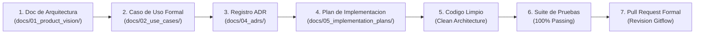

# Protocolo Maestro de Ingenieria y Gobernanza de Documentacion: Tunner

Este documento establece el marco regulatorio, los estandares de documentacion previa y los principios de arquitectura obligatorios que rigen a cualquier colaborador, ingeniero o agente que participe en el desarrollo de **Tunner**.

---

## 1. Reglas Cardinales de Documentacion Previa (Mandatory Prior Documentation)

En Tunner no se escribe una sola linea de codigo de produccion sin antes haber completado y validado el ciclo documental canónico:

Cualquier Pull Request que modifique o incorpore logica de negocio, algoritmos DSP, modelos de datos o interfaces interactivas sin acompanarse de esta cadena documental sera rechazado de inmediato.

---

## 2. Estandar de Documentos Obligatorios por Tipo

### 2.1 Documento Tecnico y de Arquitectura (`docs/01_product_vision/`)
- **Nomenclatura:** `doc_[nombre_descriptivo_en_snake_case].md`
- **Identificador:** `DOC-ARCH-[AÑO]-[NUMERO_TRES_DIGITOS]` (ejemplo: `DOC-ARCH-2026-062`).
- **Plantilla obligatoria:** [docs/templates/plantilla_documentacion.md](../templates/plantilla_documentacion.md).
- **Contenido indispensable:**
  1. Resumen ejecutivo.
  2. Fundamento teorico, matematico y acustico (formulas en LaTeX con KaTeX, frecuencias nominales en Hz, formulaciones en cents).
  3. Especificacion funcional y requerimientos atomicos (`REQ-01`, `REQ-02`, etc.).
  4. Diseno tecnico por capas (Dominio, Infraestructura/Datos, Presentacion).
  5. Casos de borde y supresion de ruido.

### 2.2 Caso de Uso Canonico (`docs/02_use_cases/`)
- **Nomenclatura:** `[NUMERO_DOS_DIGITOS]_uc_[identificador_corto].md` (ejemplo: `62_uc_hardware_io_ports_and_permission_broker.md`).
- **Identificador:** `UC-[NUMERO_DOS_DIGITOS]-[IDENTIFICADOR_EN_MAYUSCULAS]`.
- **Plantilla obligatoria:** [docs/templates/plantilla_caso_de_uso.md](../templates/plantilla_caso_de_uso.md).
- **Contenido indispensable:**
  1. Actor principal y actores secundarios de hardware (microfono, altavoces, sintetizador).
  2. Diagrama de Casos de Uso formal en Mermaid (`flowchart LR`).
  3. Diagrama de Secuencia interactivo en Mermaid (`sequenceDiagram`).
  4. Precondiciones y postcondiciones comprobables.
  5. Flujo principal paso a paso.
  6. Flujos alternativos y excepciones de error (ruido, desconexion de hardware, timeout).

### 2.3 Registro de Decision Arquitectonica / ADR (`docs/04_adrs/`)
- **Nomenclatura:** `[NUMERO_CUATRO_DIGITOS]_[nombre_decision].md` (ejemplo: `0056_hardware_io_ports_and_permission_broker.md`).
- **Estructura obligatoria:**
  1. **Estado:** Propuesto | Aprobado | Reemplazado.
  2. **Contexto:** Problema arquitectonico, limitaciones existentes y fuerzas en conflicto.
  3. **Decision:** Eleccion tecnica adoptada, clases de dominio creadas, patrones aplicados.
  4. **Consecuencias:** Beneficios medibles, desventajas asumidas y estrategias de mitigacion.

### 2.4 Plan de Implementacion Formal (`docs/05_implementation_plans/`)
- **Nomenclatura:** `[NUMERO_DOS_DIGITOS]_plan_[nombre_descriptivo].md` (ejemplo: `60_plan_hardware_io_ports_and_permission_broker.md`).
- **Plantilla obligatoria:** [docs/templates/plantilla_plan_implementacion.md](../templates/plantilla_plan_implementacion.md).
- **Contenido indispensable:**
  1. Alcance delimitado: In-Scope vs Out-of-Scope (prohibido inflar el alcance).
  2. Analisis de dependencias tecnicas y evaluacion de riesgos.
  3. Hoja de ruta paso a paso dividida en: Dominio -> Infraestructura -> Presentacion -> Pruebas.
  4. Criterios de aceptacion y Definition of Done (DoD).

---

## 3. Principios Tecnicos Innegociables de Ingenieria (Constitution Non-Negotiables)

1. **100% Offline-First y Cero Microservicios:**
   Todo el procesamiento de audio, afinacion estroboscopica, síntesis SoundFont SF2, renderizado SMuFL y evaluacion pedagogica debe ejecutarse localmente en el dispositivo. Esta prohibida cualquier dependencia de APIs en la nube, servidores remotos o transmision de audio por red.
2. **Clean Architecture Estricta:**
   * **Capa de Dominio (`lib/*/domain/`):** Dart puro. Queda estrictamente prohibido importar paquetes de Flutter (`flutter/material.dart`, `flutter/widgets.dart`), plugins de plataforma (`record`, `audioplayers`, `path_provider`) o frameworks externos.
   * **Capa de Infraestructura/Datos (`lib/*/data/`):** Implementa las interfaces abstractas definidas en el dominio. Encargada de streams PCM, decodificacion de binarios (SF2, MIDI, MusicXML) y persistencia atómica.
   * **Capa de Presentacion (`lib/*/presentation/`):** Flutter reactivo, ViewModels e Inversion de Dependencias. La UI jamas interactua con el hardware ni con los códecs directamente; solo consume metodos de casos de uso y ViewModels.
3. **Disciplina de Audio y Hardware:**
   * **Cero Bucles de Espera Activa (*Zero Busy-Waiting*):** Ningun hilo secundario ni Isolate puede ejecutar ciclos continuos al 100% de CPU. Todo muestreo debe ceder tiempo al sistema operativo mediante temporizadores deterministas.
   * **Latencia Objetivo Sub-10ms:** Los buffers de audio deben dimensionarse para minimizar la latencia perceptiva entre el instrumento fisico y la respuesta visual en pantalla.
4. **Tono Tecnico Riguroso (Zero Emojis Policy):**
   La documentacion de Tunner se rige por estandares de conservatorio y publicacion academica. Esta estrictamente prohibido el uso de emojis, pictogramas o expresiones coloquiales en el codigo fuente, comentarios de funciones, nombres de pruebas y documentos tecnicos de `docs/`.
5. **Calidad y Cobertura de Pruebas:**
   * Toda nueva clase de dominio o caso de uso debe acompanarse de pruebas unitarias.
   * Toda nueva vista o modal debe contar con pruebas de widgets e integracion.
   * `flutter analyze` debe reportar **0 errores y 0 advertencias**.
   * La suite automatizada (`flutter test`) debe pasar al **100%**.

---

## 4. Guia Rapida para Contribuidores (Checklist de Revision)

Antes de abrir un Pull Request, verifica cada uno de los siguientes puntos:

- [ ] ¿Existe el Documento Tecnico en `docs/01_product_vision/` con formula matematica y requerimientos?
- [ ] ¿Existe el Caso de Uso en `docs/02_use_cases/` con diagramas Mermaid de caso de uso y de secuencia?
- [ ] ¿Existe el ADR en `docs/04_adrs/` con estado, contexto, decision y consecuencias?
- [ ] ¿Existe el Plan de Implementacion en `docs/05_implementation_plans/` con limites de alcance?
- [ ] ¿Los archivos en `lib/*/domain/` son Dart puro sin dependencias de Flutter?
- [ ] ¿El codigo y la documentacion estan 100% libres de emojis?
- [ ] ¿Se ejecuto `flutter analyze` con 0 advertencias?
- [ ] ¿Se ejecuto `flutter test` con 100% de pruebas aprobadas?
- [ ] ¿El commit sigue el estandar Conventional Commits (`feat:`, `fix:`, `docs:`, `test:`)?
