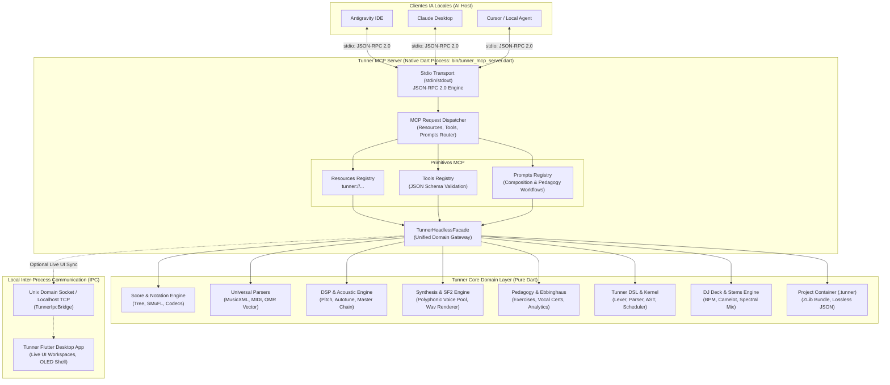

# Architecture Specification: Tunner Model Context Protocol (MCP) Server

Este documento define la arquitectura técnica formal, el diseño de protocolos y la especificación de interfaces del servidor nativo **Tunner MCP Server** (`tunner-mcp-server`), permitiendo a agentes inteligentes (Antigravity, Claude Desktop, Cursor) conectarse localmente y orquestar todas las capacidades acústicas, compositivas y pedagógicas de **Tunner**.

---

## Metadatos del Documento

- **ID del Documento:** `DOC-ARCH-2026-186`
- **Título Oficial:** Arquitectura de Integración Model Context Protocol (MCP) para Tunner
- **Estado:** Approved
- **Fecha de Creación:** 2026-11-23
- **Última Modificación:** 2026-11-23
- **Fase Asociada:** Fase 5 / Épica 13
- **Autor / Revisor Principal:** Nicolas Leon & Antigravity Core Architect

---

## 1. Resumen Ejecutivo (Executive Summary)

El servidor Tunner MCP Server es un binario nativo en Dart que implementa la especificación abierta **Model Context Protocol (MCP)** sobre el transporte estándar `stdio` mediante el protocolo **JSON-RPC 2.0**. Su propósito es transformar a Tunner en un motor acústico y de composición musical headless de nivel profesional, controlable en tiempo real por agentes autónomos de inteligencia artificial.

A través de esta arquitectura, modelos de lenguaje avanzados dejan de "alucinar" notas, frecuencias y tempos: en su lugar, leen el estado musical exacto del proyecto (`Resources`), ejecutan acciones deterministas con validación acústica estricta (`Tools`) y guían al usuario a través de flujos pedagógicos y compositivos optimizados (`Prompts`). Todo el procesamiento se realiza 100% de forma local (Offline-First), con cero microservicios de red, latencias sub-10ms y determinismo matemático absoluto.

---

## 2. Contexto del Problema y Justificación Teórica

### 2.1 Planteamiento del Problema
Los modelos de lenguaje actuales que intentan asistir en producción musical carecen de grounding acústico y herramientas de renderizado precisas. Típicamente generan fragmentos de código ad-hoc o cadenas de texto no verificadas en formatos ambiguos. Tunner dispone de más de 108.000 líneas de código con motores de análisis armónico DFT/FFT, decodificación OMR de partituras, síntesis polifónica SoundFont2 (SF2), autotune vocal de formantes, consola DJ de doble deck, evaluadores temporales DSL y exportadores canónicos (MIDI, MusicXML, WAV, PDF). Sin embargo, estas capacidades estaban confinadas a la interfaz gráfica Flutter Desktop/Mobile.

### 2.2 Fundamento Teórico y Musical
El protocolo MCP estandariza la interacción agente-herramienta sin introducir overhead de serialización complejo. La arquitectura desacopla el transporte (JSON plano en `stdin`/`stdout`) del motor de dominio musical.

Las herramientas de composición y análisis se basan en formulaciones acústicas rigurosas:
1. **Conversión de Frecuencia a Tono Canónico (A4 = 440 Hz):**
   $$f(n) = 440 \cdot 2^{\frac{n - 69}{12}}$$
   Donde $n$ es el número de nota MIDI ($0 \le n \le 127$).
2. **Desviación de Afinación en Cents:**
   $$\text{cents} = 1200 \cdot \log_2\left(\frac{f_{\text{medida}}}{f_{\text{teorica}}}\right)$$
3. **Métrica Temporal y Sub-ticks:**
   Una redonda ($1.0$) equivale a $3840$ sub-ticks discretos, garantizando alineación sin errores de redondeo en compases arbitrarios ($\frac{4}{4}$, $\frac{3}{4}$, $\frac{6}{8}$, $\frac{7}{8}$).

---

## 3. Topología del Sistema y Diagrama de Arquitectura



---

## 4. Especificación del Protocolo MCP (JSON-RPC 2.0)

### 4.1 Reglas del Canal de Comunicación (Stdio Boundary)
- **`stdout`:** Reservado **exclusivamente** para mensajes válidos de JSON-RPC 2.0 terminados en salto de línea (`\n`). Ningún print, advertencia ni traza interna de Dart puede emitirse en `stdout`.
- **`stderr`:** Canal exclusivo de telemetría, logging estructurado, avisos de inicialización y depuración para el usuario o logs de Antigravity.
- **`stdin`:** Canal de recepción de requests y notificaciones JSON-RPC desde el cliente IA.

### 4.2 Formato de Mensajes

#### Request (Cliente -> Servidor):
```json
{
  "jsonrpc": "2.0",
  "id": 1,
  "method": "tools/call",
  "params": {
    "name": "tunner_compose_progression",
    "arguments": {
      "key": "C_MAJOR",
      "meter": "4/4",
      "tempo_bpm": 120,
      "progression": ["I", "IV", "V", "I"],
      "instrument": "acoustic_grand_piano"
    }
  }
}
```

#### Response Exitosa (Servidor -> Cliente):
```json
{
  "jsonrpc": "2.0",
  "id": 1,
  "result": {
    "content": [
      {
        "type": "text",
        "text": "Score progression generated successfully with 4 measures."
      }
    ],
    "structuredData": {
      "measuresCount": 4,
      "notesCount": 16,
      "key": "C_MAJOR",
      "meter": "4/4",
      "durationSeconds": 8.0,
      "tunnerDsl": "TEMPO 120;\nMETER 4/4;\nPLAY C4, E4, G4 DURATION 1.0;\nPLAY F4, A4, C5 DURATION 1.0;\nPLAY G4, B4, D5 DURATION 1.0;\nPLAY C4, E4, G4 DURATION 1.0;\n"
    }
  }
}
```

---

## 5. Catálogo Completo de Primitivos MCP

### 5.1 Catálogo de Recursos (`Resources`)
Los recursos permiten a la IA inspeccionar el estado del sistema acústico y los proyectos sin alterar los datos:

| URI del Recurso | Nombre | Tipo MIME | Descripción |
| :--- | :--- | :--- | :--- |
| `tunner://project/active` | Active Project State | `application/json` | Estructura completa del proyecto abierto: pistas, tempo, métrica, armadura y metadatos. |
| `tunner://scores/active` | Active Sheet Music Tree | `application/json` | Árbol AST de compases, voces, notas, alteraciones, ligaduras y dinámicas SMuFL. |
| `tunner://catalog/instruments` | Instruments Catalog | `application/json` | Lista de los 40 instrumentos calibrados con tesituras (Hz), transposiciones y timbres. |
| `tunner://catalog/temperaments` | Historical Temperaments | `application/json` | Afinaciones históricas soportadas (Pitagórico, Justo, Meantone, Werckmeister III, Valotti). |
| `tunner://dsp/status` | Audio DSP Status | `application/json` | Telemetría de audio: frecuencia de muestreo, buffer size, latencia estimada y carga en Isolate. |
| `tunner://dsl/syntax` | DSL Syntax Specification | `text/markdown` | Gramática formal completa del lenguaje de scripting Tunner DSL con ejemplos ejecutables. |
| `tunner://dj/decks` | DJ Console State | `application/json` | Estado de Decks A y B: BPM detectado, clave armónica Camelot, ganancia, filtros y loop. |
| `tunner://pedagogy/history` | Ear Training Mastery | `application/json` | Historial de curvas de olvido de Ebbinghaus, tasa de acierto y lecciones sugeridas. |

---

### 5.2 Catálogo Exhaustivo de Herramientas (`Tools`)

Las herramientas se organizan en 7 módulos especializados:

#### Módulo 1: Composición y Notación Musical (`composition`)
1. **`tunner_compose_progression`**: Genera progresiones armónicas en compases, notas y voces polifónicas con reglas de conducción de voces.
2. **`tunner_edit_score_notes`**: Inserta, modifica o elimina notas/silencios en un compás específico con verificación de sub-ticks.
3. **`tunner_quantize_score`**: Cuantiza eventos rítmicos a la rejilla especificada (negras, corcheas, tresillos, semicorcheas).
4. **`tunner_transpose_score`**: Transpone tonalmente una partitura completa o fragmento por intervalo en semitonos.

#### Módulo 2: Importación, Decodificación y Exportación (`io_codecs`)
5. **`tunner_import_file`**: Importa y decodifica archivos MusicXML (`.xml`, `.musicxml`), MIDI (`.mid`) o Audio WAV a proyecto Tunner.
6. **`tunner_export_project`**: Exporta el proyecto a contenedor universal `.tunner`, MusicXML, MIDI estándar tipo 1 o PDF SMuFL.
7. **`tunner_omr_transcribe_pdf`**: Procesa un PDF musical mediante el motor OMR vectorial y genera partitura editable libre de notas artificiales.

#### Módulo 3: Síntesis de Audio y Renderizado (`audio_synthesis`)
8. **`tunner_render_score_to_wav`**: Renderiza la partitura a archivo de audio PCM WAV de 16/24 bits usando el motor SoundFont2/Additive nativo.
9. **`tunner_render_multitrack_stems`**: Renderiza cada pista o instrumento en stems de audio estéreo individuales y aislados.
10. **`tunner_load_soundfont`**: Carga y valida un banco SoundFont2 (.sf2), mapeando los presets a los instrumentos del proyecto.

#### Módulo 4: Análisis Acústico y Procesamiento DSP (`dsp_analysis`)
11. **`tunner_detect_pitch_file`**: Ejecuta el algoritmo McLeod Pitch Method (MPM) / YIN sobre un archivo WAV y extrae tono, cents y claridad.
12. **`tunner_apply_autotune`**: Aplica corrección de afinación cromática o por escala con preservación de formantes a un archivo de voz.
13. **`tunner_apply_master_dynamics`**: Aplica compresor multibanda, ecualizador paramétrico y limitador de pared de ladrillo con true-peak.

#### Módulo 5: Ejecutor Tunner DSL (`dsl_kernel`)
14. **`tunner_eval_dsl_script`**: Ejecuta un script en Tunner DSL de forma determinista para componer, modificar parámetros o programar eventos.
15. **`tunner_validate_dsl_syntax`**: Valida léxica y sintácticamente un código DSL sin ejecutarlo, devolviendo diagnósticos precisos de línea y columna.

#### Módulo 6: Consola DJ y Rendimiento en Vivo (`dj_performance`)
16. **`tunner_analyze_dj_track`**: Analiza un track de audio para extraer BPM exacto, transientes, forma de onda espectral y Camelot Key.
17. **`tunner_set_dj_controls`**: Controla crossfader, trim gains, filtros de 3 bandas (EQ Kill) y parámetros de loops en tiempo real.

#### Módulo 7: Pedagogía y Entrenamiento Auditivo (`pedagogy`)
18. **`tunner_generate_ear_training_lesson`**: Diseña una sesión adaptativa de reconocimiento de intervalos/acordes según la curva de Ebbinghaus.
19. **`tunner_evaluate_vocal_performance`**: Compara una toma de audio grabada contra la partitura teórica y emite métricas de afinación y ritmo.

---

### 5.3 Catálogo de Prompts Guiados (`Prompts`)

Los prompts proveen plantillas interactivas estructuradas para que la IA actúe como un especialista musical de clase mundial:

1. **`tunner://prompts/orchestral_composition`**: Guía al agente paso a paso para orquestar una pieza desde la progresión básica hasta partitura SMuFL y render WAV.
2. **`tunner://prompts/voice_mastering_and_tuning`**: Flujo para auditar una pista vocal, diagnosticar desviaciones en cents, configurar autotune sutil y masterizar dinámica.
3. **`tunner://prompts/ear_training_curator`**: Diagnostica las debilidades armónicas del estudiante y genera una secuencia pedagógica de 5 lecciones progresivas.
4. **`tunner://prompts/dj_harmonic_mix_planner`**: Selecciona tracks compatibles armónicamente mediante la Rueda de Camelot y calcula ajustes de pitch para mezclas perfectas.

---

## 6. Integración Opcional con la Interfaz Gráfica (Local IPC)

Para los usuarios que deseen ver en tiempo real cómo la IA escribe notas o mueve faders en la pantalla de Tunner Desktop:
- **`TunnerIpcBridge`**: Servidor local de sockets (Unix Domain Socket en Linux/macOS, Named Pipe en Windows o Localhost TCP loopback).
- Cuando la aplicación de escritorio Flutter está encendida, el servidor MCP detecta el socket activo y despacha notificaciones de sincronización visual (`ui/refreshScore`, `ui/setPlayheadPosition`, `ui/updateMixer`).
- Si la aplicación de escritorio está cerrada, el MCP Server opera en **modo headless autónomo**, procesando archivos y proyectos directamente en disco sin ninguna penalización ni fallo.

---

## 7. Criterios de Rendimiento y Benchmarking

- **Tiempo de Arranque del Proceso MCP:** $\le 120\text{ ms}$ en frío.
- **Latencia de Despacho JSON-RPC:** $\le 2\text{ ms}$ para consultas de recursos y validaciones sintácticas.
- **Rendimiento de Síntesis Headless:** Procesamiento de audio mono/estéreo a velocidad $\ge 8\times$ tiempo real en Render WAV con Isolate dedicado.
- **Consumo de Memoria:** Determinista, $\le 65\text{ MB}$ de RAM para el proceso headless en reposo.
- **Zero Busy-Waiting:** El servidor escucha `stdin` mediante streams asíncronos nativos sin ningún bucle activo de consumo de CPU.

---

## 8. Plan de Pruebas y Validación (QA)

- [ ] **Test Suite de Protocolo:** Batería de pruebas enviando JSON-RPC válidos, inválidos, truncados y concurrentes, verificando respuestas acordes al estándar.
- [ ] **Test Suite de Recursos:** Verificación de integridad de JSON Schema en todos los endpoints `tunner://`.
- [ ] **Test Suite de Herramientas:** Pruebas end-to-end de generación de partitura, transcodificación a MusicXML y renderizado a WAV verificando la integridad del audio sintético.
- [ ] **Test Suite de Conexión Externa:** Validación con clientes reales (configuración en Claude Desktop y Antigravity `customizations/`).
