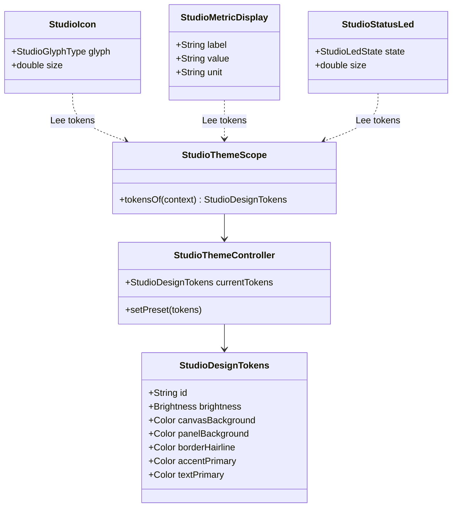

# Especificación Técnica: Componentes Atómicos y Estación de Trabajo Pro-Studio (Estilo Adobe Creative Cloud)

## Metadatos del Documento

- **ID del Documento:** `DOC-UI-2026-072`
- **Título Oficial:** `Biblioteca Atómica de UI y Arquitectura de Estación de Trabajo de Estudio`
- **Estado:** `Approved`
- **Fecha de Creación:** `2026-11-15`
- **Última Modificación:** `2026-11-15`
- **Fase Asociada:** `Global - Capa de Presentación y Sistema de Diseño`
- **Autor / Revisor Principal:** `Equipo Tunner`

---

## 1. Resumen Ejecutivo (Executive Summary)

Este documento define la especificación técnica de la **Biblioteca Atómica de UI de Estudio (`lib/core/design_system/`)** para **Tunner**, inspirada en los principios de ingeniería de interfaces de **Adobe Creative Cloud (Audition, Premiere Pro, Photoshop)** y software DAW para estaciones de trabajo.

La solución erradica de forma definitiva el uso de emojis informales, elementos desordenados y componentes gráficos inflados, reemplazándolos por un catálogo modular de **Átomos, Moléculas y Organismos de precisión**, completamente desacoplados de la lógica de negocio y los algoritmos DSP. Esto permite que el 100% de la identidad visual pueda modificarse o extenderse sin riesgo de regresiones funcionales ni degradación en la tasa de refresco a 60/120 FPS.

---

## 2. Contexto del Problema y Justificación Teórica

### 2.1 Planteamiento del Problema
La interfaz gráfica previa incorporaba inconsistencias que restaban profesionalismo:
1. **Presencia de caracteres emoji:** Se utilizaban emojis en selectores de instrumentos (``, ``, ``), botones de rack (``, ``) y diálogos (``, ``), lo que transmitía una apariencia amateur impropia de un software de conservatorio y laboratorio acústico.
2. **Text Reflow en Métricas Numéricas:** La actualización en tiempo real de frecuencias (Hz), desviaciones (cents) y tempo (BPM) producía vibración y saltos visuales debido al ancho variable de las fuentes proporcionales.
3. **Acoplamiento Visual:** Las pantallas instanciaban estilos hardcodeados y colores literales, dificultando la aplicación de temas profesionales de alto contraste.

### 2.2 Fundamento Teórico y Principios de Diseño Industrial
- **Jerarquía de Superficies Mate (4 Niveles Spectrum):**
  - Fondo Canvas: `#141414` (Darkest) / `#1E1E1E` (Dark).
  - Paneles de Trabajo: `#1B1B1D` / `#252526`.
  - Headers y Barras de Control: `#222225` / `#2D2D30`.
  - Inputs y Superficies Elevadas: `#111112` / `#1A1A1C`.
- **Delimitación Hairline de 1px:** Supresión de sombras difusas. Separación milimétrica mediante trazos de `1.0 px` (`#333338` / `#3E3E42`).
- **Cifras Tabulares Monoespaciadas (`tabularFigures`):**
  $$\Delta x = 0 \quad \forall \, t \in [0, \infty)$$
  Garantiza que el ancho de cualquier dígito $d \in \{0, 1, \dots, 9\}$ sea estrictamente idéntico, eliminando cualquier fluctuación geométrica en mediciones acústicas continuas.

---

## 3. Especificación Funcional Detallada

### 3.1 Catálogo de Componentes Atómicos

#### Átomos (`lib/core/design_system/atoms/`)
1. **`StudioIcon`:**
   - **Propósito:** Mapea la enumeración tipada `StudioGlyphType` a glifos vectoriales lineales de 16-18 px.
   - **Garantía:** Cero emojis en tiempo de compilación y ejecución.
2. **`StudioMetricDisplay`:**
   - **Propósito:** Despliega métricas acústicas en vivo (Hz, cents, BPM, dB) con etiqueta superior compacta en mayúsculas, valor monoespaciado y unidad de medida.
3. **`StudioStatusLed`:**
   - **Propósito:** Micro-indicador luminoso de 4 a 8 px con halo difuso (`StudioLedState.off`, `active`, `success`, `warning`, `danger`).
4. **`StudioHairline`:**
   - **Propósito:** Línea técnica de 1 px para separación horizontal o vertical de paneles.
5. **`StudioButton` & `StudioToggleChip`:**
   - **Propósito:** Controles interactivos de perfil bajo con radios de 2 a 4 px.
6. **`StudioBadge`:**
   - **Propósito:** Etiqueta técnica tabular de metadatos (formato, status, orden).

#### Moléculas (`lib/core/design_system/molecules/`)
1. **`StudioSegmentedControl`:** Selector mutuamente excluyente de pestañas compactas (altura 28 px).
2. **`StudioVuMeter`:** Medidor de nivel en escala de decibelios con umbrales de verde, ámbar y rojo de clipping.
3. **`StudioPanelHeader`:** Barra de cabecera de módulo con icono de herramienta, título en mayúsculas y acciones de colapso o cierre.

#### Organismos (`lib/core/design_system/organisms/`)
1. **`StudioWorkbenchShell`:** Estructura modular completa que ensambla la barra superior (`StudioToolbar`), el visor principal enmarcado y la barra de estado de transporte inferior.

---

## 4. Diseño Técnico y Arquitectura de la Solución

---

## 5. Criterios de Rendimiento y Benchmarking

- **Latencia de Render:** $\le 16.6\text{ ms}$ (60 FPS estables) y $\le 8.3\text{ ms}$ (120 FPS en pantallas ProMotion).
- **Consumo de Memoria:** Los nuevos componentes son `StatelessWidget` con constructores `const` inmutables, evitando asignaciones de memoria dinámicas innecesarias durante las actualizaciones del bucle de audio.

---

## 6. Plan de Pruebas y Validación (QA)

- [x] Pruebas de widgets unitarias en `test/core/design_system/studio_atoms_test.dart`.
- [x] Pruebas de intercambio de tema sin afectación funcional en `test/core/design_system/studio_design_system_test.dart`.
- [x] Verificación de erradicación total de emojis en `lib/` mediante auditoría por script.

---

## 7. Referencias Técnicas

1. *Adobe Spectrum Design System - Desktop & Workstation Guidelines.*
2. *W3C SMuFL (Standard Music Font Layout) v1.4.*
3. *Material Design 3 Token Hierarchy Specification.*
