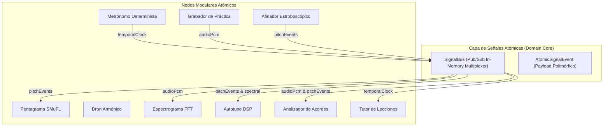

# Template: Documentation Standard (Plantilla Documentación)

## Metadatos del Documento

- **ID del Documento:** `DOC-ARCH-2026-049`
- **Título Oficial:** `Bus Universal de Interoperabilidad Atómica y Sinergia de Herramientas de Tunner`
- **Estado:** `Approved`
- **Fecha de Creación:** `2026-11-07`
- **Última Modificación:** `2026-11-07`
- **Fase Asociada:** `Fase 4 & Global`
- **Autor / Revisor Principal:** `Tunner Architecture & DSP Core Team`

---

## 1. Resumen Ejecutivo (Executive Summary)

El presente documento formaliza la arquitectura del **Bus Universal de Interoperabilidad Atómica**, garantizando que cada herramienta individual de Tunner (Afinador Estroboscópico, Metrónomo Determinista, Pentagrama Vectorial SMuFL, Grabador de Auto-Escucha, Procesador Autotune DSP, Dron Armónico, Espectrograma FFT, Analizador Polifónico y Tutor de Lecciones) actúe como un **nodo atómico interoperable**. 

Mediante un protocolo unificado de intercambio de señales en memoria (Zero-Copy cuando aplica), cada módulo es capaz de publicar eventos atómicos tipados y suscribirse a puertos de otros módulos o del bus maestro. Esto permite que acciones como iniciar el metrónomo sincronicen la grabación, guíen la detección de compases en el pentagrama, modulen la envolvente del dron y ajusten las tolerancias del afinador sin acoplamiento directo entre clases.

---

## 2. Contexto del Problema y Justificación Teórica

### 2.1 Planteamiento del Problema
Tradicionalmente, las aplicaciones musicales sufren de aislamiento funcional: el afinador no se comunica con el metrónomo, el pentagrama no sabe cuándo el grabador está en reproducción, y el analizador de armónicos no interactúa con la síntesis del dron. Los intentos de interconexión ad-hoc generan un código monolítico lleno de dependencias cruzadas (espagueti), violando el principio de responsabilidad única de Clean Architecture y la atomicidad de componentes.

### 2.2 Fundamento Teórico / Matemático
Para garantizar sinergia temporal y acústica en tiempo real, las señales transmitidas en el bus se categorizan en dimensiones matemáticas invariantes:

1. **Señal Temporal ($T$):**
   $$\Delta t = \frac{60}{BPM \cdot Q} \quad [s]$$
   Donde $BPM$ es el tempo en pulsos por minuto y $Q$ es la resolución de subdivisión (ticks por negra, $PPQ = 96$ o $480$).

2. **Señal Acústica / Pitch ($P$):**
   $$d = 1200 \cdot \log_2\left(\frac{f}{f_{\text{ref}}}\right) \quad [\text{cents}]$$
   Con $f \in [20, 20000] \text{ Hz}$ y $f_{\text{ref}} = 440 \text{ Hz}$ (o tono de referencia calibrable).

3. **Señal de Amplitud / Energía ($A$):**
   $$L_{\text{dB}} = 20 \cdot \log_{10}\left(\max\left(\frac{\text{RMS}}{V_{\text{ref}}}, 10^{-5}\right)\right)$$

4. **Señal de Marcado de Afinación / Corrección ($C$):**
   Vector de desviación por tecla o cuerda $V_{\text{micro}} = [c_0, c_1, \dots, c_{N-1}]$ donde $c_i \in [-1200.0, +1200.0]$ cents.

---

## 3. Especificación Funcional Detallada

### 3.1 Comportamiento del Sistema y Requerimientos
- **REQ-ATOMIC-01 (Desacoplamiento):** Ningún módulo del rack o herramienta de presentación conocerá la implementación interna de otro módulo. La comunicación se realiza exclusivamente mediante puertos fuertemente tipados (`PortId`) y canales de suscripción en `SignalBus`.
- **REQ-ATOMIC-02 (Latencia de Despacho):** El despacho de señales en memoria debe ejecutarse con una latencia $< 1\text{ ms}$, utilizando `StreamController.broadcast` optimizado sin bloqueos.
- **REQ-ATOMIC-03 (Tipado Estricto de Señales):** Se amplían los tipos de señal para cubrir:
  - `audioPcm`: Muestras de audio PCM crudo `List<double>`.
  - `pitchEvents`: Estimaciones instantáneas de frecuencia, nota fundamental y desviación en cents.
  - `musicalNotes`: Eventos de nota activada/desactivada (NoteOn/NoteOff con velocidad y duración).
  - `temporalClock`: Ticks del metrónomo, pulsos de compás y posición del playhead.
  - `transportControl`: Comandos de reproducción, pausa, rebobinado y grabación.
  - `tuningCalibration`: Cambios globales de tono base ($A_4$), temperamentos históricos y perfiles de desafinación por cuerda/tecla.
  - `spectralData`: Magnitudes FFT para análisis espectral simultáneo en espectrograma y analizador armónico.

---

## 4. Diseño Técnico y Arquitectura de la Solución

---

## 5. Matriz de Compatibilidad y Sinergia

| Módulo Emisor | Tipo de Señal | Módulos Receptores Naturales | Efecto de Sinergia |
| :--- | :--- | :--- | :--- |
| **Metrónomo** | `temporalClock` | Pentagrama, Grabador, Tutor | Cuantización rítmica en vivo, conteo previo antes de grabar, métrica de compases. |
| **Afinador** | `pitchEvents` | Pentagrama, Autotune, Tutor | Transcripción de notas en tiempo real, corrección de afinación, cálculo de precisión. |
| **Grabador / Mic** | `audioPcm` | Afinador, Espectrograma, Autotune, Analizador | Análisis y procesamiento simultáneo sobre la misma fuente de sonido en vivo. |
| **Consola Maestra** | `tuningCalibration` | Todos los instrumentos, Dron, Afinador | Afinación coherente unificada ($A_4$, temperamento Pitagórico/Mesotónico/Igual). |

---

## 6. Verificación y Pruebas
- Pruebas unitarias de transmisión broadcast de señales atómicas.
- Pruebas de interoperabilidad mutua: Conexión de Metrónomo $\to$ Pentagrama $\to$ Grabador.
- Verificación de consistencia ante desconexión o apagado (`isPoweredOn = false`) sin fallos en cascada.
