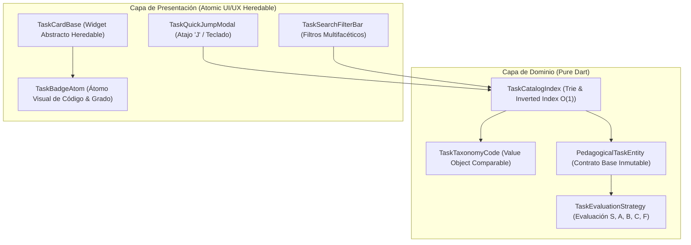

# Template: Documentation Standard (Plantilla Documentación)

## Metadatos del Documento

- **ID del Documento:** `DOC-ARCH-2026-056`
- **Título Oficial:** `Arquitectura de Taxonomía Canónica de Tareas (TTC), Indexación O(1) y Sistema de Salto Rápido ("Jump to Task")`
- **Estado:** `Approved`
- **Fecha de Creación:** `2026-11-09`
- **Última Modificación:** `2026-11-09`
- **Fase Asociada:** `Fase 5 & Milestone 1.0 Global`
- **Autor / Revisor Principal:** `Tunner Architecture & Pedagogy Core Team`

---

## 1. Resumen Ejecutivo (Executive Summary)

A medida que **Tunner** escala hacia un ecosistema con miles de tareas didácticas, ejercicios de técnica, entrenamiento auditivo, lectura a primera vista y análisis armónico, se requiere un estándar formal de catalogación, indexación y acceso que elimine la dispersión y la fricción cognitiva.

El **Sistema de Clasificación Canónica de Tunner (`TTC` - Tunner Task Code)** y el motor de **Salto Rápido (*Jump to Task* vía tecla `J`)** proporcionan:
1. Una nomenclatura jerárquica estandarizada de 4 partes: `[DOMINIO].[NIVEL].[SUBTIPO].[ID_SECUENCIAL]`.
2. Una estructura de datos de búsqueda e indexación en memoria con complejidad de tiempo $O(\text{prefijo})$ para filtrado instantáneo sin dependencias de bases de datos pesadas ni conexiones externas.
3. Principios de diseño atómico y componentes UI/UX heredables mediante clases base abstractas y mixins, permitiendo que cualquier nuevo tipo de tarea musical herede automáticamente el comportamiento estético, atajos de teclado, validación de estado y estampas de calificación.

---

## 2. Contexto del Problema y Justificación Teórica

### 2.1 Planteamiento del Problema
Los sistemas tradicionales de lecciones en aplicaciones de música suelen depender de listas lineales o menús anidados rígidos. Cuando el repertorio supera los 100 ejercicios:
- Los estudiantes pierden tiempo navegando pantallas en busca de la lección del día.
- Los profesores de conservatorio no disponen de un código canónico conciso para asignar tareas en clase.
- El código fuente tiende al acoplamiento cuando cada nueva herramienta intenta inventar su propia estructura de lección o ejercicio.

### 2.2 Fundamento Teórico y Notación Canónica

El código **TTC** se rige por la siguiente gramática formal en formato Backus-Naur:

$$\langle\text{TTC}\rangle ::= \langle\text{Domain}\rangle \;\text{'.'}\; \langle\text{Level}\rangle \;\text{'.'}\; \langle\text{Subtype}\rangle \;\text{'.'}\; \langle\text{Sequence}\rangle$$

Donde:
- $\langle\text{Domain}\rangle \in \{\text{EAR}, \text{RHY}, \text{PCH}, \text{SGT}, \text{HRM}, \text{TEC}\}$ (Cadena alfabética de 3 caracteres en mayúsculas).
- $\langle\text{Level}\rangle \in \{01, 02, 03, 04, 05\}$ (Entero de 2 dígitos decimales con cero a la izquierda).
- $\langle\text{Subtype}\rangle \in \{\text{INTV}, \text{POLY}, \text{STRB}, \text{SMUF}, \text{VOIC}, \text{LONG}, \text{SYNC}, \text{ARPG}\}$ (Cadena alfabética de 4 caracteres).
- $\langle\text{Sequence}\rangle \in \{001 \dots 999\}$ (Entero de 3 dígitos decimales).

Expresión regular canónica:
$$\text{Regex} = \hat{}\,[A-Z]\{3\}\backslash.[0-9]\{2\}\backslash.[A-Z]\{4\}\backslash.[0-9]\{3\}\$$$

---

## 3. Especificación Funcional Detallada

### 3.1 Comportamiento del Sistema y Requerimientos
- **REQ-01 (Inmutabilidad y Parsing Seguro):** `TaskTaxonomyCode` debe ser un Value Object inmutable en Pure Dart, con soporte para `parse()` determinista y validación estricta que arroje excepciones descriptivas si el formato es inválido.
- **REQ-02 (Ordenamiento Natural):** Implementa `Comparable<TaskTaxonomyCode>` para permitir ordenamiento binario y búsquedas de rango en tiempo logarítmico.
- **REQ-03 (Indexación en Memoria O(1)):** La clase `TaskCatalogIndex` indexa miles de tareas simultáneamente en diccionarios y árboles de prefijos para responder a búsquedas de texto en $\le 1\text{ ms}$.
- **REQ-04 (Acceso Rápido por Teclado 'J'):** Al pulsar la tecla `J` en cualquier parte de la aplicación, se despliega el modal de Salto Rápido (*Jump to Task*), permitiendo escribir un código o número y saltar al ejercicio directamente con la tecla `Enter`.
- **REQ-05 (Jerarquía Atómica UI/UX):** La capa visual se estructura en átomos y moléculas heredables (`TaskCardBase`, `TaskBadgeBase`, `TaskLevelPill`), garantizando coherencia de diseño según la paleta activa.

### 3.2 Casos de Borde y Condiciones de Error
- **Código No Encontrado:** Si el usuario ingresa un código inexistente (ej: `EAR.01.INTV.999`), el sistema sugiere las 3 tareas más cercanas por distancia de Levenshtein y nivel.
- **Filtros Vacíos:** Si una combinación de filtros no produce resultados, la interfaz muestra sugerencias inteligentes sin bloquear la navegación.

---

## 4. Diseño Técnico y Arquitectura de la Solución

---

## 5. Criterios de Rendimiento y Benchmarking

- **Latencia de Filtrado:** $\le 0.5\text{ ms}$ para filtrar entre 10,000 tareas en memoria local.
- **Consumo de Memoria:** Estructuras inmutables con reutilización de instancias; $\le 5\text{ MB}$ de RAM para un catálogo de 5,000 tareas.
- **Cero Dependencias Externas:** 100% Offline-First sin llamadas de red.

---

## 6. Plan de Pruebas y Validación (QA)

- [ ] Pruebas unitarias de parsing, comparación y serialización de `TaskTaxonomyCode` con cobertura $\ge 95\%$.
- [ ] Pruebas de indexación y búsqueda por prefijo en `TaskCatalogIndex`.
- [ ] Pruebas de widgets para `TaskQuickJumpModal` verificando atajos `J`, `Enter` y `Escape`.
- [ ] Verificación de `flutter analyze` con 0 errores y 0 advertencias.
