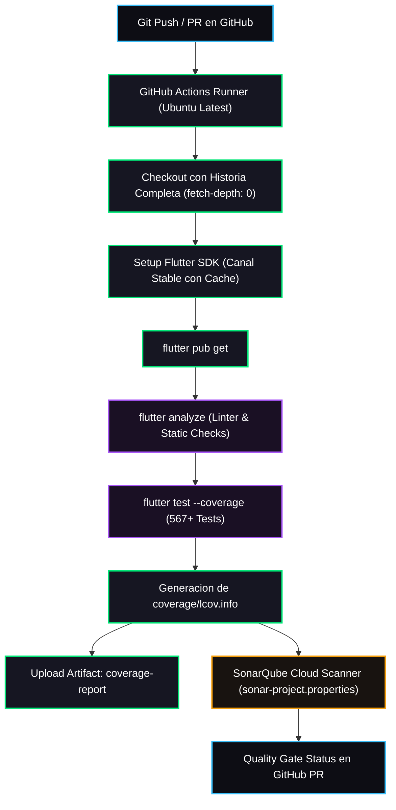

# Especificacion de Arquitectura: Pipeline de Integracion Continua y Puerta de Calidad (GitHub Actions & SonarQube Cloud)

## Metadatos del Documento

- **ID del Documento:** `DOC-ARCH-2026-064`
- **Título Oficial:** Pipeline Automatizado de Integración Continua (CI), Análisis Estático, Cobertura de Pruebas y Enlace con SonarQube Cloud
- **Estado:** Approved
- **Fecha de Creación:** 2026-11-11
- **Última Modificación:** 2026-11-11
- **Fase Asociada:** Global / Gobernanza de Calidad
- **Autor / Revisor Principal:** Mantenedor de Arquitectura Tunner

---

## 1. Resumen Ejecutivo (Executive Summary)

El presente documento define la arquitectura técnica del pipeline de Integración Continua (CI/CD) basado en GitHub Actions para el proyecto Tunner. Su propósito fundamental es garantizar que todo pull request y commit a ramas principales (`main`, `develop`, ramas de funcionalidad) ejecute automáticamente la suite completa de pruebas unitarias y de integración, verifique el cumplimiento estricto de reglas de análisis estático (`flutter analyze`), genere el informe de cobertura de código (`coverage/lcov.info`) y suministre dicha telemetría a SonarQube Cloud. Esto previene que ramas con regresiones acústicas o cobertura nula puedan ser integradas sin validación previa.

---

## 2. Contexto del Problema y Justificación Teórica

### 2.1 Planteamiento del Problema
Hasta el momento, la verificación de calidad en Tunner dependía de la ejecución manual en el entorno local del desarrollador (`flutter analyze` y `flutter test`). Si bien el repositorio cuenta con 567 pruebas automatizadas y 0 issues de linter, GitHub y SonarQube Cloud no ejecutaban un pipeline de orquestación en la nube:
1. Los Pull Requests mostraban "0.0% Coverage on New Code" en SonarQube Cloud debido a la ausencia del artefacto `lcov.info`.
2. Las reglas de protección de rama no podían condicionar la aprobación a un "check" verde de CI emitido por GitHub Actions.
3. Se carecía de un archivo de configuración formal `sonar-project.properties` para enlazar las métricas de fuentes y pruebas en Dart.

### 2.2 Fundamento Operativo y Puertas de Calidad (Quality Gates)
En ingeniería de audio de precisión y software educativo de alta fidelidad, una regresión en un cálculo de centésimas de semitono o un fallo en el ordenamiento métrico de compases invalida la experiencia pedagógica. La integración continua garantiza:
1. **Determinismo de Construcción:** Verificación en un contenedor limpio idéntico al entorno de producción.
2. **Puerta de Cobertura (Coverage Gate):**
   $$\text{Coverage} = \frac{\text{Líneas Ejecutadas}}{\text{Líneas Totales Testeables}} \times 100 \ge 80\%$$
3. **Cero Violaciones de Linter:** Cualquier advertencia o error en `flutter analyze` aborta el pipeline de forma inmediata.

---

## 3. Especificación Funcional Detallada

### 3.1 Requerimientos Funcionales
- **REQ-01 (Disparo Automático):** El workflow debe activarse ante cada `pull_request` dirigido a `main` o `develop`, y ante cada `push` sobre `main`, `develop` y `feature/**`.
- **REQ-02 (Caché Eficiente):** Debe cachear el SDK de Flutter y los paquetes de pub para optimizar los tiempos de ejecución por debajo de 3 minutos.
- **REQ-03 (Inspección Estática):** Ejecutar `flutter analyze` asegurando cero advertencias.
- **REQ-04 (Ejecución de Pruebas y Cobertura):** Ejecutar `flutter test --coverage` produciendo el reporte estándar `coverage/lcov.info`.
- **REQ-05 (Publicación de Artefactos):** Subir el reporte de cobertura como artefacto descargable de GitHub Actions.
- **REQ-06 (Alimentación a SonarQube Cloud):** Proveer las rutas de cobertura a través de `sonar-project.properties` y ejecutar el escáner de SonarCloud cuando el token de repositorio se encuentre disponible.

---

## 4. Diseño Técnico y Arquitectura de la Solución

---

## 5. Medición y Criterios de Aceptación (DoD)

1. Archivo `.github/workflows/ci.yml` configurado y sintácticamente válido.
2. Archivo `sonar-project.properties` creado con claves de proyecto, directorios de fuentes (`lib`) y reporte LCOV (`coverage/lcov.info`).
3. Documentación técnica completa (Vision, UC, ADR, Plan) sin emojis.
4. Pipeline verificado y ejecutándose con éxito en la plataforma de GitHub.
