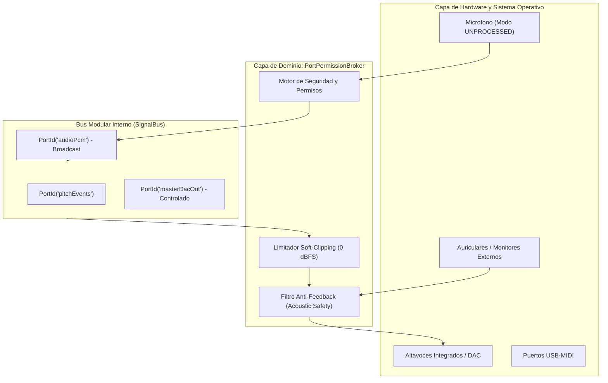

# Documento Tecnico: Arquitectura de Puertos de Hardware, Permisos de Dispositivos y Arbitraje de Senales

## Metadatos del Documento

- **ID del Documento:** `DOC-ARCH-2026-062`
- **Título Oficial:** Arquitectura de Puertos de Entrada y Salida (I/O), Permisos de Hardware, Bypass de DSP Telefónico y Árbitro de Señales (PortPermissionBroker)
- **Estado:** Approved
- **Fecha de Creación:** 2026-11-11
- **Última Modificación:** 2026-11-11
- **Fase Asociada:** Fase 2 (Infraestructura de Audio y Hardware)
- **Autor / Revisor Principal:** Nicolas Leon / Tunner Core Architecture Team

---

## 1. Resumen Ejecutivo (Executive Summary)

Este documento define la arquitectura integral para la gestión segura, de ultra baja latencia y acústicamente rigurosa de los puertos de entrada y salida (I/O) de hardware y su mapeo sobre el bus modular interno (`SignalBus`) de **Tunner**.

Establece las directrices para interactuar con interfaces de audio externas USB (class-compliant), captura de micrófono en modo crudo (*raw unprocessed*) para evadir los filtros telefónicos destructivos del sistema operativo, supresión activa de retroalimentación acústica (*Acoustic Feedback Prevention*) condicionada a la detección de transductores externos (auriculares/monitores), y la creación de la entidad de dominio `PortPermissionBroker` que gobierna la contienda y el arbitraje de permisos entre los módulos del estudio.

---

## 2. Contexto del Problema y Justificacion Fisica

### 2.1 Degeneracion Acustica por Filtros del Sistema Operativo
Los sistemas operativos móviles y de escritorio aplican por defecto cadenas de procesamiento digital de señales (DSP) agresivas sobre el flujo de micrófono:
1. **Cancelación de Eco Acústico (AEC - Acoustic Echo Cancellation):** Genera filtrado peine (*comb filtering*) que atenúa sobretonos armónicos legítimos en instrumentos acústicos (flauta, violín, guitarra).
2. **Reducción de Ruido Estacionario (NS - Noise Suppression):** Confunde ataques pianissimo ($pp$) y decaimientos naturales de cuerdas con ruido ambiental, introduciendo artefactos de fase y saltos espurios en el algoritmo McLeod Pitch Method (MPM).
3. **Control Automático de Ganancia (AGC - Automatic Gain Control):** Altera la envolvente dinámica del instrumento, distorsionando la relación de amplitudes entre la fundamental $H_1$ y los sobretonos $H_2\dots H_8$.

### 2.2 Riesgo de Bucle Acustico Destructivo (Larsen / Feedback Loop)
Cuando Tunner ejecuta funciones de reproducción en tiempo real (como la Suite Vocal con Auto-Tune en vivo, el Ensamble Virtual Minus-One o el metrónomo sonoro) mientras el micrófono de captura está abierto en los altavoces integrados del dispositivo, se produce una realimentación acústica positiva:
$$\text{Ganancia de Lazo} = G_{\text{mic}} \cdot G_{\text{amp}} \cdot H_{\text{acústica}} \ge 1.0$$
Esto provoca un acople ensordecedor que satura los convertidores ADC/DAC a $0\text{ dBFS}$ y arruina la estimación de tono.

---

## 3. Especificacion Funcional y Requerimientos

- **REQ-01 (Bypass de DSP Telefónico):** El controlador de captura debe solicitar explícitamente al sistema operativo el modo no procesado (`AudioSource.UNPROCESSED` en Android, `AVAudioSessionModeMeasurement` en iOS/macOS) garantizando flujo PCM lineal de 16/32 bits sin compresión dinámica ni ecualización.
- **REQ-02 (Detección de Auriculares y Bloqueo Anti-Feedback):** El sistema debe inspeccionar el estado de los puertos de salida. El monitoreo vocal en vivo con baja latencia únicamente tendrá permiso de emisión si se detectan auriculares o interfaces externas conectadas. Si la salida activa es el altavoz integrado, el puerto de retorno se silencia automáticamente emitiendo una advertencia de seguridad.
- **REQ-03 (Arbitraje de Escritura en el DAC):** Ningún módulo del rack puede emitir muestras directas al hardware de salida. Todas las señales deben registrarse ante el `PortPermissionBroker` y canalizarse a través del mezclador maestro, el cual aplica un limitador de seguridad con curva suave (*soft-clipping* a $0\text{ dBFS}$).
- **REQ-04 (Lectura Compartida sin Contienda):** El puerto de entrada `audioPcm` admite difusión global (Broadcast): múltiples consumidores (afinador estroboscópico, espectrograma FFT, grabador multipista) pueden suscribirse en paralelo sin degradación de rendimiento.
- **REQ-05 (Modo Exclusivo de Silencio para Calibración):** Durante la calibración del piso de ruido en el laboratorio acústico (`acoustic_lab`), el broker revoca temporalmente los permisos de emisión de todos los demás módulos generadores de sonido para asegurar el silencio de referencia.

---

## 4. Diseno Tecnico y Capas de la Solucion

### 4.1 Entidad de Dominio: `PortPermissionBroker`
Ubicada en `lib/features/modular_rack/domain/port_permission_broker.dart`:
- Evalúa solicitudes de conexión entre puertos lógicos y físicos.
- Valida si un módulo tiene permisos de lectura exclusiva o compartida.
- Conmuta el estado de protección anti-feedback según la telemetría de salida.

### 4.2 Modelo de Estado: `HardwareAudioEndpoint`
Ubicado en `lib/features/tuner/domain/hardware_audio_endpoint.dart`:
- `id`: Identificador único del puerto del dispositivo.
- `name`: Nombre descriptivo (ej: "Micrófono Integrado", "Focusrite Scarlett 2i2 Canal 1", "Auriculares Jack 3.5mm").
- `type`: Enum (`builtInMic`, `usbAudioInterface`, `bluetoothInput`, `builtInSpeaker`, `wiredHeadphones`, `bluetoothOutput`).
- `supportsRawCapture`: True si la plataforma permite eludir el DSP telefónico.

---

## 5. Criterios de Aceptacion y Verificacion

1. Pureza absoluta en la capa de dominio (cero imports de Flutter o plugins en entidades de puertos).
2. Pruebas unitarias que verifiquen el bloqueo de emisión cuando no hay auriculares y la concesión de permisos cuando se detecta conexión externa.
3. Cobertura completa de la suite de pruebas sin regresiones (100% passing).
4. Cero errores y advertencias en `flutter analyze`.
