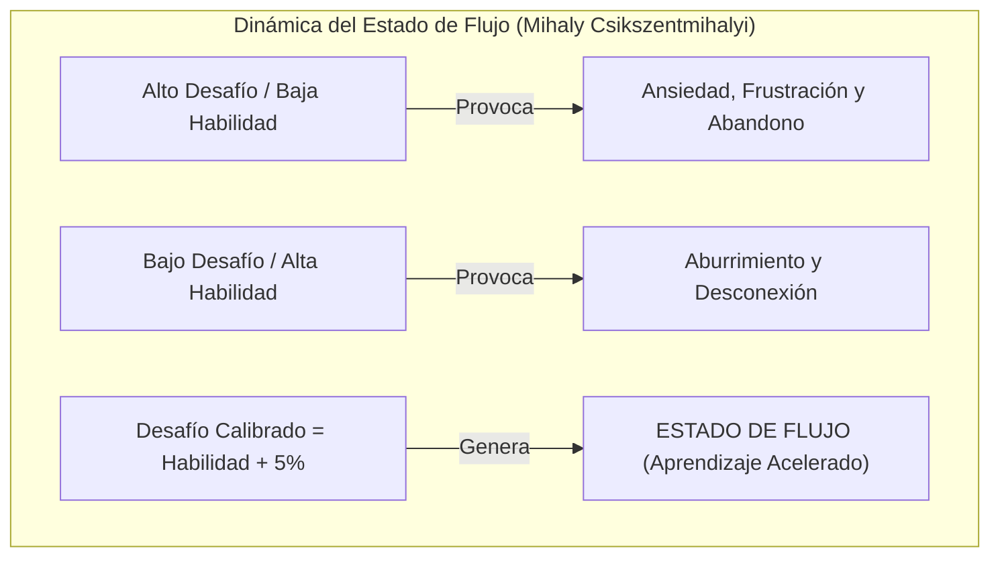
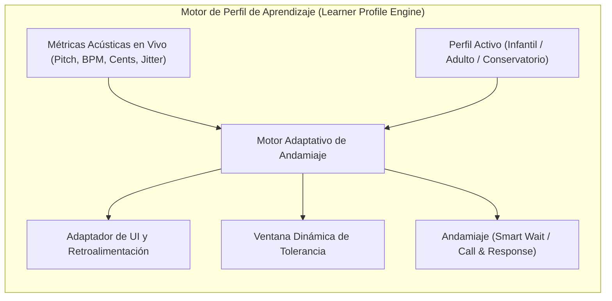

# Fundamentos Pedagógicos de Vanguardia: Andragogía, Psicología Cognitiva Infantil y Arquitectura de Adaptación Dinámica en Tunner

Este documento establece la investigación científica y pedagógica de referencia para el diseño instruccional, la psicología del aprendizaje y la personalización adaptativa en **Tunner**, abarcando las diferencias neurológicas, motivacionales y metodológicas entre el aprendizaje musical en niños y en adultos.

---

## Metadatos del Documento

- **ID del Documento:** `DOC-PEDAGOGY-2026-034`
- **Título Oficial:** Fundamentos Pedagógicos Comparados: Andragogía, Psicología del Desarrollo Infantil y Arquitectura de Aprendizaje Adaptativo
- **Estado:** `Approved`
- **Fecha de Creación:** 2026-10-28
- **Última Modificación:** 2026-10-28
- **Fase Asociada:** Fase 13 (Analítica Pedagógica y Adaptación al Usuario)
- **Autor / Revisor Principal:** Nicolas Leon / Antigravity Engine

---

## 1. Resumen Ejecutivo (Executive Summary)

El aprendizaje de la música y el dominio de la entonación vocal e instrumental no pueden abordarse bajo un modelo pedagógico monolítico. Los niños y los adultos procesan la información acústica, gestionan la frustración, retienen habilidades motoras y estructuran su motivación mediante vías neurocognitivas fundamentalmente distintas. Mientras que el infante adquiere el lenguaje sonoro a través de la inmersión sensoriomotriz, la exploración lúdica y la audición intuitiva, el adulto aprende a través del prisma de la experiencia previa, la reducción analítica de la carga cognitiva y la necesidad de relevancia práctica inmediata, enfrentando además barreras emocionales severas como el miedo al error y la autocrítica paralizante.

Este trabajo articula una revisión exhaustiva del estado del arte en pedagogía musical, andragogía, psicología del desarrollo y neurobiología del aprendizaje (Knowles, Sweller, Ericsson, Piaget, Vygotsky, Bruner, Gordon y Csikszentmihalyi). A partir de esta base teórica, se deriva una arquitectura de software dinámica que permite a Tunner transformar en tiempo real su interfaz de usuario, tolerancias microtonales, bucles de retroalimentación y modalidades de práctica para amoldarse con exactitud al perfil cognitivo y emocional del usuario final.

---

## 2. Epistemología del Aprendizaje Musical: Niños vs. Adultos

### 2.1 Comparativa Teórica y Neurobiológica Fundamental

| Dimensión Cognitiva / Neurobiológica | Aprendizaje en Niños (Pedagogía del Desarrollo) | Aprendizaje en Adultos (Andragogía & Práctica Deliberada) |
| :--- | :--- | :--- |
| **Plasticidad Sináptica y Mielinización** | Máxima neuroplasticidad; períodos críticos para el desarrollo del oído absoluto y discriminación fonológica fina (Gordon, 1997). | Plasticidad regulada dependiente de la atención focalizada y la acetilcolina/dopamina; mielinización estructural madura (Doidge, 2007). |
| **Representación del Conocimiento** | *Enactiva* (acción física) e *Icónica* (imágenes, alturas espaciales, colores) antes de la *Simbólica* (Bruner, 1966). | *Simbólica* y *Conceptual* predominante; necesidad de comprender la lógica estructural antes de interiorizar el patrón motor. |
| **Fuente de Motivación y Metas** | Intrínseca ligada al juego, la curiosidad, el placer sensorio-auditivo y la validación afectiva inmediata. | Intrínseca orientada a metas específicas (autonomía, autoexpresión, superación personal) o profesionalizante (Knowles, 1984). |
| **Barrera Emocional y Tolerancia al Error** | Alta resiliencia al error si se presenta en entornos lúdicos; no sienten vergüenza acústica de emitir tonos desafinados al explorar. | Severo miedo al ridículo y síndrome del impostor; la disonancia entre el oído crítico desarrollado y la emisión técnica genera alta deserción. |
| **Gestión de la Carga Cognitiva** | Memoria de trabajo limitada; saturación rápida ante interfaces densas o explicaciones verbales complejas (Sweller, 1988). | Capacidad de abstracción alta, pero propensión a la fatiga cognitiva por sobre-análisis ("parálisis por análisis"). |
| **Estructuración Temporal de la Práctica** | Bloques cortos, frecuentes y variados (5 a 15 minutos) con recompensas sensoriales continuas. | Bloques estructurados de 20 a 45 minutos basados en el ciclo de práctica deliberada y descomposición de dificultades (Ericsson, 1993). |

---

## 3. Fundamentación Teórica del Aprendizaje Infantil

### 3.1 Las Etapas del Desarrollo Cognitivo de Piaget aplicadas a la Música
1. **Etapa Preoperacional (2 a 7 años):** El niño no comprende la abstracción de una redonda como fracción temporal ($4/4$). Percibe el ritmo como movimiento corporal (rápido/lento, paso/salto) y el tono como altura física (arriba/abajo, grande/pequeño). Las notas deben representarse mediante metáforas visuales e interactivas.
2. **Etapa de Operaciones Concretas (7 a 11 años):** El estudiante ya puede clasificar compases y comprender secuencias de alturas tonales si están ancladas a una referencia visible y audible continua.

### 3.2 La Zona de Desarrollo Próximo (ZPD) y el Andamiaje (Vygotsky & Bruner)
Lev Vygotsky postula que el aprendizaje efectivo ocurre en la distancia entre el nivel de desarrollo real (lo que el alumno hace sin ayuda) y el nivel de desarrollo potencial (lo que puede lograr con guía). Jerome Bruner introduce el concepto de **Andamiaje (Scaffolding)**:
- El software debe ofrecer soportes temporales (guías visuales de afinación, reproducción simultánea de notas pedal o "smart wait") que se desvanecen gradualmente conforme el aprendiz interioriza la habilidad.

### 3.3 La Teoría del Aprendizaje Musical (Music Learning Theory - E. Gordon) y el Método Suzuki
- **Audiación:** Capacidad de oír y comprender música en la mente cuando el sonido no está físicamente presente. Gordon demuestra que los niños aprenden música de forma análoga al lenguaje materno: *Escuchar $\rightarrow$ Imitar (Balbuceo musical) $\rightarrow$ Pensar (Audiar) $\rightarrow$ Leer (Notación) $\rightarrow$ Escribir (Crear)*.
- **Inversión Pedagógica Tradicional Errónea:** Forzar a un niño a leer pentagramas antes de haber desarrollado la audiación genera rechazo y desconexión motriz. El sistema debe priorizar el bucle *Escuchar y Repetir (Call & Response)* antes de la lectura formal.

---

## 4. Fundamentación Teórica del Aprendizaje en Adultos (Andragogía)

### 4.1 Los Seis Principios Andragógicos de Malcolm Knowles
1. **Necesidad de Saber:** El adulto exige comprender el "por qué" detrás de cada ejercicio (e.g., por qué hacer escalas con quintas justas o por qué calibrar a $432\text{ Hz}$ vs $440\text{ Hz}$).
2. **Autoconcepto de Autonomía:** El adulto rechaza ser tratado como un receptor pasivo; debe tener el control de su repertorio, tempo de estudio y parámetros de evaluación.
3. **El Rol de la Experiencia Previa:** Posee modelos mentales previos (a veces con malos hábitos técnicos o vicios posturales) que deben ser reorientados mediante evidencia objetiva y no mediante juicios autoritarios.
4. **Disposición para Aprender:** Orientada a tareas reales (e.g., cantar una canción específica o afinar con su grupo de cámara).
5. **Orientación al Aprendizaje Centrada en Problemas:** El adulto no busca memorizar teoría abstracta, sino resolver problemas prácticos (e.g., "se me cae la afinación en los agudos").
6. **Motivación Intrínseca:** El motor principal es el crecimiento personal, la satisfacción estética y el bienestar emocional.

### 4.2 Teoría de la Carga Cognitiva (Sweller) y Parálisis por Análisis
John Sweller divide la carga cognitiva en:
- **Carga Intrínseca:** La dificultad inherente al acto de afinar una nota mientras se sostiene la respiración y se lee una clave.
- **Carga Extraña (Extraneous Load):** La interferencia mental provocada por una interfaz visual abarrotada de botones, espectrogramas y parámetros ininteligibles.
- **Carga Germana (Germane Load):** El esfuerzo mental productivo dedicado a construir esquemas cognitivos duraderos.
- **Aplicación Crucial:** En adultos principiantes, la sobreabundancia de datos acústicos (cents, THD, armónicos, FFT) eleva la carga extraña al punto de colapsar la memoria de trabajo, induciendo estrés y abandono. La interfaz debe graduar la visibilidad de datos conforme avanza la competencia del usuario.

### 4.3 Práctica Deliberada y Representaciones Mentales (K. Anders Ericsson)
El mero acto de repetir una canción no genera maestría. La práctica deliberada requiere:
1. Una tarea bien definida en el borde de la habilidad.
2. Retroalimentación inmediata, objetiva e inequívoca sobre el rendimiento.
3. Oportunidad instantánea de corregir el error sin penalización.
4. Construcción de representaciones mentales refinadas para la auto-monitorización continua.

### 4.4 Superación de la Barrera de la Vergüenza y la Teoría de la Mentalidad (Carol Dweck)
- Los adultos sufren frecuentemente de una **Mentalidad Fija (Fixed Mindset)** respecto a la música: la creencia limitante de que "se nace con oído" o "yo soy sordo para la música".
- Cuando el afinador marca "Error" en rojo estridente, confirma su miedo subconsciente. Tunner debe implementar retroalimentación basada en **Mentalidad de Crecimiento (Growth Mindset)**: mediciones cuantitativas no punitivas, señalización de micro-avances y diagnósticos orientados a la física del sonido ("aumentar presión diafragmática") en lugar de calificadores de ineptitud.

---

## 5. El Estado de Flujo (Flow) de Csikszentmihalyi en la Educación Musical

El equilibrio dinámico entre el nivel de desafío y el nivel de habilidad determina la experiencia del estudiante:

**Regla de Oro en Tunner:** El sistema debe detectar automáticamente cuándo el usuario está en zona de frustración (desafío excesivo sostenido) para reducir la velocidad, ampliar la ventana de tolerancia microtonal o sugerir un paso previo; y cuándo domina el pasaje para incrementar sutilmente la exigencia.

---

## 6. Arquitectura de Adaptación al Cliente en Tunner

Para aplicar de forma exhaustiva estos principios, Tunner debe implementar un subsistema pedagógico adaptativo desacoplado en Clean Architecture:

### 6.1 Matriz de Adaptación por Perfil de Usuario

| Parámetro del Sistema | Perfil Infantil (Exploración Lúdica) | Perfil Adulto (Práctica Deliberada) | Perfil Conservatorio (Rigor Analítico) |
| :--- | :--- | :--- | :--- |
| **Tolerancia de Afinación ($\Delta c$)** | $\pm 20\text{ a } \pm 25\text{ cents}$ (amplia para incentivar) | $\pm 10\text{ cents}$ (enfocada y constructiva) | $\pm 3\text{ a } \pm 5\text{ cents}$ (estricta de concierto) |
| **Representación Visual** | Metáforas icónicas (globos que flotan, arcoíris, estrellas, avatares reactivos). | Aguja limpia, centésimas numéricas, pentagrama simplificado, modo minimalista. | Doble pentagrama vectorial SMuFL, FFT armónico, centroide, THD, aguja estroboscópica. |
| **Modalidad de Error** | Sin estados negativos punitivos. Sonidos amigables y animación de "¡casi lo tienes!". | Pautas técnicas descriptivas ("levemente bajo, relajar hombros"). | Marcador microtonal exacto en cents con historial temporal de dispersión. |
| **Andamiaje Musical** | Call & Response lúdico; Smart Wait interactivo que pausa la partitura sin castigo. | Deconstrucción por capas (primero ritmo en un solo tono, luego intervalos a tempo libre). | Lectura a primera vista a tempo estricto con metrónomo acentuado y análisis de jitter. |
| **Duración de la Sesión** | Rutinas cortas de 5 a 10 minutos con certificado de estrellas. | Sesiones de 15 a 30 minutos con metas claras y desglose de progreso. | Sesiones de 45 a 90 minutos con reporte PDF formal de conservatorio. |
| **Reducción de Carga Cognitiva** | Solo un estímulo a la vez (escuchar o cantar, no ambos simultáneamente). | Ocultamiento de analítica avanzada hasta solicitarla; énfasis en la tarea presente. | Todos los indicadores acústicos y de mezcla de stems disponibles en pantalla. |

---

## 7. Plan de Integración en el Código de Tunner

Para materializar esta investigación en el código fuente respetando las reglas no negociables de [AGENTS.md](../../AGENTS.md):

1. **Capa de Dominio (`lib/features/pedagogy/domain/`):**
   - `LearnerProfileEntity`: Modela el perfil pedagógico (`LearnerProfileType`: `childPlayful`, `adultDeliberate`, `conservatoryMastery`, o `custom`).
   - `AdaptiveScaffoldingEngine`: Algoritmo puro de cálculo de ventanas de tolerancia dinámica, progresión de dificultad y selección de diagnósticos andragógicos/infantiles.
   - `PedagogicalFeedbackRule`: Reglas formativas basadas en psicología del aprendizaje (refuerzo positivo, pautas biomecánicas, alertas de fatiga vocal).
2. **Capa de Datos y Persistencia (`lib/features/persistence/`):**
   - Integración del perfil pedagógico en `AppUserSettingsEntity` para persistencia offline determinista en JSON.
3. **Capa de Presentación (`lib/features/pedagogy/presentation/`):**
   - Selector de Perfil Pedagógico amigable en la bienvenida o barra de herramientas.
   - Conmutación reactiva de la interfaz de usuario en `TunerScreen` para que los niños vean una interfaz limpia, cálida y lúdica, los adultos vean una estación clara sin sobrecarga, y los profesionales disfruten de la consola acústica completa.

---

## 8. Referencias Bibliográficas

1. *Knowles, M. S. (1984). Andragogy in Action: Applying modern principles of adult learning. Jossey-Bass.*
2. *Sweller, J. (1988). Cognitive load during problem solving: Effects on learning. Cognitive Science, 12(2), 257-285.*
3. *Ericsson, K. A., Krampe, R. T., & Tesch-Römer, C. (1993). The role of deliberate practice in the acquisition of expert performance. Psychological Review, 100(3), 363-406.*
4. *Dweck, C. S. (2006). Mindset: The new psychology of success. Random House.*
5. *Gordon, E. E. (1997). Learning Sequences in Music: Skill, Content, and Patterns. GIA Publications.*
6. *Bruner, J. S. (1966). Toward a Theory of Instruction. Harvard University Press.*
7. *Piaget, J. (1952). The Origins of Intelligence in Children. International Universities Press.*
8. *Csikszentmihalyi, M. (1990). Flow: The Psychology of Optimal Experience. Harper & Row.*
9. *Suzuki, S. (1983). Nurtured by Love: The Classic Approach to Talent Education. Alfred Music.*
10. *Doidge, N. (2007). The Brain That Changes Itself: Stories of Personal Triumph from the Frontiers of Brain Science. Viking.*
