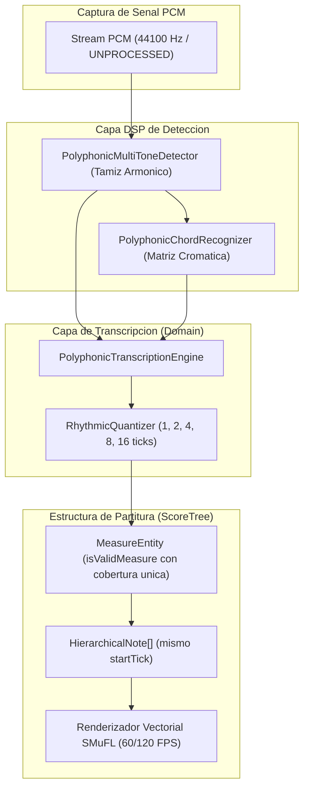

# Documento Tecnico: Transcripcion Polifonica de Audio a Partitura en Tiempo Real (Mic-to-Score Polifonico)

## Metadatos del Documento

- **ID del Documento:** `DOC-ARCH-2026-063`
- **Título Oficial:** Arquitectura de Transcripción Polifónica en Tiempo Real: Separación Espectral Multitonal, Detección de Onsets Simultáneos y Renderizado de Acordes en Pentagrama SMuFL
- **Estado:** Approved
- **Fecha de Creación:** 2026-11-11
- **Última Modificación:** 2026-11-11
- **Fase Asociada:** Fase 2 (Suites Sinérgicas Multi-Herramienta)
- **Autor / Revisor Principal:** Nicolas Leon / Tunner Core Architecture Team

---

## 1. Resumen Ejecutivo (Executive Summary)

Este documento especifica la extensión polifónica del motor de transcripción acústica en vivo de Tunner. Integra de forma sinérgica el detector multitonal basado en tamiz armónico (`PolyphonicMultiToneDetector`), el reconocedor cromático de acordes (`PolyphonicChordRecognizer`) y el cuantizador de duraciones rítmicas (`LiveTranscriptionEngine`), permitiendo transcribir interpretaciones de instrumentos polifónicos (guitarra acústica, piano, conjuntos de cuerdas) directamente a notas agrupadas en acordes sobre el pentagrama vectorial SMuFL a 60/120 FPS.

El sistema resuelve el desafío clásico de la superposición de glifos y colisiones gráficas mediante la separación de voces, la asignación temporal compartida en sub-ticks y el etiquetado armónico contextual de compás.

---

## 2. Fundamento Teorico y Matematico

### 2.1 Descomposicion Multitonal por Tamiz Armonico y Sustraccion Espectral
Dado un búfer de audio PCM en el tiempo $x[n]$, el sistema calcula la función de salience armónica $S(m)$ sobre la cuadrícula cromática MIDI $m \in [m_{\text{min}}, m_{\text{max}}]$ mediante la suma ponderada de la energía en sus armónicos superiores $h \in \{1, 2, \dots, H\}$:
$$S(m) = \sum_{h=1}^{H} w_h \cdot |X(h \cdot f_0(m))|$$
donde $f_0(m) = 440 \cdot 2^{\frac{m - 69}{12}}\text{ Hz}$, $w_h = \frac{1}{\sqrt{h}}$ es el factor de decaimiento natural de la serie de Fourier, y $|X(f)|$ es la magnitud espectral calculada mediante Transformada Discreta de Fourier de alta resolución.

Tras aislar el pico dominante $m_1 = \arg\max_m S(m)$, se aplica una sustracción espectral iterativa atenuando los armónicos $h \cdot f_0(m_1)$ para descubrir la segunda fundamental $m_2$, repitiendo el proceso hasta agotar las $K$ voces polifónicas activas por encima del umbral de ruido (*salience threshold ratio*):
$$S_{k+1}(m) = \max\left(0, S_k(m) - \gamma \sum_{h=1}^H w_h \cdot \delta(f - h \cdot f_0(m_k))\right)$$

### 2.2 Cuantizacion Temporal y Agrupacion Polifonica en Sub-Ticks
En el pentagrama jerárquico (`HierarchicalScore`), un compás de métrica $4/4$ contiene 16 sub-ticks de resolución base (semicorcheas):
$$\tau_{\text{sub-tick}} = \frac{60\,000}{B \cdot 4}\text{ ms}$$
Cuando se detecta un onset polifónico en el tiempo $t$, las $K$ notas simultáneas detectadas $\{N_1, N_2, \dots, N_K\}$ se anclan exactamente al mismo `startTick`:
$$\forall k \in \{1, \dots, K\}, \quad N_k.\text{startTick} = t_{\text{grid}}$$
La validación temporal del compás (`MeasureEntity.isValidMeasure`) se calcula como la cobertura total de sub-ticks únicos ocupados en el intervalo $[0, T_{\text{total}} - 1]$, garantizando coherencia métrica tanto en pasajes monódicos como en polifonía densa.

---

## 3. Especificacion Funcional y Requerimientos

- **REQ-01 (Detección Concurrente de Voces):** El motor debe ser capaz de identificar simultáneamente entre 2 y 6 notas discretas ejecutadas al unísono o en arpegio rápido dentro de una ventana de integración de $30\text{ ms}$.
- **REQ-02 (Cuantización Rítmica de Acordes):** Las notas pertenecientes al mismo ataque deben compartir `startTick` y `durationTicks`, emitiéndose como un acorde armónico sin desfase visual en la plica.
- **REQ-03 (Reconocimiento Armónico Acompañante):** Si el conjunto de notas forma una tríada o tétrada reconocida (Mayor, Menor, Disminuida, Séptima de Dominante, Menor 7), el sistema debe asociar el símbolo de acorde a la medida para anotación cifrada superior.
- **REQ-04 (Pista Dedicada de Transcripción):** Para evitar la colisión gráfica descrita en el anti-patrón 4.4 de Tunner, la transcripción polifónica debe generarse en una pista separada (*Performance Stave*) preservando intacta la partitura de referencia.
- **REQ-05 (Conmutación Monofónica / Polifónica):** El usuario debe poder alternar entre el estimador monofónico MPM (para vientos y voz solista) y el estimador polifónico multitonal (para guitarra, piano y ensambles).

---

## 4. Diseno Tecnico y Capas de la Solucion

### 4.1 Entidades y Servicios de Dominio
- **`PolyphonicTranscriptionEngine`:** Ubicado en `lib/features/transcription/domain/polyphonic_transcription_engine.dart`.
  - Procesa listas de `PolyphonicPitchEntity` o resultados de `PolyphonicMultiToneAnalysisResult`.
  - Agrupa candidatos simultáneos en `PolyphonicChordCandidate`.
  - Modifica inmutablemente el `SongPackage` insertando los acordes en el pentagrama.
- **Actualización de `MeasureEntity`:** Adaptar `isValidMeasure` para evaluar la unión de intervalos temporales $[\text{startTick}, \text{endTick})$, soportando acordes concurrentes.

---

## 5. Criterios de Aceptacion y Verificacion

1. Pureza absoluta en la capa de dominio: cero dependencias de Flutter o plugins nativos.
2. Pruebas unitarias que verifiquen la transcripción de tríadas mayores (Do-Mi-Sol), acordes menores y pasajes mixtos melodía-acorde.
3. 100% de pruebas passing en la suite global automatizada.
4. Cero advertencias en `flutter analyze`.
5. Cero emojis en toda la documentación y código.
