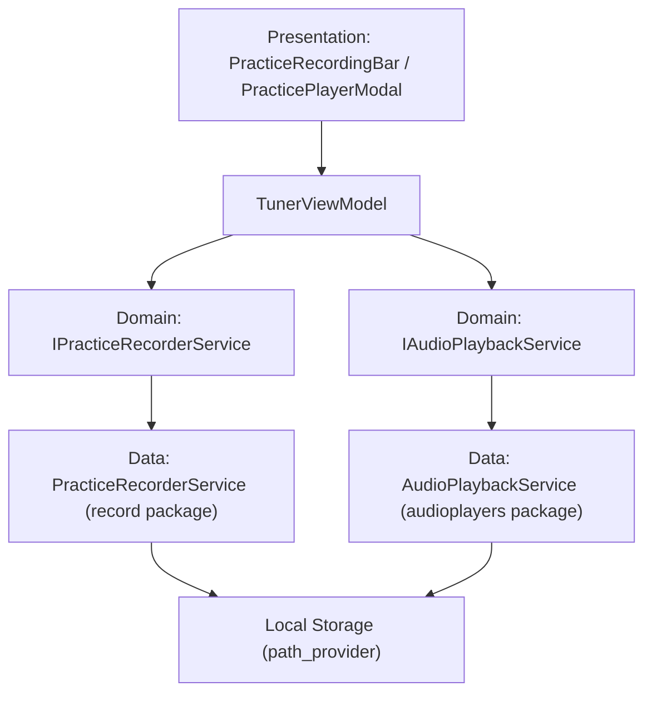

# Technical Specification: Practice Audio Recorder & Loopback Auto-Listening Studio
## Grabadora de Práctica en Alta Fidelidad y Reproductor de Auto-Escucha Sincronizada

---

## Metadatos del Documento

- **ID del Documento:** `DOC-PRACTICE-RECORDER-2026-012`
- **Título Oficial:** `Especificación Técnica: Grabadora de Práctica & Reproductor de Auto-Escucha (Audio Loopback)`
- **Estado:** `Approved`
- **Fecha de Creación:** `2026-10-26`
- **Última Modificación:** `2026-10-26`
- **Fase Asociada:** `Fase 4`
- **Autor / Revisor Principal:** `Nicolas Leon (Mantenedor Principal) & Antigravity AI`

---

## 1. Resumen Ejecutivo (Executive Summary)

El sistema de **Grabadora de Práctica & Auto-Escucha (Practice Audio Recorder & Loopback)** dota a **Tunner** de una herramienta pedagógica de autoevaluación crítica imprescindible en conservatorios y estudios profesionales. Permite al músico grabar su interpretación acústica real (voz, flauta, violín, saxofón, guitarra o piano) mientras la partitura y el metrónomo se ejecutan de manera simultánea. Al concluir la toma, el estudiante puede reproducir instantáneamente su audio capturado, visualizando la forma de onda (*waveform*), la partitura y el informe de afinación correspondiente, permitiéndole identificar auditivamente problemas de afinación sutil, respiración a destiempo o ataques imperfectos.

El subsistema opera con arquitectura **Offline First**, almacenamiento en almacenamiento seguro local del dispositivo y cero dependencias de servidores remotos o transferencias en la nube.

---

## 2. Contexto del Problema y Justificación Teórica

### 2.1 Planteamiento del Problema
En el estudio instrumental y vocal, la percepción auditiva del músico durante la emisión sonora suele verse sesgada por la conducción ósea del cráneo y la concentración mental dividida entre lectura a primera vista y control motor. Por ello, la retroalimentación visual en tiempo real (cents, notas verdes/rojas) debe complementarse con la **auto-escucha diferida (*loopback listening*)**: escuchar la propia grabación inmediatamente después de terminar el pasaje musical.

Actualmente, los músicos deben recurrir a aplicaciones externas de notas de voz o DAWs pesados, perdiendo la sincronía con el metrónomo, el compás de la partitura y las métricas analíticas calculadas por el `PracticeEvaluatorService`.

### 2.2 Fundamento Teórico / Físico / Acústico
1. **Captura en Formato Comprimido de Alta Fidelidad (AAC / M4A a 128 kbps o PCM WAV):**
   $$\text{Bitrate} = 128\text{ kbps}, \quad f_s = 44100\text{ Hz}, \quad \text{Canales} = 1\text{ (Mono Acústico)}$$
   Esto garantiza un tamaño de archivo ultraligero ($\approx 1\text{ MB}$ por minuto de práctica) sin pérdida perceptible de armónicos musicales esenciales ($20\text{ Hz} - 20000\text{ Hz}$).
2. **Normalización de Amplitud para Visualización de Forma de Onda (Waveform Scrubber):**
   Dada una muestra de potencia o amplitud $A[n] \in [-1.0, 1.0]$, se computa el valor pico absoluto normalizado en escala decibélica o lineal:
   $$\bar{A}_{\text{norm}} = \text{clamp}\left(\frac{|A[n]| - A_{\text{floor}}}{A_{\text{max}} - A_{\text{floor}}}, 0.0, 1.0\right)$$
   Estos picos se muestrean a intervalos de $100\text{ ms}$ para alimentar el visualizador de ondas y la barra de desplazamiento interactiva.

---

## 3. Especificación Funcional Detallada

### 3.1 Comportamiento del Sistema y Requerimientos
- **REQ-REC-01 (Grabación en Un Toque):** El usuario puede iniciar y detener la grabación de práctica desde la barra principal del estudio mediante un botón con animación de pulso carmesí (*Recording Beacon*).
- **REQ-REC-02 (Sincronización con Metrónomo y Partitura):** Al activar la grabación opcionalmente junto con el metrónomo o modo de práctica evaluada, la toma queda vinculada a la obra activa, el tempo (BPM) y las métricas de precisión obtenidas.
- **REQ-REC-03 (Reproductor de Auto-Escucha / Loopback):** Modal o barra flotante con reproducción de audio inmediata, control Play / Pause, rebobinado, barra de progreso con forma de onda interactiva (*scrubber* táctil) y selector de velocidad variable ($0.75\times$, $1.0\times$, $1.25\times$).
- **REQ-REC-04 (Almacenamiento Local Seguro):** Los archivos de audio se guardan en el directorio local de documentos o temporal de la aplicación mediante `path_provider` y `record`, sin requerir conexión a internet.
- **REQ-REC-05 (Integración con Informe de Práctica):** Al concluir una sesión de práctica evaluada, el modal de informe (`PracticeReportModal`) ofrece la reproducción directa de la toma grabada asociada a la sesión.

### 3.2 Casos de Borde y Condiciones de Error
- **Falta de Permisos de Micrófono:** Si el sistema operativo no concede permisos de grabación, el grabador emite una notificación de advertencia sin bloquear la UI ni crashear el motor.
- **Detención Abrupta / Interrupción:** Si el usuario abandona la pantalla o minimiza la app mientras graba, la sesión se cierra determinísticamente guardando los bytes capturados hasta ese instante.
- **Grabaciones de Duración Cero:** Si la grabación dura menos de $500\text{ ms}$, se descarta para evitar archivos residuales corruptos en el almacenamiento.

---

## 4. Diseño Técnico y Arquitectura de la Solución

### 4.1 Capa de Dominio (`lib/features/practice_recorder/domain/`)
- `practice_recording_entity.dart`: Entidad inmutable con los metadatos de la toma (`id`, `filePath`, `recordedAt`, `duration`, `songTitle`, `bpm`, `waveformPeaks`).
- `i_practice_recorder_service.dart`: Contrato abstracto con métodos `startRecording`, `stopRecording`, `pauseRecording`, `resumeRecording` y stream de picos de amplitud.
- `i_audio_playback_service.dart`: Contrato abstracto con métodos `play`, `pause`, `stop`, `seek`, `setPlaybackRate` y streams de posición/duración.

### 4.2 Capa de Infraestructura / Datos (`lib/features/practice_recorder/data/`)
- `practice_recorder_service.dart`: Orquesta el plugin `record` configurado con codificación AAC LC a 44.1 kHz, gestionando el muestreo de amplitud temporal.
- `audio_playback_service.dart`: Implementa `AudioPlayer` de `audioplayers` con listeners reactivos para actualización del scrubber.

### 4.3 Capa de Presentación (`lib/features/practice_recorder/presentation/`)
- `practice_recorder_dock.dart`: Indicador compacto de grabación con temporizador digital y botón de disparo.
- `practice_recording_player_modal.dart`: Diálogo modal de diseño de estudio profesional con visualización de onda, control de velocidad de escucha, fader de volumen y opción para descartar o conservar la grabación.

---

## 5. Criterios de Rendimiento y Benchmarking

- **Latencia de Disparo:** $\le 50\text{ ms}$ desde el tap en "Grabar" hasta el inicio efectivo del flujo de codificación.
- **Consumo de Memoria:** Los picos de onda se muestrean como lista de `double` de tamaño acotado ($\le 600$ puntos para 1 minuto de grabación), ocupando menos de $5\text{ KB}$ de memoria RAM.
- **Consumo de CPU:** El proceso de codificación AAC es acelerado por hardware por el subsistema operativo local; uso de CPU inferior al $3\%$.

---

## 6. Plan de Pruebas y Validación (QA)

- [x] Pruebas unitarias de dominio para `PracticeRecordingEntity` (validación de metadatos, serialización, cálculo de duraciones legibles).
- [x] Pruebas de integración de contratos con mocks de `IPracticeRecorderService` y `IAudioPlaybackService`.
- [x] Pruebas en `TunerViewModel` para la orquestación del ciclo de vida de grabación, parada, descarte y reproducción.
- [x] Verificación de suite completa pasando con `flutter test` y `flutter analyze`.

---

## 7. Referencias Técnicas y Bibliografía

1. *Audio Engineering Society (AES) Guidelines for Practice and Critical Self-Evaluation.*
2. *W3C Audio Working Group: Web Audio API Waveform Normalization.*
3. *Flutter record & audioplayers official architectural specifications.*
