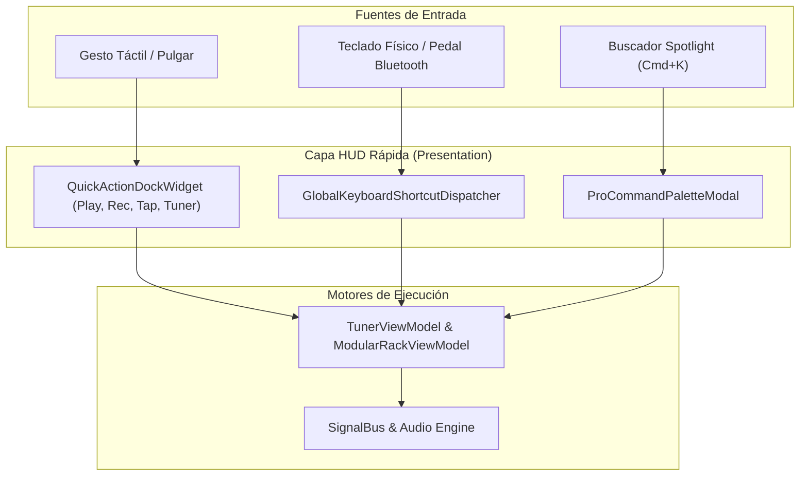

# Template: Documentation Standard (Plantilla Documentación)

## Metadatos del Documento

- **ID del Documento:** `DOC-UIUX-2026-050`
- **Título Oficial:** `Sistema Integral de UX/UI Profesional: Quick Actions Dock, Command Palette y Atajos Globales de Alta Velocidad`
- **Estado:** `Approved`
- **Fecha de Creación:** `2026-11-07`
- **Última Modificación:** `2026-11-07`
- **Fase Asociada:** `Fase 4 & Global`
- **Autor / Revisor Principal:** `Tunner UX/UI & Engineering Core Team`

---

## 1. Resumen Ejecutivo (Executive Summary)

Las aplicaciones comerciales de referencia (Moises, Ultimate Guitar Pro, Ableton Note, Logic Remote) destacan por su **fricción operativa cero**: el músico no pierde tiempo navegando por menús anidados cuando tiene un instrumento en las manos. 

Este documento especifica e implementa la capa de interacción táctil y física de grado profesional para Tunner:
1. **Quick Actions Dock (HUD Flotante):** Una barra ergonómica de acceso directo siempre visible en la parte inferior sobre la navegación, con control de transporte con un toque, botón de grabación rápida de tomas, pulsador táctil de tap-tempo y alternador de afinador instantáneo.
2. **Global Keyboard & Hardware Shortcuts:** Soporte nativo para teclados Bluetooth, controladores MIDI de pedalera y atajos de teclado estándar (`Espacio` para Play/Pause, `R` para grabar, `T` para tap-tempo, `A` para afinador, `1-5` para cambio instantáneo de vista, `Cmd/Ctrl + K` para Command Palette).
3. **Pro Command Palette (HUD Spotlight):** Buscador flotante ultrarrápido con filtros por tags (`#herramienta`, `#instrumento`, `#afinador`, `#ajuste`) que permite ejecutar cualquier acción o cargar cualquier instrumento en menos de 2 segundos.

---

## 2. Contexto del Problema y Justificación Teórica

### 2.1 Planteamiento del Problema
Cuando un músico practica:
- Sus manos están ocupadas con el mástil de la guitarra, las llaves de la flauta o el arco del violín.
- Obligar al usuario a dar 3 o 4 toques para cambiar de afinador a metrónomo o para pausar una grabación destruye la concentración pedagógica.
- La interfaz móvil estándar carece de atajos de hardware y HUDs flotantes de transporte global unificado.

### 2.2 Principios de Diseño Ergonómico y Ley de Fitts
$$\text{Tiempo de Reacción (MT)} = a + b \cdot \log_2\left(1 + \frac{D}{W}\right)$$
Donde $D$ es la distancia al botón y $W$ es el ancho del objetivo.
El **Quick Actions Dock** ubica los botones esenciales de transporte en la "Zona del Pulgar" (Thumb Zone) con un área de contacto táctil ampliada ($\ge 48\times 48 \text{ dp}$) y respuesta visual háptica inmediata $< 16\text{ ms}$ (60/120 FPS).

---

## 3. Especificación Funcional

### 3.1 Componentes de la Solución
- **REQ-UI-01 (Dock Flotante Ergonómico):** Componente `QuickActionDockWidget` flotando sobre el Scaffold principal con estado reactivo del `TunerViewModel` y `ModularRackViewModel`.
- **REQ-UI-02 (Command Palette Spotlight):** Modal de invocación rápida (`ProCommandPaletteModal`) que indexa todas las herramientas, afinadores, más de 60 instrumentos universales y configuraciones de audio.
- **REQ-UI-03 (Atajos de Teclado Globales):** Envoltorio `CallbackShortcuts` / `Focus` en `MainAppShell` que captura eventos físicos sin interferir con campos de texto abiertos.
- **REQ-UI-04 (Cheat Sheet Visual de Atajos):** Botón de ayuda rápida que despliega una tarjeta de atajos para que el usuario conozca de un vistazo todos los comandos rápidos disponibles.

---

## 4. Diagrama de Arquitectura de Interacción

