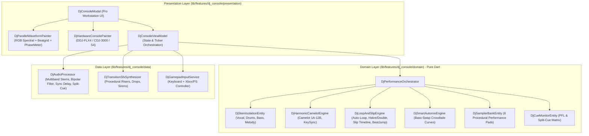

# Especificación Técnica y de Arquitectura: Estación de Trabajo DJ Profesional Autónoma para PC (Standalone Pro DJ Workstation)

---

## Metadatos del Documento

- **ID del Documento:** `DOC-DJ-2026-069`
- **Título Oficial:** `Arquitectura de Estación de Trabajo DJ Profesional Autónoma (4-Stems DSP, Mezcla Armónica Camelot, Ondas Espectrales RGB, Auto-Loops, Slip Mode, Sampler y Split-Cue)`
- **Estado:** `Approved`
- **Fecha de Creación:** `2026-11-13`
- **Última Modificación:** `2026-11-13`
- **Fase Asociada:** `Fase 2`
- **Autor / Revisor Principal:** `Equipo de Arquitectura Tunner`

---

## 1. Resumen Ejecutivo (Executive Summary)

Este documento define la arquitectura técnica y matemática para transformar el módulo de consola DJ de **Tunner** en una **Estación de Trabajo DJ Profesional Autónoma (Standalone Pro DJ Workstation)** capaz de operar al nivel de plataformas líderes de la industria (*Pioneer Rekordbox*, *Serato DJ Pro*, *Native Instruments Traktor Pro 4* y *VirtualDJ*) utilizando únicamente un computador personal (PC/Laptop), sin exigir controladores MIDI dedicados ni interfaces de audio multicanal externas.

La especificación introduce siete subsistemas de grado de estudio 100% *offline*:
1. **Aislamiento de 4 Stems en Tiempo Real (Vocals, Drums, Bass, Melody)** mediante descomposición espectral multibanda y cancelación Mid/Side en fase.
2. **Motor de Mezcla Armónica (Harmonic Mixing Engine)** con detección cromática de tonalidad, codificación en la **Rueda de Camelot (`1A`–`12B`)**, *Key-Lock* (Master Tempo) y transposición semitonal (`Key-Sync`).
3. **Visualizador Dual de Ondas Espectrales Paralelas RGB con Beatgrid y Medidor de Fase (Phase Meter)** a 60/120 FPS.
4. **Motor Cuantizado de Auto-Loops ($1/32$ a $16$ beats), Loop Roll, Slip Mode (Modo Deslizante) y Beat Jump**.
5. **Banco de Sampler de 8 Pads con Síntesis Procedural de Transiciones** (*White Noise Riser*, *Sub-Bass Drop*, *Laser Siren*, *Airhorn*, *Reverse Crash*).
6. **Motor de Automix Inteligente con Intercambio Automático de Graves (*Smart Bass-Swap Crossfade*)**.
7. **Enrutamiento de Pre-Escucha *Split-Cue* (Master L / Monitor Cue R)** para monitoreo con audífonos en PCs con una sola salida estéreo de $3.5\text{ mm}$.

---

## 2. Contexto del Problema y Justificación Teórica

### 2.1 Planteamiento del Problema
Un aspirante a DJ o profesional que desea mezclar únicamente con su computador enfrenta cuatro barreras históricas cuando carece de hardware dedicado:
1. **Ceguera Estructural y de Fase:** Sin dos pantallas de alta resolución apiladas que muestren las formas de onda coloreadas por frecuencia y la rejilla de compases (*Beatgrid*), alinear dos canciones a oído desde el teclado es propenso a desfases rítmicos (*trainwrecking*).
2. **Choques Armónicos y de Graves:** Mezclar dos canciones en tonalidades incompatibles produce disonancia cognitiva; asimismo, superponer dos líneas de bajo simultáneas satura el bus maestro.
3. **Limitación Creativa en Transiciones:** La ausencia de separación de *Stems* (crear acapellas o instrumentales al instante), *Loop Rolls*, *Slip Mode* y efectos de transición (*Risers/Drops*) limita las mezclas a simples fundidos de volumen.
4. **Imposibilidad de Pre-Escucha (Cueing) con una sola tarjeta de sonido integrada:** Los portátiles convencionales solo poseen un conector estéreo de salida, impidiendo separar la mezcla principal (altavoces) de la pre-escucha (audífonos) sin un modo *Split-Cue*.

### 2.2 Fundamento Teórico, Físico y Musical

#### A. Aislamiento de 4 Stems en Tiempo Real (Mid/Side + Filtros Crossover Linkwitz-Riley)
Para ejecutar la separación de *Stems* en tiempo real con latencia sub-$10\text{ ms}$ y cero dependencias de red o GPU propietaria, una señal estéreo $(L[n], R[n])$ se descompone inicialmente en componentes **Mid** (centro monofónico, donde residen la voz principal, el bombo y el bajo) y **Side** (imagen estéreo lateral, donde residen guitarras, sintetizadores, pads y reverberación):

$$M[n] = \frac{L[n] + R[n]}{2}, \quad S[n] = \frac{L[n] - R[n]}{2}$$

Sobre estos componentes se aplican filtros de cruce (*Crossover*) y envolventes de transitorios:
1. **Stem Bass ($B_{\text{stem}}$):** Filtrado paso-bajo de 4.º orden ($f_c = 220\text{ Hz}$) sobre $M[n]$.
2. **Stem Vocals ($V_{\text{stem}}$):** Filtrado paso-banda formántico ($f_{\text{low}} = 280\text{ Hz}, f_{\text{high}} = 3800\text{ Hz}$) sobre el canal central $M[n]$ con atenuación de crestas percusivas.
3. **Stem Drums ($D_{\text{stem}}$):** Detección diferencial de envolvente rápida ($\tau_{\text{attack}} = 2\text{ ms}$, $\tau_{\text{release}} = 45\text{ ms}$) que extrae los impactos transitorios de bombo, caja y *hi-hats* ($> 4000\text{ Hz}$).
4. **Stem Melody / Harmonic ($H_{\text{stem}}$):** Componente lateral $S[n]$ combinado con el residuo armónico sostenido.

La señal reconstruida ponderada por los estados de silenciamiento/volumen $(\alpha_B, \alpha_D, \alpha_V, \alpha_H \in [0.0, 1.0])$ garantiza reconstrucción coherente cuando todos los coeficientes valen $1.0$.

#### B. Detección de Tonalidad y Grafo de la Rueda de Camelot
El vector de energía cromática (*Pitch Class Profile* o *Chromagram*) $\mathbf{c} = [c_0, c_1, \dots, c_{11}]$ acumula la magnitud espectral de cada una de las 12 clases de alturas ($C, C\sharp, \dots, B$). La correlación de Pearson $r$ frente a los perfiles mayores y menores de Krumhansl-Kessler determina la tonalidad óptima.

Cada tonalidad se proyecta en la **Rueda de Camelot**, donde números adyacentes están separados por una quinta justa ($\pm 7$ semitonos). Dos pistas con códigos $(N_1, L_1)$ y $(N_2, L_2)$ donde $N \in \{1\dots 12\}$ y $L \in \{A, B\}$ son armónicamente compatibles si:
1. **Unísono Exacto:** $N_1 = N_2 \land L_1 = L_2$ (Distancia $= 0$).
2. **Quinta Dominante / Subdominante:** $((N_1 - N_2) \bmod 12 \in \{1, 11\}) \land (L_1 = L_2)$.
3. **Relativo Mayor / Menor:** $(N_1 = N_2) \land (L_1 \neq L_2)$.
4. **Salto de Energía Semitonal (*Energy Boost*):** $((N_2 - N_1) \bmod 12 \in \{2, 7\}) \land (L_1 = L_2)$.

#### C. Cuantización de Auto-Loops y Slip Mode (Línea de Tiempo Dual)
Dado un tempo efectivo $\text{BPM}_{\text{eff}}$ y una fracción de bucle $b \in \{1/32, 1/16, 1/8, 1/4, 1/2, 1, 2, 4, 8, 16\}$ beats, la duración exacta del bucle en milisegundos es:

$$T_{\text{loop}} = b \cdot \left(\frac{60000}{\text{BPM}_{\text{eff}}}\right)\text{ ms}$$

Cuando **Slip Mode** está activo, el reproductor mantiene dos punteros temporales independientes:
- $t_{\text{audible}}$: Posición actual reproducida (afectada por bucles, *scratches* o *Hot Cues*).
- $t_{\text{slip}}$: Reloj fantasma en segundo plano que avanza de forma monótona a razón de $\Delta t \cdot \text{pitchMultiplier}$. Al liberar la acción momentánea, se asigna instantáneamente $t_{\text{audible}} \leftarrow t_{\text{slip}}$, conservando intacta la frase musical.

#### D. Enrutamiento Split-Cue para PC con Salida Estéreo Única
En modo **Split-Cue**, la matriz de salida estéreo $(Out_L[n], Out_R[n])$ separa físicamente los canales:

$$Out_L[n] = \text{MasterMix}[n] \quad (\text{hacia altavoces principales})$$

$$Out_R[n] = \text{CueMix}[n] \quad (\text{hacia auriculares del DJ})$$

---

## 3. Especificación Funcional Detallada

### 3.1 Requerimientos del Sistema
- **REQ-DJ-PRO-01 (4-Stems en Tiempo Real):** Cada Deck (A y B) debe disponer de controles independientes (botones Kill y niveles) para `VOCAL`, `DRUMS`, `BASS` y `MELODY`, ejecutables por clic, teclado o mando de consola.
- **REQ-DJ-PRO-02 (Mezcla Armónica Camelot y Key-Sync):** Cada Deck debe mostrar su notación Camelot (`8A`, `8B`, etc.), el indicador de compatibilidad armónica con el Deck opuesto (`PERFECT MATCH`, `HARMONIC STEP`, `ENERGY BOOST`, `KEY CLASH`), control de *Key-Lock* y botón `KEY SYNC` que ajusta los semitonos automáticamente.
- **REQ-DJ-PRO-03 (Ondas Espectrales Paralelas RGB y Phase Meter):** Panel superior de doble onda apilada con codificación RGB (Bajos en rojo, Medios en verde, Agudos en azul), marcas de *Beatgrid* y barra central de alineación de fase (*Phase Meter*).
- **REQ-DJ-PRO-04 (Auto-Loops, Loop Roll, Slip Mode y Beat Jump):** Controles de bucle automático cuantizado ($1/4$, $1/2$, $1$, $2$, $4$, $8$ beats), botones `1/2x` (dividir bucle) y `2x` (duplicar bucle), interruptor `SLIP` y botones `BEAT JUMP` ($\pm 1, \pm 4$ beats).
- **REQ-DJ-PRO-05 (Sampler de 8 Pads Procedural):** Rack de 8 pads de efectos de transición generados matemáticamente (*Airhorn*, *White Noise Riser*, *Sub Drop*, *Laser Siren*, *Vinyl Brake*, *Backspin*, *Crowd Cheer Synth*, *Stutter Impact*) con control de volumen propio.
- **REQ-DJ-PRO-06 (Automix Inteligente con Bass-Swap):** Motor de transición automática programable (duración en compases) que mueve el crossfader suavemente e intercambia automáticamente las bandas `LOW EQ` a mitad del recorrido para evitar colisión de graves.
- **REQ-DJ-PRO-07 (Pre-Escucha PFL y Modo Split-Cue):** Botones `CUE (PFL)` por canal, mezcla `CUE / MASTER` para audífonos y conmutador `SPLIT-CUE MONO` para usuarios que mezclan únicamente con la salida de audio integrada del PC.

### 3.2 Casos de Borde y Condiciones de Error
- **División de Bucle Mínima:** Al presionar `1/2x` repetidamente, el bucle se limita a un piso de $1/32$ de beat ($\ge 15\text{ ms}$) para evitar bloqueos o zumbidos por oscilación de buffer.
- **Límite de Transposición Armónica (`Key-Sync`):** El ajuste automático de tonalidad busca la distancia mínima en semitonos dentro del rango $[-6, +6]$ semitonos para preservar la naturalidad de los formantes vocales.
- **Cancelación de Automix por Intervención Manual:** Si el usuario mueve manualmente el crossfader o presiona Play/Cue durante una transición de *Automix*, el motor cede inmediatamente el control al humano sin saltos bruscos de ganancia.

---

## 4. Diseño Técnico y Arquitectura de la Solución

---

## 5. Criterios de Rendimiento y Benchmarking

- **Latencia de Procesamiento de Stems y FX:** $\le 4\text{ ms}$ para un bloque estéreo de 256 muestras a $44100\text{ Hz}$.
- **Fluidez Gráfica de Ondas Paralelas RGB:** Renderizado vectorial a $60/120\text{ FPS}$ constantes (`< 2.5 ms` de tiempo de `paint` por frame).
- **Asignación de Memoria:** Pre-alocación de `Float32List` para síntesis de *Sampler* y perfiles de onda, garantizando cero recolecciones de basura (GC pauses) durante la mezcla en vivo.

---

## 6. Plan de Pruebas y Validación (QA)

- [ ] Pruebas unitarias de `DjHarmonicCamelotEngine`: verificación de las 24 claves musicales, distancias en la rueda de Camelot y cálculo óptimo de semitonos en `Key-Sync`.
- [ ] Pruebas unitarias de `DjStemIsolationEntity` y procesamiento DSP multibanda: verificación de atenuación selectiva de frecuencias y reconstrucción sin *clipping*.
- [ ] Pruebas unitarias de `DjLoopAndSlipEngine`: cuantización exacta de bucles, `halveLoop`, `doubleLoop`, `beatJump` y restauración de puntero con `Slip Mode`.
- [ ] Pruebas unitarias de `DjSmartAutomixEngine`: progreso de transición y activación del intercambio automático de bajos (*Bass-Swap*) al cruzar el punto central.
- [ ] Pruebas de widgets (`flutter test`) validando la interacción completa en la interfaz profesional de DJ.

---

## 7. Referencias Técnicas y Bibliografía

1. *Krumhansl, C. L. (1990). Cognitive Foundations of Musical Pitch. Oxford University Press.*
2. *Mark Davis — The Camelot Easymix System (Harmonic Mixing Circle of Fifths Notation).*
3. *Zölzer, U. (2011). DAFX: Digital Audio Effects (2nd ed.). Wiley — Time-Domain Crossover Filters & Mid/Side Processing.*
