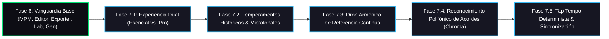

# Investigación Integral del Estado del Arte y Hoja de Ruta de Vanguardia: Tunner Studio

Este documento establece el diagnóstico exhaustivo de estado del arte en software musical digital, acústica de conservatorio y experiencia de usuario (UX), definiendo la hoja de ruta estratégica para consolidar a **Tunner** como el ecosistema musical abierto más avanzado del mundo.

---

## Metadatos del Documento

- **ID del Documento:** `DOC-VANGUARD-ROADMAP-2026-001`
- **Título Oficial:** Diagnóstico del Estado del Arte, Arquitectura de Experiencia Dual y Hoja de Ruta de Vanguardia
- **Estado:** `Approved`
- **Fecha de Creación:** 2026-10-27
- **Fase Asociada:** `Fase 7 (Vanguardia Absoluta)`
- **Autor / Revisor Principal:** Nicolas Leon / Antigravity Engine

---

## 1. Resumen Ejecutivo (Executive Summary)

Tunner ha alcanzado hitos sin precedentes en software libre: detección estroboscópica microtonal con McLeod Pitch Method (MPM), síntesis en memoria con envolvente ADSR, editor interactivo SMuFL con historial Memento, exportadores canónicos W3C MusicXML y MIDI binario SMF, transcripción de micrófono a partitura en tiempo real y laboratorio de análisis de timbre con 8 armónicos, centroide y THD.

Para posicionar a Tunner en el nivel definitivo de adopción global, se identifican dos ejes cardinales de evolución:
1. **El Paradigma de la Experiencia Dual (Dual Experience Paradigm):**
   Una plataforma que sirve a dos públicos radicalmente distintos sin comprometer a ninguno:
   * **Usuario Esencial / Principiante:** Interfaz limpia, monumental, minimalista y libre de distracciones, que en menos de 1 segundo muestra la aguja estroboscópica, la nota detectada y la afinación perfecta.
   * **Usuario Conservatorio / Profesional / Investigador:** Acceso inmediato a la estación de trabajo acústica completa: partitura vectorial SMuFL, consola multicanal de stems, laboratorio de armónicos, generador procedural de escalas, transcripción y analítica 4D.
2. **Capacidades Acústicas de Vanguardia Mundial:**
   * **Motor de Temperamentos Históricos y Microtonales:** Temperamento Igual ($12\text{-TET}$), Pitagórico, Justo (Ptolemaico), Mesotónico de 1/4 de coma, Werckmeister III, Kirnberger III y Vallotti.
   * **Dron Armónico de Referencia Continua (Tone Drone Studio):** Síntesis de notas pedal para entrenamiento del oído interno y afinación interválica pura.
   * **Reconocimiento Polifónico de Acordes (Pitch Class Profile / Chroma Vectors):** Identificación instantánea de tríadas y cuatriadas mayores, menores, disminuidas y de séptima mediante vectores de cromagrama en tiempo real.
   * **Tap Tempo Determinista:** Medición y calibración de tempo por pulsación rítmica con filtrado de jitter.

---

## 2. Análisis Comparativo con el Estado del Arte

| Dimensión Técnica | Afinadores Convencionales | TonalEnergy / Peterson Pro | MuseScore / Sibelius | Tunner (Meta Fase 7) |
| :--- | :--- | :--- | :--- | :--- |
| **Arquitectura de UI** | Fija / Sobrecargada o muy básica | Compleja, curva alta | Compleja de escritorio | **Dual Adaptativa (Esencial vs. Conservatorio Pro)** |
| **Precisión de Tono** | $\pm 1 - 5\text{ cents}$ (FFT cruda) | $\pm 0.1\text{ cents}$ (Strobe) | N/A (Solo edición) | **$\pm 0.1\text{ cents}$ (MPM + NSDF + Interp. Parabólica)** |
| **Temperamentos** | Solo Temperamento Igual (12-TET) | Históricos limitados | N/A | **7 Temperamentos Canónicos de Conservatorio** |
| **Notación Musical** | Inexistente | Básica no estándar | SMuFL completa en PC | **SMuFL Vectorial en vivo 60/120 FPS Offline** |
| **Transcripción Micrófono** | N/A | N/A | Offline / Pago | **Mic-to-Score en vivo con Cuantizador Rítmico** |
| **Análisis de Timbre** | N/A | Espectrograma básico | N/A | **8 Armónicos + Centroide Espectral + THD%** |
| **Reconocimiento Acordes** | N/A | N/A | N/A | **Vector Chroma 12-TET en Tiempo Real** |
| **Generador Técnico** | N/A | N/A | Plugins de terceros | **Procedural de Escalas, Arpegios y Rutinas** |
| **Privacidad & Offline** | Telemetría / Cloud | Cerrado / Pago | Cerrado / Desktop | **100% Offline First, AGPLv3, Clean Architecture** |

---

## 3. Hoja de Ruta de Implementación por Fases (Phased Implementation Roadmap)

### Fase 7.1: Experiencia Dual Progresiva (Modo Esencial Minimalista vs. Modo Conservatorio Pro)
- **Objetivo:** Ofrecer una experiencia visual limpia, monumental y enfocada para afinación rápida sin fricción, y permitir conmutar con 1 toque al entorno integral de conservatorio.
- **Persistencia:** Guardar y restaurar la preferencia del usuario atómicamente.

### Fase 7.2: Motor de Temperamentos Históricos y Microtonales
- **Objetivo:** Implementar los 7 sistemas de afinación canónicos en el dominio puro:
  1. *Temperamento Igual (Equal Temperament, 12-TET)*
  2. *Pitagórico (Pythagorean Tuning - Quintas puras 3:2)*
  3. *Justo / Ptolemaico (Just Intonation - Terceras mayores puras 5:4)*
  4. *Mesotónico de 1/4 de coma (Quarter-comma Meantone)*
  5. *Werckmeister III (Temperamento circular barroco de J.S. Bach)*
  6. *Kirnberger III*
  7. *Vallotti & Tartini*
- **Recálculo Físico en Vivo:** Ajuste microtonal de frecuencias diapasón, cents y desviaciones estroboscópicas.

### Fase 7.3: Dron Armónico de Referencia Continua (Tone Drone Studio)
- **Objetivo:** Generador procedural de notas pedal continuas (fundamental y quinta justa) en cualquier tonalidad y temperamento activo para práctica de entonación.

### Fase 7.4: Reconocimiento Polifónico de Acordes (Pitch Class Profile & Chroma)
- **Objetivo:** Cálculo del vector de 12 clases cromáticas $[C, C\sharp, D\dots B]$ y clasificación probabilística de tríadas y cuatriadas mayores, menores, disminuidas, aumentadas y de séptima.

### Fase 7.5: Tap Tempo Determinista con Filtrado de Jitter
- **Objetivo:** Medición del pulso manual mediante promedio móvil ponderado de intervalos temporales con rechazo de valores atípicos.
