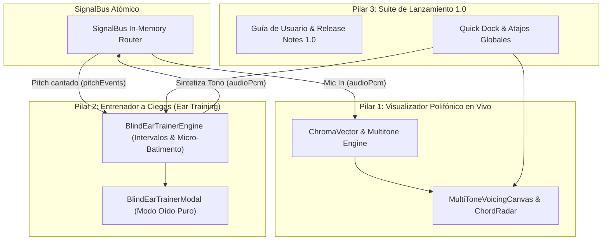

# Template: Documentation Standard (Plantilla Documentación)

## Metadatos del Documento

- **ID del Documento:** `DOC-ARCH-2026-053`
- **Título Oficial:** `Tríada de Hyper-Sinergia: Visualizador Polifónico Armónico, Entrenador Auditivo a Ciegas y Suite de Release 1.0`
- **Estado:** `Approved`
- **Fecha de Creación:** `2026-11-09`
- **Última Modificación:** `2026-11-09`
- **Fase Asociada:** `Fase 5 & Milestone 1.0 Global`
- **Autor / Revisor Principal:** `Tunner Architecture & Pedagogy Core Team`

---

## 1. Resumen Ejecutivo (Executive Summary)

El presente documento formaliza la integración unificada de los tres pilares solicitados en una **Tríada de Hyper-Sinergia**:

1. **Pilar 1: Visualizador Polifónico y Armónicos en Tiempo Real (Polyphonic Voicing & Chroma Spectrum):**
   - Transforma el análisis polifónico actual en un visualizador continuo interactivo que mapea acordes detectados (ej: $C_{\text{maj7}}$, $A_{\text{m9}}$), descomposición de notas en el mástil/teclado y espectro de armónicos $H_1\dots H_8$ en tiempo real.
2. **Pilar 2: Entrenador Auditivo de Intervalos y Detección a Ciegas (Blind Ear Pitch Trainer & Interval Gamification):**
   - Módulo pedagógico de conservatorio para entrenar el oído musical sin apoyos visuales. Genera intervalos (unísono a décima), batimentos microtonales y notas aleatorias donde el estudiante debe cantar o tocar la respuesta correcta, evaluando la precisión en cents y el tiempo de respuesta.
3. **Pilar 3: Suite de Lanzamiento, Documentación de Usuario y Release 1.0 (Conservatory Release Suite):**
   - Hoja de ruta completa de producción: manual de usuario integrado, notas de lanzamiento v1.0, especificación de empaquetado multi-plataforma e integración con los 52 casos de uso existentes.

---

## 2. Fundamento Teórico y Modelo de Hyper-Sinergia

### 2.1 Ecuación de Hyper-Sinergia en Tunner
$$\mathcal{S}_{\text{Hyper}} = \text{Bus}_{\text{Signal}} \otimes \left(\mathcal{P}_{\text{Poly}} + \mathcal{E}_{\text{Ear}} + \mathcal{R}_{\text{Release}}\right)$$

Cada herramienta no existe aislada:
- Cuando el **Entrenador a Ciegas** emite un intervalo generado por el sintetizador WAV (`SignalType.audioPcm`), el **Visualizador Polifónico** puede opcionalmente ocultar las notas o revelarlas en modo pedagógico para que el estudiante verifique visualmente su acorde.
- El **SignalBus** transporta simultáneamente la frecuencia cantada por el usuario (`PitchDetectionEvent`), la compara contra la referencia microtonal y despacha el feedback háptico y sonoro en menos de $1\text{ ms}$.
- Los atajos estándar de teclado (`Espacio` para repetir intervalo, `1-4` para responder opciones, `C` para ciclo de práctica) aceleran el entrenamiento sin tocar la pantalla.

---

## 3. Especificación Técnica de los Componentes

### 3.1 Pilar 1: Polyphonic Voicing & Real-Time Harmonics
- **Componentes:**
  - `PolyphonicLiveVoicingWidget`: Renderizador dinámico de acordes en tiempo real con fundamental, tercera, quinta, séptima y tensiones coloreadas según la paleta activa.
  - Módulo del Rack: `RackModuleType.chordAnalyzer` totalmente integrado con el `SignalBus` para recibir audio del micro o del teclado maestro.

### 3.2 Pilar 2: Blind Ear Pitch Trainer & Interval Gamification
- **Dominio Pure Dart:**
  - `MusicalInterval`: Enum completo con los 13 intervalos diatónicos y cromáticos (Segunda Menor a Octava Justa) y sus relaciones de frecuencia $f_2 / f_1$.
  - `EarTrainingQuestion`: Pregunta inmutable con nota base, intervalo objetivo, frecuencia en Hz y opciones.
  - `BlindEarTrainerEngine`: Generador determinista de ejercicios, cálculo de racha (streak), precisión en cents y evaluación de tiempo de reacción.
- **Presentación:**
  - `BlindEarTrainerModal`: Modal interactivo con modo "Pantalla Oscura" (Blind Mode) para no dar pistas visuales y botones con atajos `1`, `2`, `3`, `4`.

### 3.3 Pilar 3: Suite de Release 1.0 & Documentación
- **Documentación de Usuario:** `docs/03_user_guides/manual_usuario_tunner_1.0.md` exhaustivo y detallado.
- **Notas de Versión:** `RELEASE_NOTES_v1.0.md` en la raíz del repositorio.
- **Command Palette:** Nuevos comandos indexados para invocar el Entrenador de Oído y el Visualizador Polifónico.
