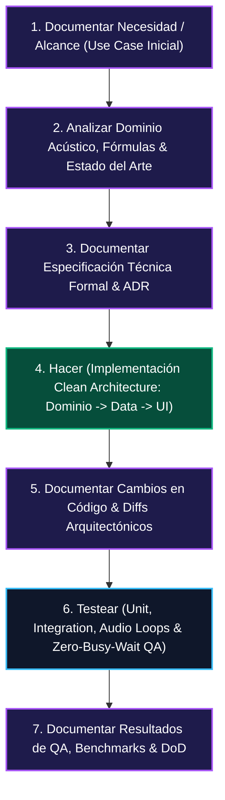
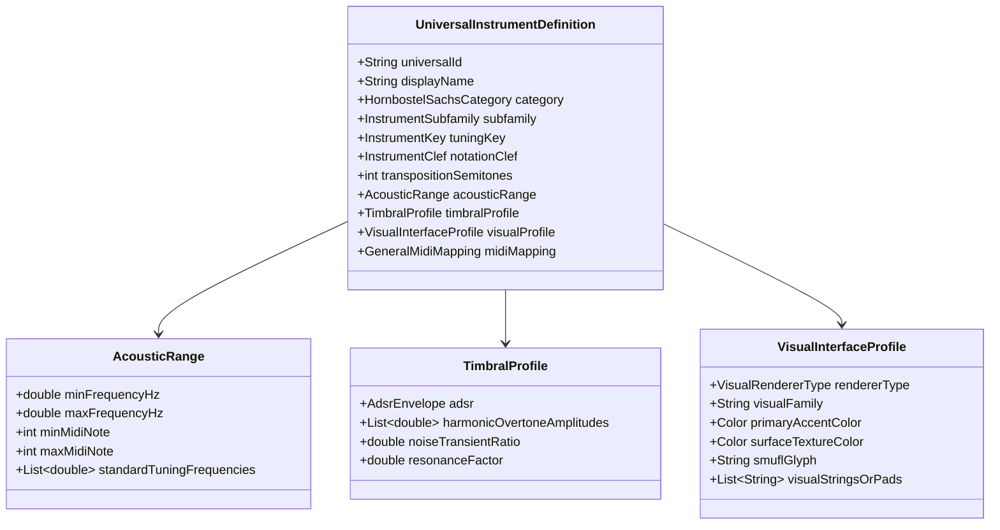

# Documento de Arquitectura y Taxonomía Universal de Instrumentos: Metodología Clean Architecture

---

## Metadatos del Documento

- **ID del Documento:** `DOC-ARCH-2026-0048`
- **Título Oficial:** Motor Universal de Emulación de Instrumentos, Taxonomía Jerárquica de IDs, Propiedades Acústico-Visuales y Ciclo Riguroso Clean Architecture
- **Estado:** Approved
- **Fecha de Creación:** 2026-11-06
- **Última Modificación:** 2026-11-06
- **Fase Asociada:** Fase 4 (Estudio de Producción, Orquestación y Emulación Universal)
- **Autor / Revisor Principal:** Equipo de Arquitectura Tunner & Creador del Proyecto

---

## 1. El Ciclo de Ingeniería Riguroso (The 7-Step Cycle)

Para garantizar la máxima calidad técnica, mantenibilidad y alineación con la constitución de [AGENTS.md](../../AGENTS.md), cada avance sigue estrictamente el ciclo iterativo de 7 pasos:

---

## 2. Taxonomía Universal de IDs para Instrumentos Musicales

Para permitir búsquedas instantáneas, filtrado taxonómico eficiente en Dart y ordenamiento semántico, se adopta un estándar unificado basado en la clasificación etnomusicológica **Hornbostel-Sachs (HS)** combinada con el estándar **General MIDI (GM1 / GM2)** y el **Standard Drum Map (Canal 10)**.

### 2.1 Estructura del ID Universal
$$\text{UniversalInstrumentID} = \text{CategoríaHS} \mathbin{.} \text{Subfamilia} \mathbin{.} \text{CódigoInstrumento}$$

Ejemplos:
- `chordophone.plucked.guitar_electric_standard`
- `aerophone.woodwind.flute_concert_c`
- `aerophone.brass.trumpet_bb`
- `idiophone.pitched_percussion.marimba_concert`
- `membranophone.drums_acoustic.snare_drum_concert`
- `membranophone.latin.conga_quinto`
- `electrophone.synth.synth_lead_saw`
- `vocal.human.voice_soprano`

### 2.2 Tabla Maestra de Categorías y Familias Universales

| Categoría Hornbostel-Sachs | Subfamilia | Rango General MIDI | Clave Musical Típica | Tipo de Entrada / Sensor Visual |
| :--- | :--- | :--- | :--- | :--- |
| **`aerophone`** (Vientos) | `woodwind` (Maderas) | GM 64-79 | Sol (𝄞) / Fa (𝄢) | Esquema de Llaves / Columna de Aire |
| **`aerophone`** (Vientos) | `brass` (Metales) | GM 56-63 | Sol (𝄞) / Fa (𝄢) | Pistones / Varas / Embocadura |
| **`chordophone`** (Cuerdas) | `plucked` (Pulsadas) | GM 24-39 | Sol (𝄞) / Fa (𝄢) | Diapasón con Trastes (Fretboard) |
| **`chordophone`** (Cuerdas) | `bowed` (Frotadas) | GM 40-47 | Sol / Do / Fa | Diapasón Continuo (Fretless / Fingerboard) |
| **`chordophone`** (Teclados) | `keyboard` (Teclados/Arpas) | GM 0-15 | Doble Pentagrama | Teclas de Piano (Keybed) |
| **`idiophone`** (Perc. Afinada) | `pitched_percussion` | GM 8-15 | Sol / Fa / Percusión | Láminas de Madera / Metal (Mallets) |
| **`idiophone`** (Perc. Indeterminada)| `latin` / `auxiliary` | GM Drum Map (35-81) | Clave de Percusión (𝄵) | Pads Táctiles / Transientes de Ataque |
| **`membranophone`** (Parches) | `drums_acoustic` / `ethnic`| GM Drum Map (35-81) | Clave de Percusión (𝄵) | Parches de Tambor / Sensores de Impacto |
| **`electrophone`** (Electrónicos)| `synth` / `bass_synth` | GM 80-103 | Sol / Fa | Oscilador / Filtro / Envolvente |
| **`vocal`** (Voz Humana) | `human` | N/A (Micrófono) | Sol / Fa | Visualizador de Formantes y Curva Tonal |

---

## 3. Modelo de Dominio de Instrumento Universal (`UniversalInstrumentDefinition`)

Para poder **emular cualquier instrumento acústico o electrónico** de manera determinista y sin dependencias externas, cada instrumento se modela mediante cuatro pilares inmutables de Clean Architecture:

### 3.1 Propiedades Físicas y Acústicas (`AcousticRange`)
- Rango de frecuencias exacto en Hertz: $[f_{\text{min}}, f_{\text{max}}]$.
- Frecuencias de afinación de referencia para cuerdas abiertas o parches (ej. Guitarra Standard: $82.41\text{ Hz } (E_2), 110.0\text{ Hz } (A_2), 146.83\text{ Hz } (D_3), 196.0\text{ Hz } (G_3), 246.94\text{ Hz } (B_3), 329.63\text{ Hz } (E_4)$).

### 3.2 Propiedades Tímbricas y Síntesis Procedural (`TimbralProfile`)
- **Envolvente ADSR:**
  - *Attack Time ($t_a$):* De $1\text{ ms}$ en un xilófono o caja hasta $150\text{ ms}$ en una flauta o violín legato.
  - *Decay Time ($t_d$):* Tiempo de caída al nivel sostenido.
  - *Sustain Level ($L_s$):* Nivel de amplitud mientras se mantiene el aire o la cuerda ($0.0$ en percusión percutida, $>0.7$ en vientos y órganos).
  - *Release Time ($t_r$):* Desvanecimiento tras soltar la tecla o cesar el sonido.
- **Espectro de Armónicos:** Amplitud relativa de los primeros 8 armónicos $A_1, A_2, \dots, A_8$, permitiendo generar en síntesis procedural un sonido representativo de flauta (fundamental pura), clarinete (armónicos impares dominantes) o guitarra acústica (armónicos ricos).

### 3.3 Propiedades Visuales y Estéticas (`VisualInterfaceProfile`)
- **Tipo de Renderizador Táctil:**
  - `fretboard`: Muestra mástil con trastes, cuerdas animadas y puntos de posición (Guitarras, Bajos, Ukeleles, Banjo).
  - `fingerboard`: Muestra diapasón liso sin trastes con líneas guía de entonación sutiles y visualizador de vibrato (Violín, Viola, Cello, Contrabajo).
  - `keybed`: Teclado interactivo con teclas blancas y negras iluminadas (Piano, Clavecín, Órgano, Acordeón).
  - `malletBars`: Teclas de percusión afinada (Marimba, Xilófono, Vibráfono, Glockenspiel).
  - `drumPads`: Cuadrícula de pads táctiles sensibles a dinámica (Batería acústica, Timbales, Congas, Bongós, Platillos).
  - `valveGrid`: Esquema de digitación y presión de aire (Trompeta, Trompa, Tuba, Saxofón, Flauta).
  - `vocalCurve`: Curva de entonación continua y diagrama de formantes para la voz humana.
- **Paleta Estética Adaptativa:** Cada instrumento define sus colores y texturas de estudio (ej. acabado nogal/arce para acústicos, latón dorado brillante para metales, titanio oscuro para sintetizadores).

---

## 4. Desglose Exhaustivo de Subtareas para la Implementación

```mermaid
graph TD
    classDef domain fill:#1E1B4B,stroke:#A855F7,stroke-width:2px,color:#fff;
    classDef data fill:#064E3B,stroke:#10B981,stroke-width:2px,color:#fff;
    classDef ui fill:#0F172A,stroke:#38BDF8,stroke-width:2px,color:#fff;
    classDef qa fill:#334155,stroke:#94A3B8,stroke-width:2px,color:#fff;

    subgraph "Subtareas Paso 1: Dominio"
        T1["T-01: UniversalInstrumentId & Taxonomía Hornbostel-Sachs"]:::domain
        T2["T-02: AcousticRange, TimbralProfile (ADSR) & VisualProfile"]:::domain
        T3["T-03: Catálogo Universal Maestro (Vientos, Cuerdas, Percusiones, Voces, Teclados)"]:::domain
        T4["T-04: SignalBus, PortId & Conexiones Punto a Punto / Broadcast"]:::domain
        T5["T-05: Tests Unitarios de Dominio (100% Cobertura)"]:::qa
    end

    subgraph "Subtareas Paso 2: Infraestructura y Síntesis"
        T6["T-06: Motor de Síntesis Procedural Timbral (Osciladores ADSR Offline)"]:::data
        T7["T-07: Conectores de Stream de Audio & Pitch al SignalBus"]:::data
        T8["T-08: Tests de Integración de Audio y Despacho de Señales"]:::qa
    end

    subgraph "Subtareas Paso 3: Presentación y UX"
        T9["T-09: ModularRackViewModel & Orquestación Multitarea"]:::ui
        T10["T-10: MultitaskMasterConsoleWidget (Transporte & Matriz de IDs)"]:::ui
        T11["T-11: RackUnitCard con Estilo Adaptativo por Instrumento"]:::ui
        T12["T-12: Renderizadores Táctiles (Fretboard, Fingerboard, Mallet, DrumPads, Keybed, Viento)"]:::ui
        T13["T-13: ModularStudioRackView con Drag & Drop y Drawer de Módulos"]:::ui
        T14["T-14: Integración en MainAppShell & Flujo General"]:::ui
    end

    subgraph "Subtareas Paso 4: QA, Lints & Documentación Final"
        T15["T-15: flutter analyze & flutter test de Regresión"]:::qa
        T16["T-16: Documentación Final de Entrega y Cierre de DoD"]:::domain
    end

    T1 --> T2 --> T3 --> T4 --> T5
    T5 --> T6 --> T7 --> T8
    T8 --> T9 --> T10 --> T11 --> T12 --> T13 --> T14
    T14 --> T15 --> T16
```

---

## 5. Criterios de Aceptación (Definition of Done)
1. Catálogo completo de instrumentos cubriendo Vientos, Cuerdas frotadas y pulsadas, Teclados, Percusiones afinadas e indeterminadas, Batería, Electrónicos y Voces, todos identificados por IDs universales ordenables (`HS.subfamilia.codigo`).
2. Cada instrumento cuenta con sus clases de propiedades físicas, tímbricas (ADSR), mapeo MIDI y estética visual asociada.
3. El `SignalBus` permite conectar cualquier salida a cualquier entrada por ID (en modo específico o broadcast).
4. La Consola Multitarea coordina el transporte global sincronizado.
5. Cobertura de pruebas unitarias $\ge 90\%$ y `flutter analyze` con 0 errores y 0 warnings.
