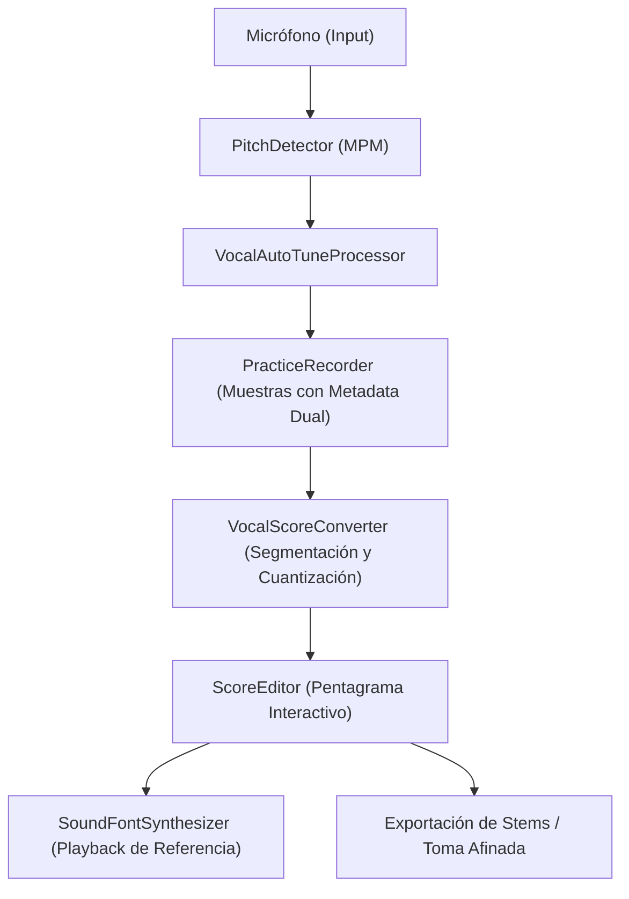

# Especificación Técnica: Suite Vocal con Auto-Tune en Tiempo Real, Grabación Multitrack y Corrección Tonal sobre Pentagrama (Melodyne-Style)

---

## Metadatos del Documento

- **ID del Documento:** `DOC-ARCH-2026-060`
- **Título Oficial:** Suite Vocal con Auto-Tune en Tiempo Real, Grabación Multitrack y Edición Microtonal sobre Pentagrama
- **Estado:** `Approved`
- **Fecha de Creación:** `2026-11-10`
- **Última Modificación:** `2026-11-10`
- **Fase Asociada:** `Fase 2 / Global (Multi-Tool Ecosystems)`
- **Autor / Revisor Principal:** `Tunner Core Engineering Team`

---

## 1. Resumen Ejecutivo (Executive Summary)

Este documento especifica la integración sinérgica profunda entre el motor de afinación en tiempo real (**Vocal Auto-Tune**), la captura multicanal (**Practice Recorder**), la notación gráfica interactiva (**Sheet Music / Score Editor**) y la reproducción tímbrica (**SoundFont SF2 Synthesizer**).

Hasta el momento, estas cuatro herramientas operaban como subsistemas desacoplados: el Auto-Tune cuantizaba el pitch en tiempo real para feedback inmediato, la grabadora capturaba eventos de audio/pitch brutos, y el editor de partituras requería transcripción manual o secuenciación sintética. Esta especificación unifica los cuatro componentes en un flujo de producción profesional y pedagógico inspirado en el estándar de la industria (Antares Auto-Tune + Celemony Melodyne + DAW Multitrack):

$$\text{Voz en Vivo} \longrightarrow \text{Auto-Tune en Tiempo Real} \longrightarrow \text{Toma Multitrack con Metadata Dual} \longrightarrow \text{Editor Microtonal en Pentagrama} \longrightarrow \text{Resíntesis SoundFont}$$

---

## 2. Contexto del Problema y Justificación Teórica

### 2.1 Planteamiento del Problema
En la práctica del canto lírico y contemporáneo, los estudiantes y vocalistas enfrentan tres limitaciones críticas con las aplicaciones actuales:
1. **Falta de trazabilidad tonal:** Los vocalistas escuchan su voz procesada o ven la aguja de afinación en el instante, pero al terminar la grabación no pueden inspeccionar visualmente en qué notas exactas desafinaron ni en cuántos cents.
2. **Desconexión entre audio grabado y partitura musical:** Las grabadoras convencionales capturan archivos WAV o arrays de muestras sin vincularlos a compases, alturas de escala ni duraciones métricas.
3. **Imposibilidad de corrección pedagógica asistida:** Cuando un estudiante graba una frase vocal con imperfecciones, no puede "corregir" la partitura resultante para escuchar de inmediato cómo debió haber sonado en su tesitura exacta con un instrumento de referencia.

### 2.2 Fundamento Físico y Matemático de la Corrección Tonal

#### Muestra Dual (Raw vs Corrected)
Cada muestra capturada durante la sesión vocal contiene la frecuencia fundamental detectada $f_{\text{raw}}$ y la frecuencia meta cuantizada por la escala $f_{\text{target}}$:

$$\Delta_{\text{cents}} = 1200 \cdot \log_2\left(\frac{f_{\text{raw}}}{f_{\text{target}}}\right)$$

#### Factor de Cuantización Proporcional (Retune Speed & Humanize)
La corrección en tiempo real aplica un filtro exponencial continuo con constante de tiempo $\tau$ proporcional a la velocidad de retune:

$$f_{\text{out}}(t) = f_{\text{raw}}(t) + \alpha \cdot \left(f_{\text{target}}(t) - f_{\text{raw}}(t)\right)$$

donde $\alpha \in [0.0, 1.0]$ representa la rigidez o fuerza del Auto-Tune ($\alpha = 1.0$ modo robótico duro estilo T-Pain/Cher, $\alpha = 0.5$ asistencia vocal sutil y natural).

#### Discretización de Notas Vocales a Estructura de Pentagrama
El flujo vocal segmenta las muestras continuas en notas discretas (`VocalPitchSegment`) mediante detección de onsets basada en saltos de frecuencia $\Delta \text{semitonos} \ge 0.8$ o transiciones sonoras $\text{RMS} < \text{Gate}$. Cada segmento contiene:
- `pitchName`: Nota musical identificada (ej. Do4 / C4).
- `midiNumber`: Altura MIDI continua media.
- `centsAverage`: Desviación media acumulada en cents.
- `durationTicks`: Duración cuantizada a la cuadrícula de semicorcheas (1 a 16 ticks).

---

## 3. Especificación Funcional Detallada

### 3.1 Requerimientos Funcionales
- **REQ-01 (Metadata Dual en Grabación):** Cada muestra capturada en `PracticeRecordingEntity` / `MultiTrackSessionEntity` debe incluir `correctedPitchHz`, `centsDeviation` y `isAutoTuned`.
- **REQ-02 (Conversión Automática Toma $\to$ Pentagrama Editable):** Al finalizar la toma, el usuario puede convertirla con 1 tap a un paquete de partitura (`SongPackage`) editable en el `ScoreEditor`.
- **REQ-03 (Edición Microtonal de Tono):** En el editor de partituras, cada nota derivada de la toma vocal puede ajustarse en semitonos o microtonalmente ($\pm 5$ cents).
- **REQ-04 (Cuantización Global de Notas a Escala con 1 Tap):** Botón `Alinear notas a escala activa` que reajusta automáticamente todas las notas desafinadas al grado modal más cercano.
- **REQ-05 (Audición Inmediata con Timbre SoundFont):** Reproducción de la toma afinada utilizando el motor SoundFont SF2 local (ej. patch 54 "Voice Oohs" o instrumento acústico activo).

### 3.2 Casos de Borde y Condiciones de Error
- **Silencios prolongados o respiraciones:** Se descartan de la partitura y se traducen en silencios métricos (`RestNote`).
- **Glissandi y vibratos vocales naturales:** Se calculan promedios ponderados por energía RMS para evitar notas fragmentadas artificiales.

---

## 4. Diseño Técnico y Arquitectura de la Solución

---

## 5. Criterios de Aceptación y Definición de Terminado (DoD)
1. 100% pruebas unitarias e integradas pasando en `test/features/vocal_autotune/` y `test/features/practice_recorder/`.
2. 0 errores y 0 advertencias en `flutter analyze`.
3. Adhesión estricta a Clean Architecture (Dominio puro sin dependencias de UI ni librerías de plataforma).
