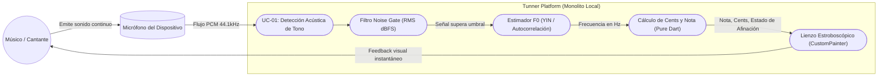
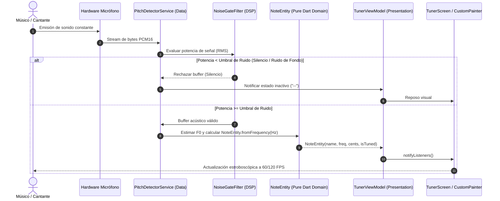

# UC-01: Detección Acústica de Tono en Tiempo Real (Acoustic Pitch Detection)

---

## Metadatos del Caso de Uso

- **ID del Caso de Uso:** `UC-01-ACOUSTIC-PITCH-DETECTION`
- **Nombre Canónico:** `Detección y Estimación de Frecuencia Fundamental (F0) y Cents en Tiempo Real`
- **Fase Asociada:** `Fase 1`
- **Actor Principal:** `Músico / Cantante`
- **Actores Secundarios:** `Hardware de Micrófono (OS Audio In), Isolate DSP, Lienzo de Afinador (UI Canvas)`
- **Estado:** `Approved`

---

## 1. Descripción Breve y Propósito

Permite al usuario emitir una nota vocal o instrumental continua para que el sistema estime su frecuencia fundamental ($F_0$), determine la nota musical temperada más cercana ($A_4 = 440\text{ Hz}$), calcule la desviación microtonal exacta en cents ($\pm 50.0\text{ cents}$) y lo represente visualmente en el afinador estroboscópico/numérico sin latencia perceptible ($\le 10\text{ ms}$).

---

## 2. Diagrama de Caso de Uso (Mermaid)

---

## 3. Precondiciones y Postcondiciones

### 3.1 Precondiciones
1. El usuario ha concedido permisos de acceso al micrófono del sistema operativo (`permission_handler`).
2. El perfil de afinación está seleccionado (por defecto: Cromático Universal, o especializado: Canto/Flauta/Guitarra).
3. El micrófono del dispositivo está operativo y transmite muestras PCM a $44100\text{ Hz}$, 16-bit mono.

### 3.2 Postcondiciones
1. La pantalla de afinación refleja en tiempo real la nota detectada con su octava (e.g. $A_4$, $C_3$) y la aguja o estroboscopio rota en función del desvío en cents.
2. Cero retención innecesaria de buffers en memoria; liberación determinista del stream al silenciar la entrada.

---

## 4. Diagrama de Flujo y Secuencia (Mermaid)

---

## 5. Flujo Principal de Eventos (Happy Path)

1. El usuario activa el micrófono o abre la pantalla del afinador.
2. El sistema inicia la captura de paquetes PCM en chunks de 1024 o 2048 muestras a $44.1\text{ kHz}$.
3. El filtro *Noise Gate* calcula la energía cuadrática media (RMS) de la señal y verifica que supere los $-45\text{ dBFS}$ (evitando falsos positivos por respiración o ruido de habitación).
4. El estimador de frecuencia extrae la frecuencia fundamental $F_0$ dentro del rango configurado ($27.5\text{ Hz}$ a $4186\text{ Hz}$).
5. La capa de dominio calcula:
   $$\text{midi} = 12 \cdot \log_2\left(\frac{f}{440}\right) + 69$$
   $$\text{cents} = (\text{midi} - \text{round}(\text{midi})) \cdot 100$$
6. El ViewModel actualiza su estado y el `CustomPainter` renderiza la aguja/estroboscopio en menos de $10\text{ ms}$ desde la captura física del sonido.

---

## 6. Flujos Alternativos y Excepciones

### Flujo Alternativo A1: Cantante con Vibrato Pronunciado
- Si el perfil seleccionado es "Vocal / Canto", el sistema aplica una ventana de mediana móvil sobre los últimos 3 fotogramas de frecuencia para suavizar la oscilación natural de $5\text{ Hz}$ del vibrato, permitiendo una lectura legible sin temblores histéricos en la aguja.

### Flujo de Excepción E1: El usuario deniega permisos de micrófono
- El sistema captura la denegación mediante `permission_handler`, suspende la inicialización del stream sin fallar y muestra un banner amigable en la UI invitando a habilitar el micrófono en los ajustes del sistema.

### Flujo de Excepción E2: Entrada saturada (Clipping)
- Si la señal supera los $0\text{ dBFS}$ (distorsión armónica masiva), el sistema atenúa visualmente la aguja y marca una alerta de ganancia excesiva para evitar lecturas de notas fantasmas.

---

## 7. Criterios de Calidad y No Negociables Asociados

- **Latencia de respuesta:** Menor a $10\text{ ms}$.
- **Consumo de CPU:** El análisis de pitch no debe ejecutarse en el hilo principal de la UI si supera el 5% de tiempo de cuadro.
- **Rango Dinámico:** Detección comprobada en graves ($E_2$ de guitarra, $C_2$ de cello) y agudos ($C_6$ de soprano/flauta).
