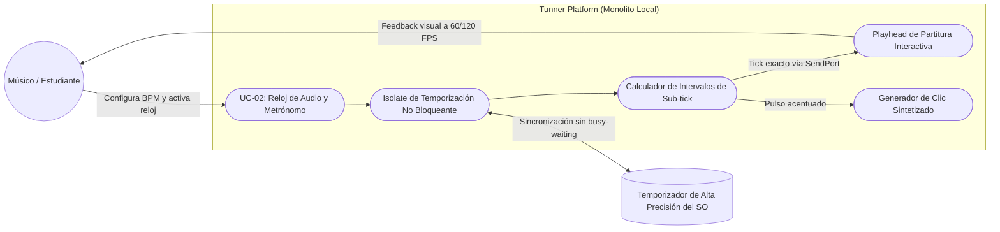
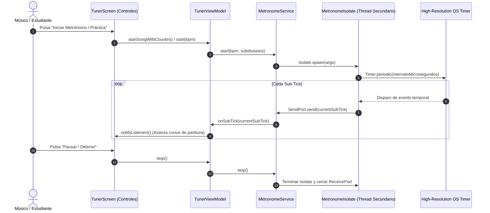

# UC-02: Generación de Reloj Rítmico de Alta Precisión y Metrónomo (High-Resolution Audio Clock)

---

## Metadatos del Caso de Uso

- **ID del Caso de Uso:** `UC-02-HIGH-RES-AUDIO-CLOCK`
- **Nombre Canónico:** `Generación y Despacho de Eventos Rítmicos Deterministas sin Consumo Parásito de CPU`
- **Fase Asociada:** `Fase 1`
- **Actor Principal:** `Estudiante / Músico`
- **Actores Secundarios:** `Isolate de Temporización (OS Timer), Motor de Partituras (Presentation), Sintetizador de Clics`
- **Estado:** `Approved`

---

## 1. Descripción Breve y Propósito

Proporciona un reloj temporal de alta resolución para la práctica instrumental y el avance interactivo de compases y figuras musicales. Debe garantizar precisión determinista de sub-milisegundo en las subdivisiones rítmicas a cualquier tempo ($40\text{ a } 240\text{ BPM}$) con **0% de consumo parásito de batería/CPU en reposo**, rindiendo el tiempo de cómputo al sistema operativo mediante temporizadores de eventos no bloqueantes.

---

## 2. Diagrama de Caso de Uso (Mermaid)

---

## 3. Precondiciones y Postcondiciones

### 3.1 Precondiciones
1. El usuario ha configurado o seleccionado el tempo deseado ($40 \le \text{BPM} \le 240$).
2. La métrica del compás y la subdivisión rítmica están establecidas (ej. 4/4 con semicorcheas = 16 sub-ticks por compás).

### 3.2 Postcondiciones
1. El `Isolate` despacha pulsos a intervalos matemáticamente exactos:
   $$\Delta t = \frac{60000}{\text{BPM} \times \text{subdivisiones}}\text{ ms}$$
2. El uso de CPU del hilo secundario permanece por debajo del $1.0\%$.
3. Al detener el metrónomo, el `Isolate` se destruye de inmediato liberando los puertos de memoria.

---

## 4. Diagrama de Flujo y Secuencia (Mermaid)

---

## 5. Flujo Principal de Eventos (Happy Path)

1. El usuario inicia el metrónomo a $120\text{ BPM}$ en compás de 4/4 con subdivisión en semicorcheas (4 ticks por pulso = 16 ticks por compás).
2. El sistema calcula el intervalo exacto:
   $$\text{intervalo} = \frac{60000}{120 \times 4} = 125.0\text{ ms} = 125000\text{ }\mu\text{s}$$
3. El `Isolate` programa el temporizador del sistema operativo (`Timer.periodic` o *compensated sleep*).
4. Mientras transcurre el intervalo entre ticks, el hilo duerme (*yield*), permitiendo al procesador ahorrar energía y mantenerse frío.
5. Al cumplirse cada $125\text{ ms}$, el puerto transmite el contador del sub-tick al hilo principal de Flutter.
6. La interfaz actualiza la posición del cursor de la partitura y emite el clic auditivo sincronizado.

---

## 6. Flujos Alternativos y Excepciones

### Flujo Alternativo A1: Cambio dinámico de tempo (BPM Slider)
- Si el usuario desliza la barra de BPM mientras el metrónomo está en marcha, el servicio reajusta el intervalo del temporizador de forma atómica sin necesidad de destruir y recrear el Isolate por completo, garantizando fluidez sin congelamientos de audio.

### Flujo Alternativo A2: Compás de Entrada (Count-In)
- Si se activa el modo de práctica, el reloj ejecuta 1 compás completo (4 pulsos de negra) de pre-conteo (*Count-In*) con indicación visual antes de comenzar la evaluación de las notas de la partitura.

### Flujo de Excepción E1: Pausa de la app en segundo plano (Lifecycle Event)
- Si el usuario minimiza la aplicación o recibe una llamada telefónica, el sistema pausa la emisión de eventos del Isolate para evitar desincronizaciones con el reloj del sistema operativo.

---

## 7. Criterios de Calidad y No Negociables Asociados

- **Consumo de CPU:** $\le 1\%$ en reposo y ejecución (eliminación estricta de busy-waiting).
- **Precisión Temporal (Jitter):** Desviación acumulada menor a $2\text{ ms}$ tras 10 minutos de reproducción continua.
- **Sincronización:** El cursor visual de la partitura y el pulso auditivo deben mantener coherencia sensorial perfecta.
