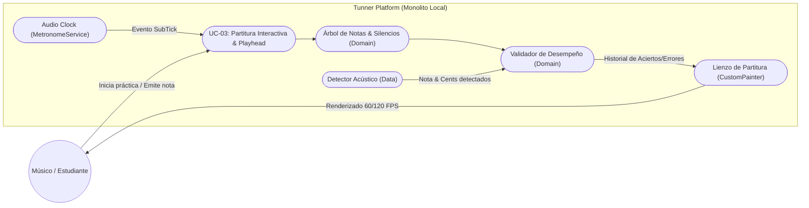
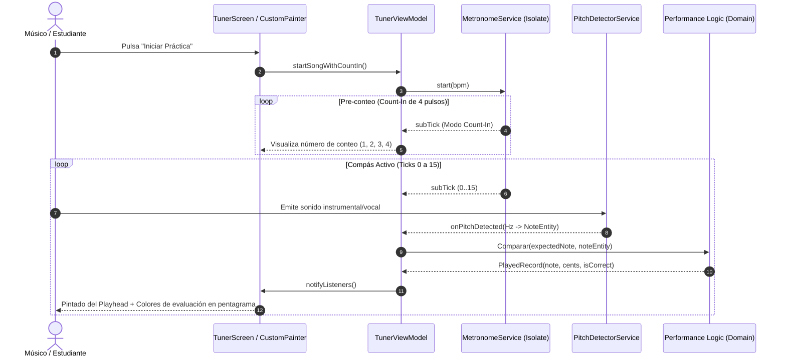

# UC-03: Renderizado y Seguimiento de Partitura Interactiva con Evaluación en Tiempo Real

---

## Metadatos del Caso de Uso

- **ID del Caso de Uso:** `UC-03-INTERACTIVE-SCORE-PLAYHEAD`
- **Nombre Canónico:** `Renderizado de Partitura, Desplazamiento del Playhead y Evaluación Acústica en Tiempo Real`
- **Fase Asociada:** `Fase 1 / Fase 2 (Transición)`
- **Actor Principal:** `Estudiante / Músico`
- **Actores Secundarios:** `Audio Clock (MetronomeService), PitchDetectorService, Lienzo CustomPainter (UI)`
- **Estado:** `Approved`

---

## 1. Descripción Breve y Propósito

Permite al estudiante visualizar una partitura musical con sus subdivisiones rítmicas y notas esperadas, seguir un cursor de reproducción (*playhead*) sincronizado con el reloj de audio determinista, y recibir retroalimentación visual inmediata (coloración dinámica y registro de entonación) sobre cada nota y silencio emitido a lo largo del compás, tanto si canta como si toca un instrumento.

---

## 2. Diagrama de Caso de Uso (Mermaid)

---

## 3. Precondiciones y Postcondiciones

### 3.1 Precondiciones
1. Existe una obra o estudio cargado en la lista de reproducción (`SongEntity` con lista de `SongNote`).
2. El micrófono se encuentra activo para capturar la interpretación del usuario.
3. El reloj de audio (`MetronomeService`) está configurado con el tempo deseado en BPM.

### 3.2 Postcondiciones
1. La posición horizontal del cursor (*playhead*) refleja exactamente el sub-tick temporal actual.
2. Cada sub-pulso transcurrido almacena un registro inmutable (`PlayedRecord`) con el nombre de la nota cantada/tocada, su desviación en cents y su veredicto (Acierto / Desafinado / Silencio respetado o violado).
3. El pentagrama actualiza la coloración de las figuras:
   - **Verde neón:** Nota correcta afinada ($\le 15\text{ cents}$) o silencio respetado.
   - **Ámbar / Naranja:** Nota correcta pero con desviación de entonación ($> 15\text{ cents}$).
   - **Rojo / Magenta:** Nota errónea (altura equivocada) o silencio violado por emisión de sonido.

---

## 4. Diagrama de Flujo y Secuencia (Mermaid)

---

## 5. Flujo Principal de Eventos (Happy Path)

1. El usuario selecciona un estudio musical y pulsa el botón de inicio.
2. El sistema ejecuta el pre-conteo de 4 tiempos (*Count-In*) para que el estudiante interiorice el tempo antes de empezar.
3. Al alcanzar el tick 0 de la partitura:
   - El *playhead* se posiciona en el inicio del compás.
   - Se identifica la `expectedNote` correspondiente al rango de ticks actual.
4. El usuario toca la nota requerida (ej. "Mi4"):
   - El `PitchDetectorService` captura la onda y calcula la frecuencia fundamental.
   - El validador confirma que la nota coincide y calcula la tolerancia en cents.
   - Se inserta un `PlayedRecord(isCorrect: true)` en el historial del compás.
5. El `CustomPainter` dibuja el cursor desplazándose uniformemente y pinta la nota evaluada en verde brillante.
6. Al llegar a un silencio (`isRest == true`):
   - El sistema comprueba que el nivel de audio capturado sea nulo o inferior al umbral del *Noise Gate*.
   - Si no hay sonido, marca el silencio como exitoso; si el usuario toca durante el silencio, lo marca como infracción rítmica en rojo.
7. Al completar el compás (tick 15), el historial se reinicia o se pasa al siguiente compás de forma fluida.

---

## 6. Flujos Alternativos y Excepciones

### Flujo Alternativo A1: El usuario pausa la reproducción
- El reloj de audio se detiene de inmediato, el Isolate libera su temporizador y el cursor permanece estático en la última posición registrada hasta que se reanude o se reinicie.

### Flujo Alternativo A2: Ajuste de Tempo en caliente
- Si el estudiante disminuye la velocidad (ej. de 120 a 60 BPM para estudiar un pasaje difícil), el intervalo entre ticks se recalcula instantáneamente sin perder el compás ni desfasar la posición del cursor.

### Flujo de Excepción E1: Desconexión repentina de entrada de audio
- Si el micrófono deja de recibir señal por desprendimiento de hardware, el validador continúa el avance del playhead marcando las notas como no ejecutadas sin lanzar excepciones ni detener la interfaz.

---

## 7. Criterios de Calidad y No Negociables Asociados

- **Fluidez visual:** La posición del cursor debe interpolarse a 60/120 FPS sin dar saltos bruscos (*jank* o *stuttering*).
- **Consumo de memoria:** Los registros del compás (`_measureHistory`) se gestionan en mapas fijos de tamaño $N$ ($N = 16$), sin acumulación infinita de objetos en el Garbage Collector.
- **Feedback instantáneo:** La latencia visual acumulada entre la emisión del sonido y la coloración de la nota no debe exceder los $10\text{ ms}$.
