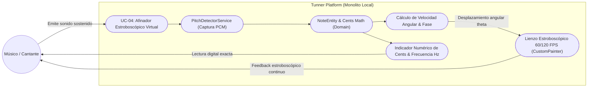
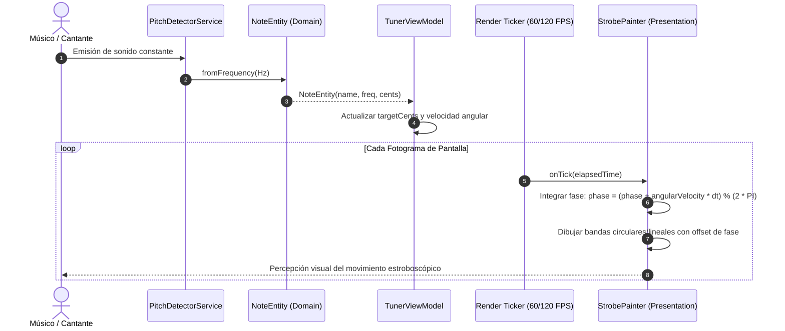

# UC-04: Afinador Estroboscópico Virtual y Medición Microtonal de Estudio (Virtual Strobe Tuner)

---

## Metadatos del Caso de Uso

- **ID del Caso de Uso:** `UC-04-VIRTUAL-STROBE-TUNER`
- **Nombre Canónico:** `Visualización Estroboscópica Continua y Medición Microtonal en Tiempo Real`
- **Fase Asociada:** `Fase 1`
- **Actor Principal:** `Músico / Cantante / Luthier`
- **Actores Secundarios:** `PitchDetectorService (Data), NoteEntity (Domain), CustomPainter (Presentation)`
- **Estado:** `Approved`

---

## 1. Descripción Breve y Propósito

Proporciona una interfaz visual de afinación de grado de estudio basada en el principio físico del estroboscopio (*Strobe Tuner*). A diferencia de las agujas convencionales que sufren de histeresis y saltos bruscos, las bandas estroboscópicas virtuales rotan de forma continua a una velocidad y dirección matemáticamente proporcionales a la diferencia de frecuencia ($\Delta f$), deteniéndose por completo únicamente cuando la afinación es matemáticamente exacta ($\le 0.1\text{ cents}$ de tolerancia). Esto permite a cantantes, instrumentistas y luthiers calibrar y percibir micro-desviaciones inaudibles para afinadores genéricos.

---

## 2. Diagrama de Caso de Uso (Mermaid)

---

## 3. Precondiciones y Postcondiciones

### 3.1 Precondiciones
1. El micrófono está capturando audio y transmitiendo frecuencias válidas que superan el umbral del *Noise Gate* RMS.
2. La frecuencia de refresco de pantalla del dispositivo está activa ($60\text{ Hz}$ o $120\text{ Hz}$ vía `Ticker` / `AnimationController`).

### 3.2 Postcondiciones
1. Si el sonido está por debajo de la afinación (*Flat* / $\text{cents} < 0$), las bandas del disco rotan hacia la izquierda.
2. Si el sonido está por encima de la afinación (*Sharp* / $\text{cents} > 0$), las bandas del disco rotan hacia la derecha.
3. La velocidad de rotación angular ($\omega$) es directamente proporcional a la magnitud del error:
   $$\omega = k \cdot \text{cents}$$
4. Cuando el error es menor a $\pm 0.5\text{ cents}$, las bandas se perciben virtualmente congeladas (afinación perfecta de concierto).
5. Al cesar el sonido, la rotación desacelera suavemente y entra en reposo visual sin parpadeos molestos.

---

## 4. Diagrama de Flujo y Secuencia (Mermaid)

---

## 5. Fundamento Físico y Matemático de la Solución

El afinador estroboscópico virtual emula los discos mecánicos originales de los afinadores *Peterson*:

1. **Relación Frecuencia Teórica vs Real:**
   Dada la nota temperada detectada con frecuencia teórica $f_{\text{ref}}$ y la frecuencia física emitida $f$:
   $$\Delta f = f - f_{\text{ref}}$$
2. **Desviación en Cents:**
   $$\text{cents} = 1200 \cdot \log_2\left(\frac{f}{f_{\text{ref}}}\right)$$
3. **Velocidad de Rotación Angular:**
   En lugar de depender de saltos discretos por buffer de audio, la fase $\theta(t)$ evoluciona continuamente en cada cuadro de renderizado:
   $$\theta(t) = \theta(t - \Delta t) + (\text{cents} \cdot \alpha \cdot \Delta t)$$
   Donde $\alpha$ es un factor de escala visual para lograr una lectura orgánica del ojo humano ($\approx 0.05\text{ rad/s por cent}$).

---

## 6. Flujos Alternativos y Excepciones

### Flujo Alternativo A1: Afinación en Modo Guitarra / Bajo (Bajas Frecuencias)
- En frecuencias graves ($< 100\text{ Hz}$), la oscilación por ciclo es más lenta. El estroboscopio utiliza un suavizado de paso bajo (*exponential moving average*) sobre los cents para evitar que los armónicos del golpe de cuerda produzcan oscilaciones visuales erráticas.

### Flujo Alternativo A2: Cambio de Frecuencia de Concierto ($A_4 = 440\text{ Hz} \rightarrow 432\text{ Hz}$ o $442\text{ Hz}$)
- Si el usuario modifica la frecuencia de calibración de concierto, la referencia teórica $f_{\text{ref}}$ se recalcula globalmente en la capa de dominio sin requerir reinicio del motor de audio.

### Flujo de Excepción E1: Silencio o Entrada Débil
- Cuando la señal cae por debajo del umbral del Noise Gate, el factor de amortiguamiento $\beta$ desacelera la velocidad angular a 0 en menos de $300\text{ ms}$, evitando que el estroboscopio quede girando indefinidamente por inercia fantasma.

---

## 7. Criterios de Calidad y No Negociables Asociados

- **Resolución visual:** Capacidad de discernir diferencias de $\pm 0.1\text{ cents}$.
- **Consumo de UI:** El cálculo de la fase $\theta$ en el `CustomPainter` debe tomar menos de $1.0\text{ ms}$ por fotograma para asegurar 120 FPS sólidos en pantallas ProMotion / AMOLED.
- **Sin Dependencias Nativas:** 100% dibujado en canvas vectorial de Flutter.
