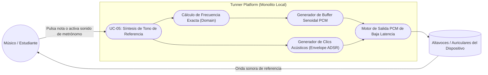
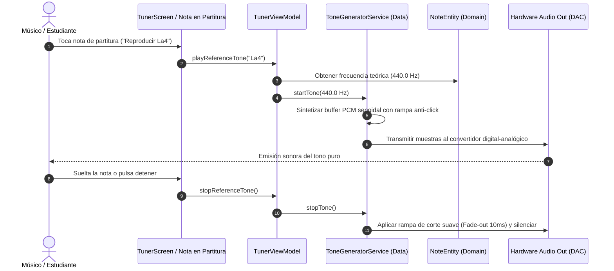

# UC-05: Síntesis Sonora y Reproducción de Tono de Referencia (Audio Reference Tone)

---

## Metadatos del Caso de Uso

- **ID del Caso de Uso:** `UC-05-AUDIO-REFERENCE-TONE`
- **Nombre Canónico:** `Generación y Síntesis de Ondas Senoidales Puras y Clics Rítmicos en Tiempo Real`
- **Fase Asociada:** `Fase 1 / Fase 3 (Transición)`
- **Actor Principal:** `Estudiante / Músico`
- **Actores Secundarios:** `Hardware de Salida de Audio (OS Audio Out / DAC), Sintetizador PCM (Data), ViewModel`
- **Estado:** `Approved`

---

## 1. Descripción Breve y Propósito

Permite al estudiante escuchar tonos de afinación puros de referencia (onda senoidal sin armónicos distorsionados) para cualquier nota musical seleccionada, así como pulsos de metrónomo audibles con acentuación diferenciada en el tiempo fuerte del compás. Este caso de uso entrena el oído musical (*Ear Training*) permitiendo al usuario interiorizar mentalmente la altura tonal correcta antes de cantar o atacar una nota en su instrumento, cerrando el bucle perceptivo entre escuchar, producir y afinar.

---

## 2. Diagrama de Caso de Uso (Mermaid)

---

## 3. Precondiciones y Postcondiciones

### 3.1 Precondiciones
1. El dispositivo cuenta con un canal de salida de audio operativo (altavoces internos o auriculares conectados).
2. El volumen del sistema no está silenciado por hardware.
3. Se ha seleccionado una nota objetivo válida (ej. $A_4 = 440.0\text{ Hz}$) o se ha iniciado el metrónomo con volumen activo.

### 3.2 Postcondiciones
1. Se genera una secuencia digital PCM a $44100\text{ Hz}$ de 16-bit con forma de onda senoidal pura:
   $$x[n] = A \cdot \sin\left(\frac{2\pi f n}{f_s}\right)$$
2. El sintetizador aplica una envolvente de ataque y decaimiento suave (*Attack/Release smoothing* de $\approx 10\text{ ms}$) para evitar clics o chasquidos (*pops*) al iniciar o cortar la reproducción.
3. Cero conflicto con el flujo de entrada del micrófono (`PitchDetectorService`).

---

## 4. Diagrama de Flujo y Secuencia (Mermaid)

---

## 5. Fundamento Acústico y Matemático

1. **Pureza de Onda vs. Armónicos Complejos:**
   Para afinar de oído, un sonido con demasiados armónicos complejos (como un sintetizador cuadrado o de sierra) confunde la percepción de la frecuencia fundamental en principiantes. La onda senoidal pura:
   $$s(t) = A(t) \cdot \sin(2\pi f_0 t)$$
   proporciona la energía concentrada exclusivamente en $f_0$, permitiendo que el cerebro experimente con claridad los batimientos acústicos (*acoustic beats*) cuando el usuario canta ligeramente desafinado respecto a la referencia.
2. **Eliminación de Discontinuidades de Fase (Anti-Popping):**
   Cualquier inicio abrupto de una onda genera una componente de alta frecuencia audible como un chasquido. Se aplica una ventana lineal o coseno elevado de rampa:
   $$A(t) = \begin{cases} 
   \frac{t}{t_{\text{attack}}} & 0 \le t < t_{\text{attack}} \\
   1 & t_{\text{attack}} \le t < t_{\text{release}} \\
   1 - \frac{t - t_{\text{release}}}{\Delta t} & t_{\text{release}} \le t \le t_{\text{end}}
   \end{cases}$$
   con $t_{\text{attack}} = t_{\text{release}} = 10\text{ ms}$.

---

## 6. Flujos Alternativos y Excepciones

### Flujo Alternativo A1: Clics Diferenciados de Metrónomo
- En el tiempo 1 del compás (pulso fuerte), el generador sintetiza un clic de tono alto ($f = 1200\text{ Hz}$, $30\text{ ms}$). En los tiempos débiles (pulsos 2, 3 y 4), sintetiza un clic de tono medio ($f = 800\text{ Hz}$, $20\text{ ms}$), facilitando la orientación rítmica del estudiante con los ojos cerrados.

### Flujo Alternativo A2: Modo Práctica con Auriculares
- Si el sistema detecta auriculares conectados, permite activar la emisión simultánea del tono de referencia y la captura del micrófono sin riesgo de realimentación acústica (*feedback loop* o eco).

### Flujo de Excepción E1: Dispositivo en Modo Silencio Total
- Si el sistema operativo tiene bloqueada la salida de audio multimedia, la UI muestra un indicador discreto notificando que el sonido del sistema está muteado.

---

## 7. Criterios de Calidad y No Negociables Asociados

- **Latencia de inicio de reproducción:** $\le 15\text{ ms}$ tras la pulsación en pantalla.
- **Distorsión Armónica Total (THD):** Prácticamente $0\%$ en tonos senoidales.
- **Cero Dependencias de Red:** Síntesis 100% matemática calculada en memoria en el procesador local.
