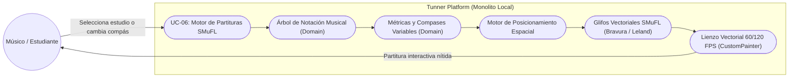
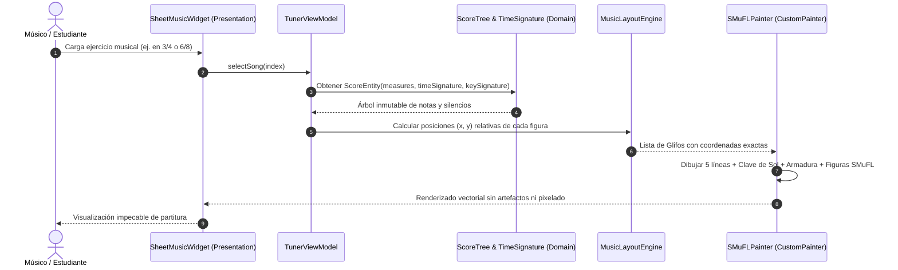

# UC-06: Modelo de Notación Estándar y Renderizado Vectorial SMuFL (Sheet Music Engine)

---

## Metadatos del Caso de Uso

- **ID del Caso de Uso:** `UC-06-SMUFL-SHEET-MUSIC-ENGINE`
- **Nombre Canónico:** `Modelado Jerárquico de Notación Musical y Renderizado Vectorial Basado en SMuFL`
- **Fase Asociada:** `Fase 2`
- **Actor Principal:** `Estudiante / Músico / Docente`
- **Actores Secundarios:** `Motor de Renderizado Flutter (CustomPainter / Impeller), Fuentes Vectoriales SMuFL, Árbol de Dominio (Pure Dart)`
- **Estado:** `Approved`

---

## 1. Descripción Breve y Propósito

Permite estructurar, interpretar y renderizar en pantalla partituras musicales estándar con calidad editorial de imprenta. El sistema sustituye las aproximaciones geométricas ad-hoc por un **árbol jerárquico de dominio puro en Dart** (`Score` $\rightarrow$ `Part` $\rightarrow$ `Measure` $\rightarrow$ `Voice` $\rightarrow$ `Note/Rest/Chord`), capaz de soportar cualquier compás métrico (simples como $2/4, 3/4, 4/4$ o compuestos como $6/8, 9/8, 12/8$), tonalidades con armaduras de clave (sostenidos y bemoles reales), líneas adicionales dinámicas y símbolos musicales basados en el estándar internacional **SMuFL (Standard Music Font Layout)**.

---

## 2. Diagrama de Caso de Uso (Mermaid)

---

## 3. Precondiciones y Postcondiciones

### 3.1 Precondiciones
1. La obra musical está modelada a través del árbol de dominio `ScoreEntity` conteniendo compases con métrica definida (`TimeSignature`).
2. Las definiciones de glifos tipográficos SMuFL estándar (clave de sol, cabezas de nota, silencios, alteraciones) están indexadas en el proyecto.

### 3.2 Postcondiciones
1. El pentagrama se dibuja con 5 líneas horizontales equidistantes con un espaciado canónico de $10\text{ pt}$ (*interlineado*).
2. Las figuras musicales se ubican verticalmente según su clave y paso diatónico exacto, añadiendo líneas adicionales (*ledger lines*) si la nota rebasa el pentagrama superior o inferiormente.
3. El espaciado horizontal es proporcional a la duración temporal de las figuras (espaciado no lineal tipo editorial).
4. El renderizado en `CustomPainter` se ejecuta en menos de $2\text{ ms}$, manteniendo la pantalla a 60/120 FPS estables.

---

## 4. Diagrama de Flujo y Secuencia (Mermaid)

---

## 5. Fundamento de Tipografía Musical y Estándar SMuFL

1. **Standard Music Font Layout (SMuFL):**
   Mantenido por el W3C Music Notation Community Group, asigna puntos de código Unicode en el área de uso privado (*Private Use Area*: `U+E000` a `U+F8FF`) para cada símbolo musical del mundo:
   - Clave de Sol (*G Clef*): `U+E050`
   - Clave de Fa (*F Clef*): `U+E062`
   - Cabeza de nota negra (*Notehead Black*): `U+E0A4`
   - Cabeza de nota blanca (*Notehead Half*): `U+E0A3`
   - Silencio de negra (*Quarter Rest*): `U+E4E5`
   - Sostenido (*Accidental Sharp*): `U+E262`
   - Bemol (*Accidental Flat*): `U+E260`
2. **Espaciado Editorial Óptimo:**
   El espaciado horizontal $W$ no es un grid rígido, sino una función proporcional al logaritmo de la duración musical de cada figura:
   $$W(d) = W_0 \cdot \sqrt{\text{duration}}$$
   garantizando que las negras ocupen más espacio visual que las semicorcheas sin comprimir la lectura.

---

## 6. Flujos Alternativos y Excepciones

### Flujo Alternativo A1: Compás Compuesto (ej. 6/8, 9/8)
- El motor de tiempo agrupa los pulsos en subdivisiones ternarias de corchea ($3 + 3$), adaptando la barra de compás y la posición del cursor de audio sin romper la sincronización del metrónomo.

### Flujo Alternativo A2: Armadura de Clave con Alteraciones (Key Signature)
- Si la partitura está en Sol Mayor ($1\text{ sostenido: Fa#}$) o Fa Mayor ($1\text{ bemol: Si}\flat$), los glifos de alteración se imprimen inmediatamente a la derecha de la clave y las notas del pentagrama heredan la alteración automáticamente sin dibujarla redundantemente en cada compás.

### Flujo de Excepción E1: Densidad de Notas Extrema en Pantallas Estrechas
- Si el número de notas en un compás satura el ancho horizontal del móvil, el motor activa compresión inteligente o scroll horizontal continuo sincronizado con el playhead para evitar superposición de cabezas de nota.

---

## 7. Criterios de Calidad y No Negociables Asociados

- **Adherencia Estándar:** Compatibilidad con la especificación SMuFL v1.4.
- **Rendimiento Gráfico:** Tiempo de pintura de pentagrama inferior a $2\text{ ms}$ en hardware acelerado por GPU (Impeller).
- **Cero Dependencia de Red:** Fuentes y glifos embebidos 100% como assets locales en el binario.
