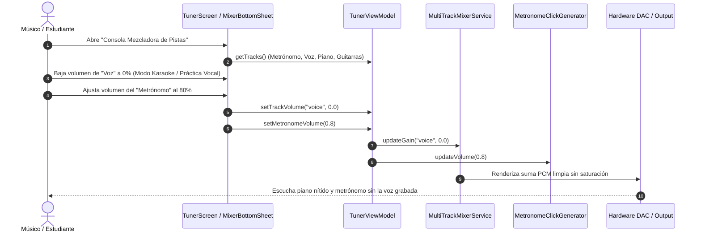

# UC-07: Mezclador Multicanal de Acompañamiento, Separación de Pistas (Stems) y Balance de Metrónomo

---

## Metadatos del Caso de Uso

- **ID del Caso de Uso:** `UC-07-MULTITRACK-STEM-MIXER`
- **Nombre Canónico:** `Control Independiente de Volumen por Pistas (Voz, Piano, Guitarras) y Metrónomo Sincronizado`
- **Fase Asociada:** `Fase 3` (Transición a `Fase 4`)
- **Actor Principal:** `Estudiante / Músico`
- **Actores Secundarios:** `Motor de Audio Multi-Pista (Data), Modelo de Dominio de Pistas Musicales, ViewModel`
- **Estado:** `Approved`
- **Documentos Relacionados:** `docs/02_use_cases/02_uc_high_res_audio_clock.md`, `docs/02_use_cases/05_uc_audio_reference_tone.md`

---

## 1. Descripción Breve y Propósito

Permite al estudiante descomponer una obra musical en sus distintas capas o instrumentos (*stems* o pistas aisladas: por ejemplo, voz principal, piano acompañante, bajo/guitarra y metrónomo) y ajustar de forma independiente el volumen, muteo y solo de cada pista en tiempo real. 

Esto resuelve la necesidad pedagógica fundamental de la práctica musical: silenciar el propio instrumento para tocar la parte en vivo con la banda/acompañamiento (*minus-one* o *backing track*), o aislar un instrumento en solitario para estudiarlo al detalle, manteniendo el metrónomo en un nivel de volumen calibrado a gusto del ejecutante.

---

## 2. Diagrama de Caso de Uso (Mermaid)

```mermaid
flowchart LR
    Musician(("Músico / Estudiante"))
    AudioOut[("Altavoces / Auriculares")]

    subgraph TunnerSystem ["Tunner Platform (Monolito Local)"]
        UC07(["UC-07: Mezclador Multicanal y Stems"])
        TrackModel(["Modelo de Pistas de Audio (Domain)"])
        MetronomeEngine(["Reloj y Generador de Clic PCM"])
        MixerDSP(["Motor DSP de Suma y Ganancia PCM"])
    end

    Musician -->|Ajusta deslizadores de volumen (Metrónomo, Voz, Piano, etc.)| UC07
    UC07 --> TrackModel
    TrackModel --> MixerDSP
    MetronomeEngine -->|Buffer de Clic a ganancia G_metro| MixerDSP
    MixerDSP -->|Audio estéreo unificado con latencia < 10ms| AudioOut
```

---

## 3. Precondiciones y Postcondiciones

### 3.1 Precondiciones
1. La obra seleccionada cuenta con información o recursos de canales de acompañamiento definidos (o síntesis polifónica interna por capas de voces).
2. El metrónomo de alta resolución está disponible con generador de clics PCM.
3. El usuario puede interactuar con el panel mezclador (*Mixer Console*) desde la interfaz.

### 3.2 Postcondiciones
1. El motor de mezcla aplica ganancias lineales independientes ($0.0 \le G_i \le 1.0$) a cada pista sin saturación ni recorte armónico (*clipping*):
   $$y[n] = \text{clip}\left(G_{\text{metro}} \cdot x_{\text{metro}}[n] + \sum_{k=1}^{K} G_k \cdot x_k[n], -1.0, 1.0\right)$$
2. El metrónomo mantiene su sincronización determinista de fase sin desfasarse al modificar volúmenes en caliente.
3. Cada canal ofrece controles de:
   - **Volumen continuo:** $0\%$ a $100\%$.
   - **Mute:** Silenciamiento instantáneo ($G = 0$).
   - **Solo:** Aislamiento exclusivo de esa pista silenciando el resto.

---

## 4. Diagrama de Flujo y Secuencia (Mermaid)



---

## 5. Criterios de Rendimiento y No Negociables

- **Cero latencia añadida por mezcla:** La mezcla en bloque PCM no debe introducir un retardo mayor a $2\text{ ms}$.
- **Consumo de memoria determinista:** No se crean arrays nuevos en cada bloque de audio; se utilizan buffers prealojados en memoria local.
- **Offline First estricto:** La separación y reproducción de pistas se procesa 100% en el dispositivo sin enviar paquetes de red a la nube.
