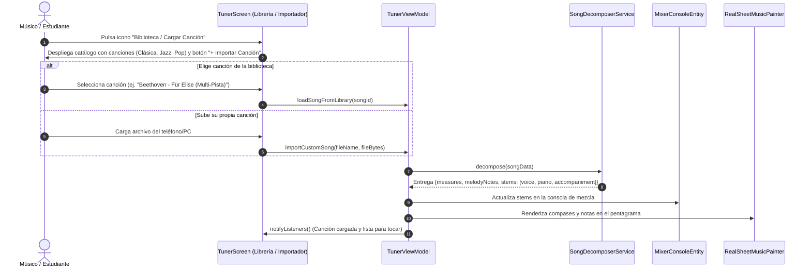

# UC-08: Lector Universal de Canciones, Ingesta Multi-Pista y Biblioteca de Repertorio

---

## Metadatos del Caso de Uso

- **ID del Caso de Uso:** `UC-08-SONG-INGESTION-AND-LIBRARY`
- **Nombre Canónico:** `Lector de Canciones Multi-Pista y Biblioteca de Repertorio Descompuesto`
- **Fase Asociada:** `Fase 4`
- **Actor Principal:** `Estudiante / Músico`
- **Actores Secundarios:** `Parser Local (Domain/Data), Consola Mezcladora (MixerConsoleEntity), Motor de Partituras`
- **Estado:** `Approved`
- **ADR Relacionado:** `docs/04_adrs/0003_hybrid_song_library_and_midi_parser.md`

---

## 1. Descripción Breve y Propósito

Permite al usuario acceder a una biblioteca organizada de canciones con acompañamiento descompuesto (Voz, Piano, Bajo, Metrónomo), así como **subir o importar cualquier canción externa** (en formato multi-pista estándar). Al cargar la canción, el motor descompone automáticamente sus pistas en la consola de mezcla y proyecta las notas de la melodía elegida directamente sobre el pentagrama para su estudio interactivo y afinación en tiempo real.

---

## 2. Diagrama de Caso de Uso (Mermaid)

```mermaid
flowchart LR
    Musician(("Músico / Estudiante"))
    FileStorage[("Almacenamiento Local del Dispositivo")]

    subgraph TunnerSystem ["Tunner Platform (Monolito Local)"]
        UC08(["UC-08: Lector y Biblioteca de Canciones"])
        LibraryBrowser(["Explorador de Repertorio Canónico"])
        LocalFileImporter(["Importador de Archivos de Canción"])
        SongDecomposer(["Descompositor de Pistas (Stems) y Notas"])
        ScoreView(["Pentagrama Interactivo (Presentation)"])
        MixerConsole(["Consola de Mezcla Multicanal (Stems)"])
    end

    Musician -->|Explora repertorio o pulsa 'Importar Canción'| UC08
    UC08 --> LibraryBrowser
    UC08 --> LocalFileImporter
    LocalFileImporter <-->|Lee bytes de archivo local| FileStorage
    LibraryBrowser --> SongDecomposer
    LocalFileImporter --> SongDecomposer
    SongDecomposer -->|Despacha pistas separadas (Voz, Piano, etc.)| MixerConsole
    SongDecomposer -->|Despacha notas y compases para afinación| ScoreView
```

---

## 3. Diagrama de Flujo y Secuencia (Mermaid)



---

## 4. Criterios de Aceptación (Definition of Done)

- **Cero dependencia de red:** Todo el procesamiento ocurre 100% en local.
- **Sincronización:** Cada pista descompuesta se refleja inmediatamente en la consola de mezcla con volumen, mute y solo individuales.
- **Pentagrama actualizado:** Las notas melódicas son proyectadas con precisión rítmica en el pentagrama adaptado al tempo de la canción.
