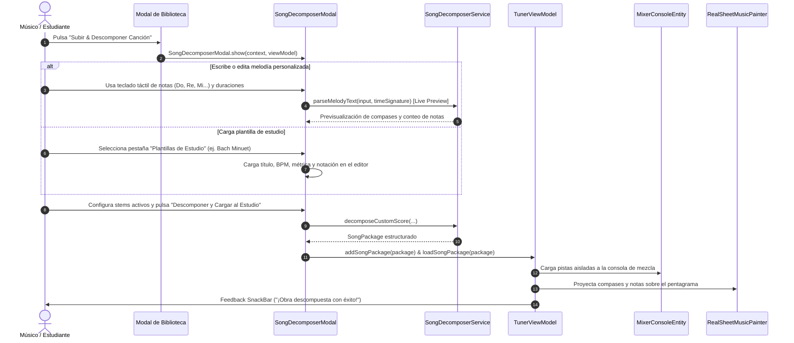

# UC-08: Lector Universal de Canciones, Ingesta Multi-Pista y Estudio de Descomposición

---

## Metadatos del Caso de Uso

- **ID del Caso de Uso:** `UC-08-SONG-INGESTION-AND-DECOMPOSITION-STUDIO`
- **Nombre Canónico:** `Lector de Canciones Multi-Pista, Estudio de Descomposición y Biblioteca de Repertorio`
- **Fase Asociada:** `Fase 4`
- **Actor Principal:** `Estudiante / Músico`
- **Actores Secundarios:** `Parser Local (SongDecomposerService), Consola Mezcladora (MixerConsoleEntity), Motor de Partituras (ScoreTree/RealSheetMusicPainter)`
- **Estado:** `Approved & Implemented`
- **ADR Relacionado:** `docs/04_adrs/0003_hybrid_song_library_and_midi_parser.md`

---

## 1. Descripción Breve y Propósito

Permite al usuario acceder a una biblioteca organizada de canciones con acompañamiento descompuesto (Voz, Piano, Bajo, Metrónomo), así como **crear, componer o descomponer interactivamente obras musicales** mediante el **Estudio de Descomposición Musical** (`SongDecomposerModal`).

El estudio permite:
1. **Entrada melódica libre:** Soporta notación textual flexible (solfeo `Do4 Re4 Mi4` o internacional `C4 D4 E4`, duraciones explícitas `:4`, `:8`, silencios `_` o `R` y barras de compás `|`).
2. **Teclado rápido de notas:** Teclas táctiles para Do, Re, Mi, Fa, Sol, La, Si, silencios, selección de octavas (3, 4, 5), alteraciones (#, b), figuras rítmicas (Redonda, Blanca, Negra, Corchea) y divisores de compás.
3. **Catálogo de plantillas maestras:** Obras didácticas preconfiguradas (Mozart, Bach, Vivaldi, Greensleeves, Escalas) cargables en un solo toque.
4. **Descomposición por capas (Stems):** Configuración granular de pistas a aislar (Melodía Principal, Acompañamiento Armónico, Bajo, Ritmo/Percusión).
5. **Carga directa al estudio de práctica:** Ingesta inmediata en `TunerViewModel.addSongPackage(...)` y `loadSongPackage(...)` para visualización rítmica en el pentagrama y control independiente de volúmenes en la consola de mezcla.

---

## 2. Diagrama de Caso de Uso (Mermaid)

```mermaid
flowchart LR
    Musician(("Músico / Estudiante"))

    subgraph TunnerSystem ["Tunner Platform (Monolito Local Offline)"]
        UC08(["UC-08: Lector y Descompositor Musical"])
        LibraryModal(["Modal de Biblioteca de Canciones"])
        StudioModal(["Estudio de Descomposición (SongDecomposerModal)"])
        QuickKeypad(["Teclado Rápido de Notas y Duraciones"])
        TemplateCatalog(["Plantillas Maestras Curadas"])
        ParserEngine(["Motor de Análisis Melódico y Métrica"])
        StemDecomposer(["Generador de Capas Pedagógicas (Stems)"])
        ScoreView(["Pentagrama Interactivo (RealSheetMusicPainter)"])
        MixerConsole(["Consola Mezcladora (MixerConsoleEntity)"])
    end

    Musician -->|Pulsa 'Subir & Descomponer' en Biblioteca| StudioModal
    Musician -->|Inserta notas interactivamente| QuickKeypad
    Musician -->|Selecciona obra clásica/didáctica| TemplateCatalog
    StudioModal --> QuickKeypad
    StudioModal --> TemplateCatalog
    StudioModal -->|Procesa cadena melódica y métrica| ParserEngine
    ParserEngine -->|Genera compases matemáticamente balanceados| StemDecomposer
    StemDecomposer -->|Despacha stems independientes (Lead, Piano, Bass, Ritmo)| MixerConsole
    StemDecomposer -->|Despacha árbol jerárquico de notas| ScoreView
```

---

## 3. Diagrama de Flujo y Secuencia (Mermaid)



---

## 4. Criterios de Aceptación (Definition of Done)

- **Cero latencia de red:** 100% de la descomposición y estructuración ocurre localmente en el dispositivo.
- **Tolerancia a errores de notación:** Relleno automático con silencios si un compás no alcanza la suma de sub-ticks de su métrica.
- **Soporte bilingüe de notación:** Acepta tanto nomenclatura latina (Do, Re, Mi, Fa, Sol, La, Si) como anglosajona (C, D, E, F, G, A, B).
- **Integración con mezclador:** Cada capa descompuesta (Lead, Armonía, Bajo, Ritmo) cuenta con control individual de volumen, mute y solo.
- **Pruebas automatizadas:** Cobertura unitaria para parseo, normalización y widget tests para todas las interacciones de UI.
