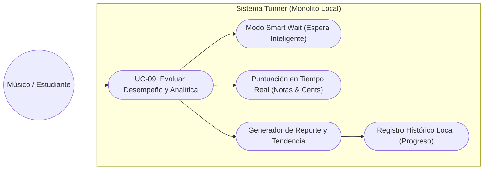
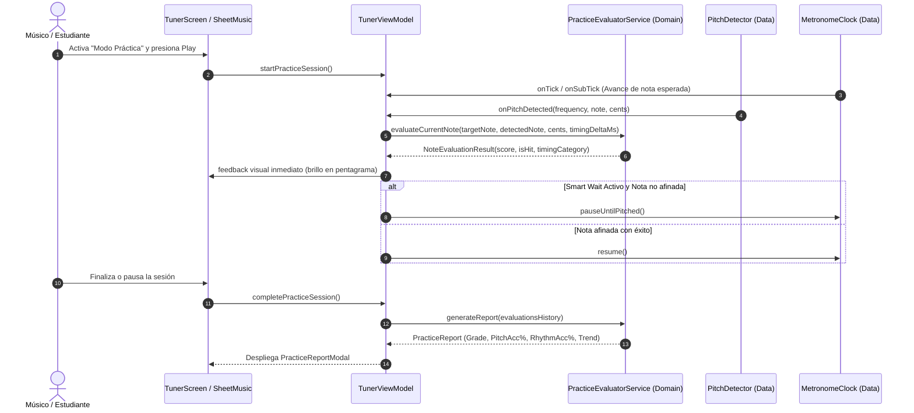

# Use Case: UC-09 Interactive Practice Evaluation & Performance Analytics

Este documento formaliza el caso de uso para la evaluación acústico-rítmica interactiva en tiempo real y la generación de reportes analíticos de desempeño y mejora continua en **Tunner**.

---

## Metadatos del Caso de Uso

- **ID del Caso de Uso:** `UC-09-PRACTICE-EVALUATION-AND-ANALYTICS`
- **Nombre Canónico:** `Evaluar Desempeño Musical en Vivo y Generar Analítica de Progreso`
- **Fase Asociada:** `Fase 3 & Fase 4`
- **Actor Principal:** `Estudiante / Músico`
- **Actores Secundarios:** `Motor de Estimación de Tono (Data), Reloj de Metrónomo (Data), Canvas de Partitura (Presentation)`
- **Estado:** `Approved`

---

## 1. Descripción Breve y Propósito

Permite al estudiante activar el **Modo de Práctica Evaluada** durante la ejecución de una obra o estudio en el pentagrama. El sistema compara nota por nota la afinación emitida por el usuario contra la nota esperada en la partitura, calculando:
1. **Precisión de Afinación ($F_0$ & Cents):** Si la frecuencia emitida corresponde al tono objetivo y el desvío exacto en centésimas ($\pm\text{cents}$).
2. **Precisión Rítmica:** Si el ataque de la nota ocurrió a tiempo (*On-Time*), adelantado (*Early*) o retrasado (*Late*) respecto a los pulsos del metrónomo.
3. **Modo Espera Inteligente (*Smart Wait*):** Si está activo, el cursor no avanza al siguiente compás hasta que la nota actual sea sostenida con afinación correcta.
4. **Analítica de Progreso y Reporte:** Al finalizar la sesión, se genera un reporte cuantitativo estilo conservatorio con calificación global (S/A/B/C/D), mapa de calor de notas problemáticas y comparación de tendencia (mejora o declive vs. sesiones anteriores).

---

## 2. Diagrama de Caso de Uso (Mermaid)

---

## 3. Precondiciones y Postcondiciones

### 3.1 Precondiciones
1. El usuario ha seleccionado una obra o estudio de la biblioteca de canciones.
2. El motor de captura acústica (micrófono) está activo y calibrado con el umbral de ruido.
3. El usuario activa el botón "Modo Evaluación" o inicia el reproductor con seguimiento.

### 3.2 Postcondiciones
1. Cada nota ejecutada recibe una calificación atómica en memoria.
2. Al detenerse o finalizar la partitura, se despliega la pantalla modal analítica con desglose de desempeño.
3. Se actualiza el vector histórico de sesiones para calcular tendencias de aprendizaje (mejora o desvío).
4. Cero almacenamiento externo o dependencias en la nube (100% privado y offline).

---

## 4. Diagrama de Flujo y Secuencia (Mermaid)

---

## 5. Flujo Principal de Eventos (Happy Path)

1. El músico activa el modo de práctica e inicia la reproducción con metrónomo.
2. La partitura destaca visualmente la nota activa en el compás actual.
3. El músico toca la nota en su instrumento o voz.
4. El detector de tono calcula la nota captada y la desviación en cents en $< 10\text{ ms}$.
5. El evaluador contrasta el resultado con la nota esperada y asigna puntaje y clasificación temporal (*On-time*, *Early*, *Late*).
6. Al completarse la partitura, el sistema computa la calificación ponderada:
   $$\text{Score} = (\text{Precisión Pitch} \times 0.65) + (\text{Precisión Rítmica} \times 0.35)$$
7. Se despliega el reporte analítico con medidores circulares de precisión y análisis de mejora/declive.

---

## 6. Flujos Alternativos y Excepciones

### Flujo Alternativo A1: Modo Smart Wait
- Si el usuario desafina más allá de la tolerancia (por defecto $\pm 15\text{ cents}$), el cursor no avanza al siguiente tick, dando oportunidad de corregir la embocadura o postura vocal.

### Flujo de Excepción E1: Silencio o Ruido Ambiental
- Si el nivel RMS está por debajo del Noise Gate, el sistema interpreta silencio y no penaliza como nota errónea, esperando la emisión del estudiante.

---

## 7. Criterios de Calidad y No Negociables
- **Determinismo Matemático:** Evaluación de cents exacta con tolerancia configurable.
- **Rendimiento:** Evaluación ejecutada en hilo puro Dart sin bloquear la animación a 60/120 FPS.
- **Privacidad Absoluta:** Todas las métricas se analizan y almacenan en memoria local del dispositivo.
