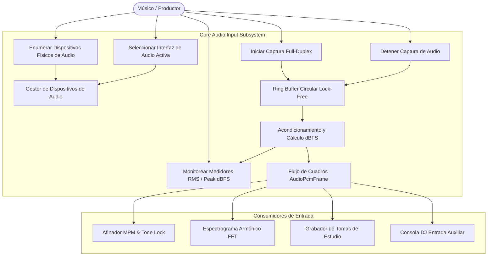
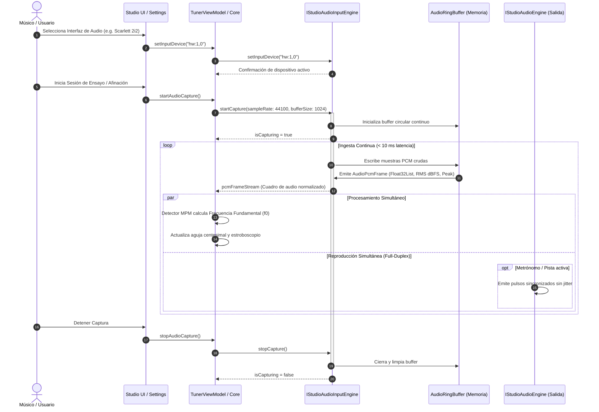

# Caso de Uso 100: Sistema Canónico de Entrada y Salida Full-Duplex en Core Audio con Matriz de Dispositivos

## Metadatos
- **ID:** `UC-100`
- **Fase:** Fase 1 / Infraestructura Core
- **Estado:** Aprobado
- **Fecha:** 2026-11-16
- **Autor:** Antigravity AI & Tunner Architecture Team

---

## 1. Descripción
Este caso de uso formaliza la arquitectura de Entrada y Salida (I/O) Full-Duplex de grado profesional en `lib/core/audio/`. Dota a Tunner Studio de un motor central de ingesta de audio de baja latencia (`IStudioAudioInputEngine`) que gobierna la enumeración reactiva de interfaces de audio físicas (USB/PCI/Bluetooth), cambio en caliente de dispositivos (hot-plugging), captura continua mediante un Ring Buffer circular libre de bloqueos (lock-free) y acondicionamiento estandarizado de señal con cálculo de decibelios Full Scale (dBFS).

El motor de entrada se acopla bidireccionalmente con el motor de salida (`IStudioAudioEngine`) y la matriz de enrutamiento (`StudioPatchbayRoutingService`), permitiendo que cualquier flujo de entrada sea analizado (Afinador, Espectrograma FFT), grabado (Grabador Multitrack) o mezclado (Consola DJ) sin contención en el hilo principal de Flutter.

---

## 2. Diagrama de Caso de Uso

---

## 3. Diagrama de Secuencia: Ingesta Full-Duplex y Distribución a Consumidores

---

## 4. Precondiciones y Postcondiciones

### 4.1 Precondiciones
1. El sistema operativo concede permisos de acceso al dispositivo de entrada de micrófono / línea.
2. Al menos un dispositivo de entrada físico o virtual se encuentra disponible y registrado.

### 4.2 Postcondiciones
1. Las muestras de audio se capturan y distribuyen en bloques normalizados `AudioPcmFrame` con valores flotantes en el rango $[-1.0, 1.0]$.
2. La latencia total del pipeline de ingesta se mantiene por debajo del límite de $10\text{ ms}$.
3. Los niveles de energía RMS y Pico se reportan en dBFS calibrados en el rango $[-100.0, 0.0]\text{ dBFS}$.
4. El cambio de dispositivo no produce fugas de memoria ni hilos huérfanos.

---

## 5. Requerimientos Funcionales y No Funcionales

- **REQ-01 (Enumeración de Dispositivos):** El sistema debe listar dinámicamente todos los dispositivos de captura de audio del host con nombre legible y canalización.
- **REQ-02 (Buffer Circular Lock-Free):** La ingesta debe operar con un Ring Buffer de tamaño de potencia de dos ($2^N$), eliminando asignaciones dinámicas y bloqueos por semáforos en la recolección de basura.
- **REQ-03 (Metrología en dBFS):** El cálculo de energía acústica debe seguir el estándar de la industria:
  $$\text{RMS} = \sqrt{\frac{1}{N}\sum_{i=1}^N x_i^2}, \quad \text{dBFS} = 20 \log_{10}(\text{RMS})$$
- **REQ-04 (Concurrencia Full-Duplex):** La captura de audio de entrada no debe degradar la tasa de cuadros (60/120 FPS) ni provocar jitter en la salida de audio (`IStudioAudioEngine`).
