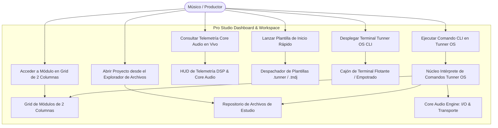
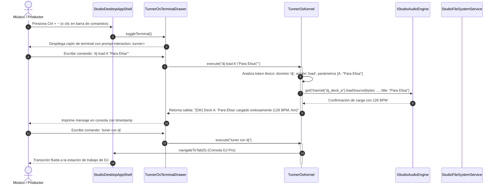

# Caso de Uso 101: Pro Studio Dashboard Hub, Activos Canónicos de Workspace y Terminal Interactiva Tunner OS

## Metadatos
- **ID:** `UC-101`
- **Fase:** Fase 1 / Experiencia de Estudio & Interoperabilidad
- **Estado:** Aprobado
- **Fecha:** 2026-11-17
- **Autor:** Antigravity AI & Tunner Architecture Team

---

## 1. Descripción
Este caso de uso especifica la evolución integral de la pantalla principal de Tunner Studio hacia un **Centro de Control de Estación de Audio Digital (Pro Studio Dashboard Hub)**. Transforma la vista inicial en un entorno de alta densidad con:
1. **Telemetría Core Audio en Tiempo Real:** Monitorización continua de frecuencia de muestreo (44.1/48.0 kHz), latencia (< 8ms), estado del Ring Buffer y medidor estéreo de entrada en decibelios Full Scale (dBFS).
2. **Grid Responsivo de 2 Columnas:** Despliegue ergonómico de los 5 módulos troncales (Afinador de Precisión, Aprender a Tocar, Rack Modular, Biblioteca de Partituras y Consola DJ Pro Workstation) junto con plantillas de inicio rápido (.tunner, .tndj, presets acústicos).
3. **Poblado Dinámico de Proyectos en el Workspace:** Eliminación del estado vacío `(0)` mediante inyección reactiva de obras y sesiones de demostración interactivas.
4. **Terminal Desplegable Tunner OS CLI (`Ctrl + ~`):** Consola interactiva de comandos en tiempo real para control unificado del transporte, enrutamiento, carga de pistas e inspección del sistema de archivos canónico.

---

## 2. Diagrama de Casos de Uso

---

## 3. Diagrama de Secuencia: Despliegue e Interacción con Terminal Tunner OS CLI

---

## 4. Precondiciones y Postcondiciones

### 4.1 Precondiciones
1. El motor de audio central (`IStudioAudioEngine` e `IStudioAudioInputEngine`) se encuentra instanciado en el contexto de la aplicación.
2. El repositorio de archivos (`StudioFileSystemRepository`) ha inicializado el árbol de directorios del proyecto.

### 4.2 Postcondiciones
1. El dashboard renderiza un grid de 2 columnas en resoluciones de escritorio ($\ge 950\text{ px}$), optimizando el aprovechamiento visual sin áreas vacías.
2. La barra lateral de archivos contiene al menos 4 activos de demostración con apertura interactiva inmediata.
3. La terminal Tunner OS procesa comandos válidos en $< 5\text{ ms}$ y emite mensajes de error claros con sintaxis de ayuda cuando los parámetros son incorrectos.

---

## 5. Requerimientos Funcionales y No Funcionales

- **REQ-01 (Grid de 2 Columnas):** En pantallas de escritorio, los módulos principales y las tarjetas de acción deben organizarse en 2 columnas balanceadas.
- **REQ-02 (Telemetría en Tiempo Real):** El panel superior debe consultar de forma reactiva el estado de `IStudioAudioEngine` e `IStudioAudioInputEngine` (tasa de muestreo, estado de captura y medidor dBFS).
- **REQ-03 (Intérprete de Comandos CLI):** El núcleo debe reconocer comandos para los dominios `dj`, `tuner`, `fs`, `io`, `dsp`, `theme` y `help`.
- **REQ-04 (Ergonomía de Terminal):** El cajón de terminal debe soportar navegación de historial con flechas arriba/abajo y tecla de escape o `Ctrl + ~` para ocultarse.
- **REQ-05 (Cero Bloqueo de Hilo):** La ejecución de comandos y el renderizado del terminal no deben impactar el procesamiento de audio ni la tasa de cuadros (60/120 FPS).
