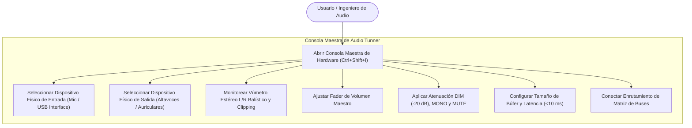
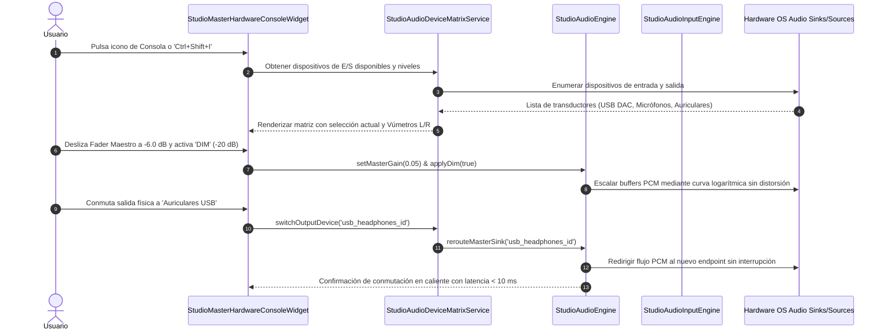

# Caso de Uso 102: Consola Maestra de E/S de Hardware y Matriz Dinámica de Audio

Este documento formaliza los requisitos, diagramas de arquitectura y flujos de ejecución para la Consola Maestra de Hardware y Matriz de Dispositivos de Audio de **Tunner Studio**.

---

## 1. Diagrama de Casos de Uso Formal (Mermaid)

---

## 2. Diagrama de Secuencia y Flujo de Señal (Mermaid)

---

## 3. Especificación Formal del Caso de Uso

### 3.1 Precondiciones
1. El motor de audio central de Tunner (`IStudioAudioEngine` e `IStudioAudioInputEngine`) está inicializado en la aplicación.
2. El sistema operativo host tiene al menos un endpoint de salida y un endpoint de captura de audio reconocidos.

### 3.2 Postcondiciones
1. La ganancia del bus maestro estéreo se actualiza inmediatamente en todos los canales de salida activos.
2. Los vúmetros L/R reflejan de forma continua la amplitud RMS y los picos en decibelios con tasa de refresco a 60 FPS.
3. La configuración seleccionada (dispositivo de entrada, salida, buffer y ganancia) se almacena para persistencia entre sesiones.

### 3.3 Flujo Principal
1. El usuario invoca la consola maestra mediante la combinación de teclas global `Ctrl+Shift+I` o pulsando el botón de consola en la barra superior.
2. La interfaz despliega el panel de hardware con los medidores estéreo, selector de dispositivos y fader maestro.
3. El usuario ajusta el nivel de salida con el fader táctil proporcional; el sistema recalcula los coeficientes de escala lineal:
   $$\text{Ganancia Lineal} = 10^{\frac{\text{dB}}{20}}$$
4. Si el nivel de señal supera los $0\text{ dBFS}$, el limitador suave atenúa suavemente los armónicos impares y enciende el LED de clipping en rojo.
5. El usuario conmuta dispositivos de hardware; la matriz transfiere el flujo de audio en caliente.

### 3.4 Flujos Alternativos y de Error
- **Error en conmutación de dispositivo hardware:** Si una interfaz USB es desconectada físicamente, el servicio conmuta automáticamente al dispositivo de audio predeterminado del sistema operativo sin bloquear la aplicación y muestra un aviso visual discreto.
- **Sobrecarga de búfer (Buffer Underrun):** Si el tamaño de búfer seleccionado (ej. 128 muestras) genera saturación en procesadores con alta carga, el sistema recomienda aumentar el búfer a 256 o 512 muestras.
