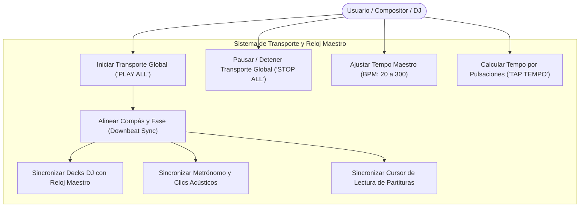
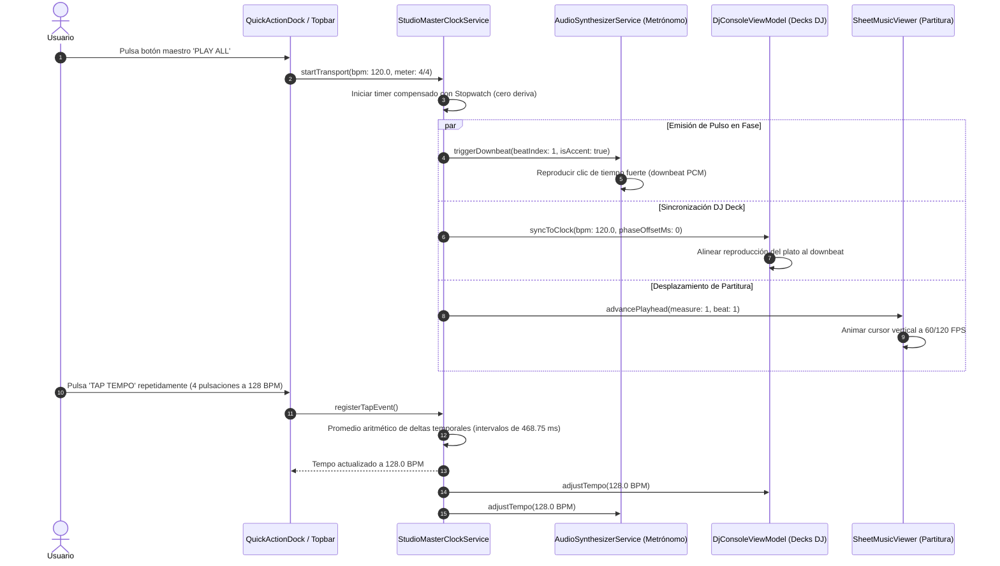

# Caso de Uso 103: Reloj Maestro de Transporte Unificado y Sincronización Global de Estudio

Este documento define la especificación canónica, diagramas de flujo y modelos de sincronización para el Reloj Maestro de Transporte Global (*Studio Master Clock*) de **Tunner**.

---

## 1. Diagrama de Casos de Uso Formal (Mermaid)

---

## 2. Diagrama de Secuencia de Sincronización de Fase (Mermaid)

---

## 3. Especificación Formal del Caso de Uso

### 3.1 Precondiciones
1. La aplicación Tunner está en ejecución y los módulos que requieren sincronización (Consola DJ, Metrónomo, Partitura) están instanciados.
2. No existen procesos de E/S que bloqueen el bucle de eventos principal.

### 3.2 Postcondiciones
1. El reloj de transporte emite eventos periódicos de pulso rítmico (*quarter notes*, *eighth notes*, *sixteenth notes*) con precisión de microsegundos.
2. La deriva temporal acumulativa $\Delta t_{\text{deriva}}$ se mantiene en $0.0\text{ ms}$ mediante compensación por `Stopwatch` del sistema operativo.
3. El estado de reproducción de todos los módulos suscriptores es consistente.

### 3.3 Flujo Principal
1. El usuario define el tempo maestro en la barra superior o pulsa `TAP TEMPO` en el teclado o pantalla táctil.
2. Al pulsar el botón `PLAY ALL` (o presionar la barra espaciadora en modo estudio), el `StudioMasterClockService` emite la señal de arranque con marca temporal $T_0$.
3. Cada pulso de reloj despacha eventos síncronos a los suscriptores:
   - El canal de metrónomo dispara el búfer PCM correspondiente.
   - La consola DJ calcula el factor de velocidad $R = \frac{\text{BPM}_{\text{maestro}}}{\text{BPM}_{\text{track}}}$ y ajusta el pitch sin discontinuidad.
   - El visor de partituras desplaza el cursor a lo largo de las cabezas de nota según la duración métrica correspondiente.
4. Al pulsar `STOP ALL`, el transporte se detiene y todos los módulos pausan su reproducción y resetean el playhead.

### 3.4 Flujos Alternativos y de Error
- **Desincronización por carga elevada de CPU:** Si el procesador experimenta un retraso temporal puntual, el reloj maestro calcula el número de ticks transcurridos en tiempo real mediante `elapsedMicroseconds` y adelanta la fase instantáneamente en lugar de acumular retraso, preservando la métrica global.
