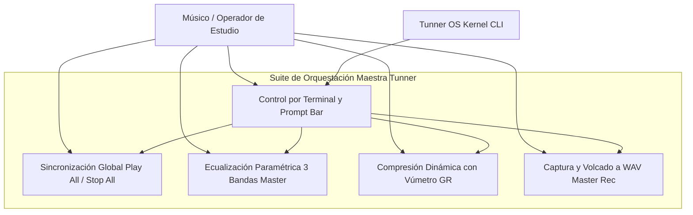
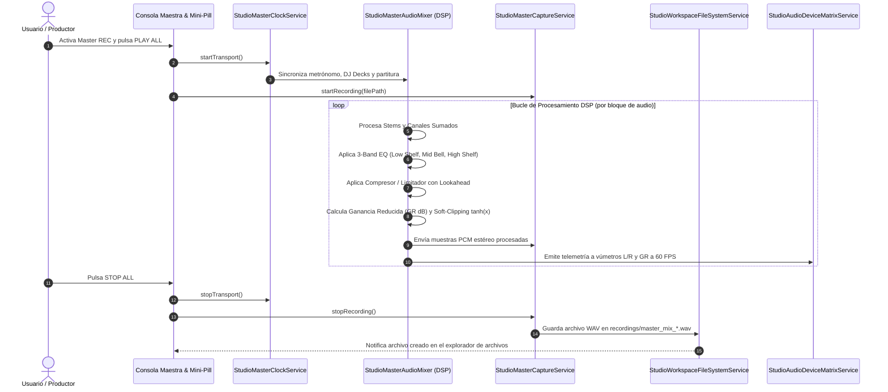

# Caso de Uso 104: Suite Unificada de Orquestación Maestra, Cadena DSP y Captura en Vivo (Master Studio Orchestration, DSP & Capture Suite)

---

## 1. Identificación y Metadatos

- **ID:** `UC-104`
- **Nombre:** Suite Unificada de Orquestación Maestra, Cadena DSP de Masterización, Captura en Vivo a WAV y Control CLI
- **Módulo:** Audio Core / Master Console / DSP / Studio Orchestration
- **Prioridad:** Alta (Arquitectura Crítica de Audio Profesional)
- **Actores:**
  - **Músico / Productor:** Requiere reproducir el estudio sincronizadamente, ecualizar y comprimir el bus de salida, grabar la mezcla en vivo y controlar el sistema por teclado o consola.
  - **DJ:** Requiere pre-escucha CUE, masterización con pegada y compresión para evitar saturación digital, y grabación de su set directamente a disco.
  - **Tunner Studio OS Kernel:** Intérprete de línea de comandos que orquesta las llamadas al subsistema de audio mediante comandos de prompt.
- **Fase de Desarrollo:** Fase 5 (Consolidación de Workstation Pro)
- **ADR Relacionado:** [ADR-0093](../04_adrs/0093_master_studio_orchestration_and_dsp_suite.md)
- **Plan de Implementación:** [Plan Master Studio Orchestration](../05_implementation_plans/plan_master_studio_orchestration_dsp_and_capture_suite.md)

---

## 2. Descripción General y Valor para el Producto

Este caso de uso unifica lo mejor de las capacidades de un estudio digital de audio (DAW) profesional dentro de Tunner:
1. **Sincronización Total de Transporte:** Conecta el reloj maestro (`StudioMasterClockService`) con el metrónomo, el visor de partituras/stems y la consola DJ para arrancar y detener todas las herramientas en fase acústica absoluta mediante `PLAY ALL` / `STOP ALL`.
2. **Cadena DSP de Masterización (Mastering Chain):** Incorpora en el bus maestro filtros biquad de segundo orden (Low Shelf, Mid Peaking y High Shelf) y un compresor/limitador analógico con medidor visual de reducción de ganancia (GR en dB).
3. **Captura y Exportación Maestra en Vivo (Master Mixdown to WAV):** Permite grabar en cualquier momento la mezcla total en formato WAV PCM (16/24 bits) y alojarla directamente en el explorador de archivos del proyecto (`StudioWorkspaceFileSystemService`).
4. **Comandos de Consola en Tunner OS Kernel:** Permite ajustar el reloj, el ruteo de la matriz y la cadena de masterización mediante comandos breves en el prompt (`/master`, `/route`, `/clock`, `/eq`, `/comp`).

---

## 3. Diagrama de Casos de Uso (Mermaid)

---

## 4. Diagrama de Secuencia y Flujo de Procesamiento Acústico (Mermaid)

---

## 5. Especificación de Flujos

### 5.1 Precondiciones
1. El motor de audio `IStudioAudioEngine` y la matriz `StudioAudioDeviceMatrixService` se encuentran inicializados y enlazados a los dispositivos físicos predeterminados.
2. El sistema de archivos del espacio de trabajo `StudioWorkspaceFileSystemService` está activo para alojar las grabaciones maestras.

### 5.2 Flujo Principal (Happy Path)
1. El usuario abre la consola maestra con `Ctrl+Shift+I` o mediante la mini-píldora inferior.
2. Ajusta el ecualizador de 3 bandas (ej. $+2\text{ dB}$ en graves a 100 Hz, $+1.5\text{ dB}$ en agudos a 8 kHz).
3. Configura el umbral de compresión en $-6\text{ dB}$ con ratio $4:1$.
4. Pulsa el botón `REC MASTER`. La consola y la mini-píldora muestran el indicador LED rojo activo y el cronómetro de grabación.
5. Pulsa `PLAY ALL`. El metrónomo, los reproductores de DJ y el cursor de partitura inician sincronizados al compás establecido por el reloj maestro.
6. El vúmetro de reducción de ganancia (GR) refleja dinámicamente la atenuación de picos transitorios.
7. Al finalizar la interpretación, pulsa `STOP ALL`. La reproducción se detiene y la grabación se finaliza automáticamente.
8. El archivo WAV masterizado queda disponible en el árbol del explorador para ser reproducido o exportado.

### 5.3 Flujos Alternativos y Excepciones
- **A1. Activación de Bypass en Cadena DSP:** Si el usuario desactiva el ecualizador o el compresor mediante el botón `BYPASS`, el flujo DSP omite las etapas de filtrado y dinámica, entregando la señal limpia sin latencia adicional.
- **A2. Espacio de disco bajo o fallo de I/O en grabación:** Si ocurre un error al escribir el archivo WAV, la grabación se aborta limpiamente, se emite una alerta en la barra de estado y el audio en vivo continúa sonando sin interrupciones.
- **A3. Ejecución por comandos CLI:** El usuario escribe `/master rec` o `/clock bpm 126` en la barra de prompt; el intérprete `TunnerOsKernel` traduce la instrucción y la despacha al servicio correspondiente.

---

## 6. Criterios de Aceptación (DoD de Caso de Uso)
1. **Rendimiento DSP:** Las rutinas de filtro biquad y cálculo de envolvente de compresión deben ejecutarse en sub-milisegundos sin generar pausas en la UI.
2. **Cero Busy-Waiting:** Tanto el reloj maestro como los temporizadores de vúmetro y reducción de ganancia deben respetar el planificador de hilos del sistema operativo.
3. **Formato WAV Estándar:** El archivo generado debe ser un WAV estándar PCM estéreo de 16/24 bits compatible con cualquier reproductor multimedia o DAW externo.
4. **100% de Pruebas Automatizadas:** Cobertura de pruebas para las fórmulas de ecualización, detector de picos del compresor, grabador WAV y comandos de consola.
