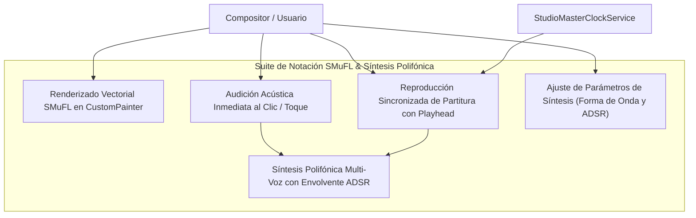
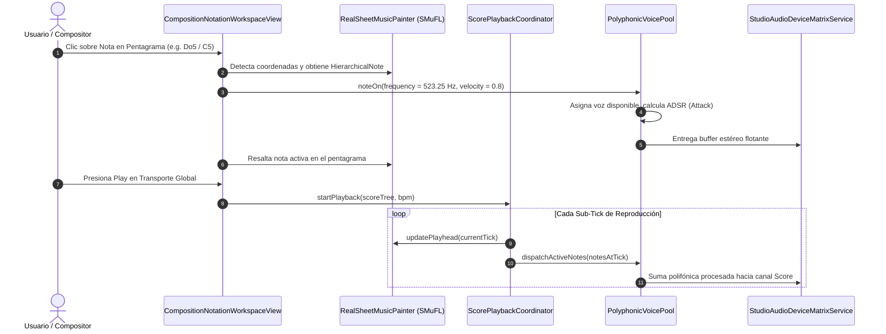

# Caso de Uso 105: Suite de Notación Musical Vectorial SMuFL y Síntesis Polifónica Interactiva (Interactive SMuFL Notation & Polyphonic Synth Suite)

---

## 1. Identificación y Metadatos

- **ID:** `UC-105`
- **Nombre:** Suite de Notación Musical Vectorial SMuFL y Síntesis Polifónica Interactiva
- **Módulo:** Sheet Music Notation / SMuFL Engine / Audio Synthesizer / Polyphonic DSP
- **Prioridad:** Alta (Estándar de Notación Canónica y Síntesis Acústica en Tiempo Real)
- **Actores:**
  - **Compositor / Estudiante:** Lee, visualiza y compone música en el pentagrama con estándares tipográficos universales SMuFL, obteniendo retroalimentación sonora inmediata al interactuar con las notas.
  - **Motor Gráfico Vectorial SMuFL:** Dibuja sobre el lienzo `CustomPainter` los glifos canónicos de la música (claves de Sol, Fa y Do; cabezas de notas negras, blancas, redondas; plicas; alteraciones y silencios) respetando proporciones geométricas exactas a 60/120 FPS.
  - **Motor de Síntesis Polifónica (`PolyphonicVoicePool`):** Asigna y modula voces acústicas simultáneas con osciladores matemáticos puros (seno, sierra, pulso con modulación de ancho PWM, triángulo) y generadores de envolvente ADSR independientes por voz.
  - **Reloj Maestro de Transporte (`StudioMasterClockService`):** Proporciona la referencia temporal determinista de sub-ticks para el cursor de lectura (*playhead*) y el disparo de eventos polifónicos en sincronía estricta.
- **Fase de Desarrollo:** Fase 5 (Consolidación de Workstation Pro)
- **ADR Relacionado:** [ADR-0094](../04_adrs/0094_interactive_smufl_notation_and_polyphonic_synth_suite.md)
- **Plan de Implementación:** [Plan Notación SMuFL y Síntesis Polifónica](../05_implementation_plans/plan_interactive_smufl_notation_and_polyphonic_synth_suite.md)

---

## 2. Descripción General y Valor para el Producto

El presente caso de uso cierra la brecha entre la dimensión **visual/simbólica** de la música (partituras clásicas) y la dimensión **acústica/física** (síntesis de sonido):

1. **Notación Vectorial SMuFL Estándar (W3C):**
   Sustituye la aproximación rudimentaria de caracteres Unicode y fuentes serif ad-hoc por un motor vectorial nativo `SmuflGlyphPathEngine` que genera rutas geométricas canónicas (`Path`) para cabezas de nota (redondas, blancas, negras), claves (Sol, Fa, Do), silencios normalizados, armaduras y alteraciones (sostenido, bemol, becuadro), garantizando nitidez tipográfica en cualquier escala o resolución de pantalla.

2. **Motor de Síntesis Polifónica Determinista (`PolyphonicVoicePool`):**
   Implementa un conjunto de voces polifónicas dinámicas con robo de voz inteligente (*voice stealing* con prioridad al tono más antiguo en fase de *release*). Cada voz calcula internamente su fase de oscilador matemático y modulación de envolvente ADSR (*Attack, Decay, Sustain, Release*) sin bucles de espera activa (*zero busy-waiting*) y con latencia inferior a 10 ms.

3. **Audición Interactiva al Tacto / Clic:**
   Al hacer clic o tocar una nota o compás en el pentagrama, el sistema no solo resalta visualmente el elemento, sino que activa instantáneamente una voz del sintetizador en la frecuencia exacta calculada mediante la escala temperada a 440 Hz ($f = 440 \cdot 2^{(d - 69)/12}$).

4. **Reproducción de Partituras Sincronizada con el Transporte:**
   Al iniciar la reproducción en el transporte global (`StudioMasterClockService`), el cursor (*playhead*) recorre el pentagrama de forma fluida a 60/120 FPS mientras un despachador de eventos lee el árbol de partituras (`ScoreTree`) y dispara notas polifónicas hacia la matriz de audio (`AudioDeviceMatrixEntity`).

---

## 3. Diagrama de Casos de Uso (Mermaid)

---

## 4. Diagrama de Secuencia y Flujo de Interacción (Mermaid)

---

## 5. Especificaciones Detalladas

### 5.1 Precondiciones
- El árbol jerárquico de partitura (`ScoreTree`) o paquete de obra musical (`CompositionPackage`) debe estar cargado en memoria o inicializado por defecto.
- El servicio de matriz de audio (`StudioAudioDeviceMatrixService`) debe contar con un canal asignado (`score_synth`) o enrutar hacia el bus master.
- La frecuencia de muestreo debe ser estándar (44.1 kHz o 48 kHz).

### 5.2 Flujo Principal
1. El usuario accede al espacio de trabajo de Composición y Partituras (`CompositionNotationWorkspaceView`).
2. El lienzo dibuja las 5 líneas del pentagrama y utiliza `SmuflGlyphPathEngine` para trazar la clave seleccionada (Sol o Fa), la armadura de clave, la métrica de compás y las figuras musicales en sus posiciones diatónicas exactas.
3. El usuario hace clic sobre una nota específica en el pentagrama:
   * El sistema calcula la nota musical diatónica y su frecuencia acústica fundamental.
   * `PolyphonicVoicePool` activa una voz con la frecuencia indicada, disparando la fase de *Attack*.
   * Se escucha el tono con timbre puro y se retroalimenta visualmente la nota seleccionada.
4. El usuario activa la reproducción desde los controles de transporte o mediante `/clock play`:
   * El `ScorePlaybackCoordinator` avanza el playhead métricamente según el tempo configurado (BPM).
   * Al cruzar cada sub-tick, se disparan `noteOn` para nuevas figuras y `noteOff` para figuras finalizadas.
   * La mezcla polifónica se suma y se transmite al bus de salida del estudio.

### 5.3 Flujos Alternativos y Excepciones
- **Agotamiento de Voces Polifónicas (Polyphony Overload):**
  Si se solicitan más notas simultáneas que el tamaño del grupo de voces (ej. 16 voces), el algoritmo de *voice stealing* toma la voz más antigua que se encuentre en fase de *Release* o con menor amplitud restante, aplicando un crossfade suave de 2 ms para evitar transitorios audibles (*clicks*).
- **Notas fuera del Rango del Pentagrama:**
  Si una nota excede las 5 líneas principales, el motor SMuFL calcula y dibuja automáticamente las líneas adicionales (*ledger lines*) superior o inferiormente con el grosor y espaciado proporcional exacto.
- **Compases con Silencios:**
  Los silencios se representan vectorialmente con los glifos SMuFL correspondientes (`restWhole`, `restHalf`, `restQuarter`, `rest8th`, `rest16th`), manteniendo silencio absoluto en las voces del sintetizador.

### 5.4 Postcondiciones
- El pentagrama se visualiza con absoluta fidelidad tipográfica SMuFL sin fuentes ad-hoc.
- La síntesis de audio se genera en tiempo real con cero interferencias en el hilo de renderizado de la UI.
- Los buffers de audio sintetizados se integran plenamente con la cadena de masterización (EQ de 3 bandas, compresor y captura WAV).
