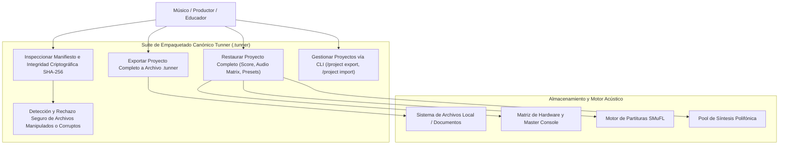
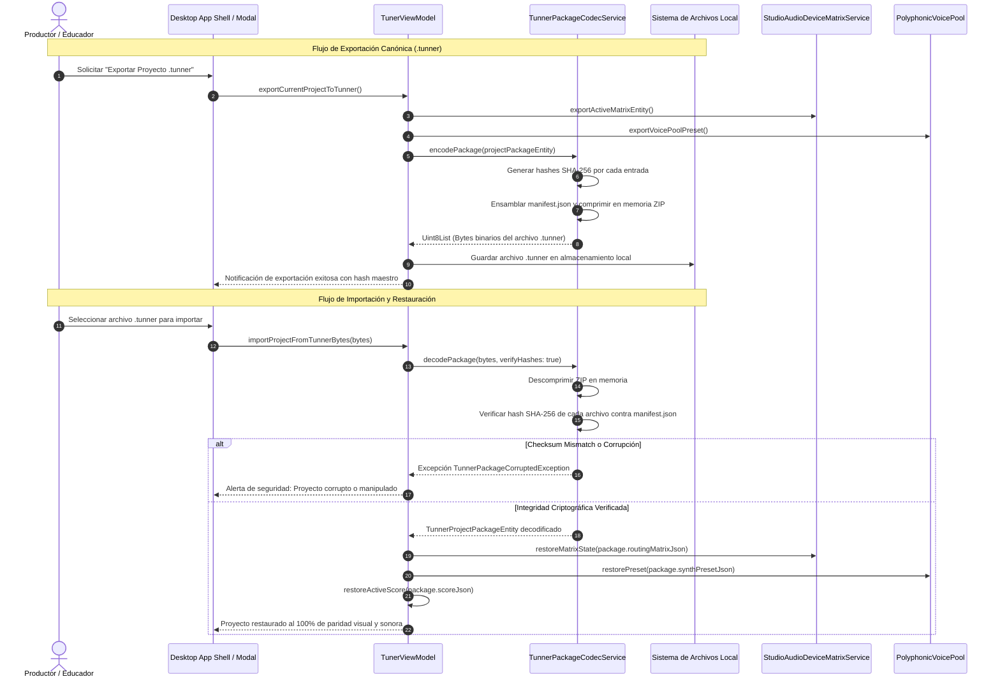

# Caso de Uso 106: Formato Canónico (.tunner), Contenedor de Proyecto Universal y Serialización Lossless

---

## Metadatos

- **ID del Caso de Uso:** `UC-106`
- **Nombre:** Formato Canónico de Paquete (.tunner), Contenedor de Proyectos de Estudio y Serialización Criptográfica Lossless
- **Módulo:** Core Packaging & Audio Project Workspace
- **Fase Asociada:** Fase 6 (Ecosistema de Plataforma Autónoma y Contenedor Canónico)
- **Actores:** Productor Musical / Educador, `TunnerPackageCodecService`, `StudioAudioDeviceMatrixService`, `TunerViewModel`, `TunnerOsKernel`.
- **Issue Relacionado:** [#33](https://github.com/Nicolas11Leon/Tunner/issues/33)
- **ADR Relacionado:** [ADR 0095](../04_adrs/0095_canonical_tunner_project_container_and_lossless_serialization.md)
- **Plan Relacionado:** [Plan Épica 6.1](../05_implementation_plans/plan_canonical_tunner_project_container_and_lossless_serialization.md)

---

## 1. Resumen Ejecutivo

Este caso de uso formaliza el estándar de empaquetado, exportación y restauración de proyectos completos de **Tunner** mediante el contenedor canónico `.tunner`. 

El formato `.tunner` es un paquete comprimido determinista (formato DEFLATE/ZIP) que encapsula íntegramente la matriz de hardware (`routing_matrix.json`), las partituras jerárquicas vectoriales (`notation/score.json`), los sintetizadores polifónicos y presets de envolventes ADSR (`instruments/synth_preset.json`), el estado de decks y blueprints de DJ (`dj_workstation/session.json`), y los stems de audio PCM (`audio_vault/stems/`), junto con un manifiesto con firma de integridad criptográfica SHA-256 (`manifest.json`) para prevenir cualquier corrupción acústica.

---

## 2. Diagrama de Casos de Uso (Mermaid)

---

## 3. Diagrama de Flujo y Secuencia (Mermaid)

---

## 4. Precondiciones y Postcondiciones

### 4.1 Precondiciones
1. La aplicación debe contar con un espacio de trabajo inicializado.
2. Si se importa un archivo `.tunner`, el arreglo de bytes debe ser accesible en memoria o desde disco local.
3. El formato de compresión debe ser estándar DEFLATE/ZIP ejecutable en memoria sin llamadas a red.

### 4.2 Postcondiciones
1. El proyecto exportado contiene todas las pistas, enrutamiento, sintetizadores y partituras en un único archivo autónomo portable entre Linux, Windows, macOS, Android e iOS.
2. La restauración del archivo recrea de forma bit a bit el estado acústico de la matriz de hardware y la configuración tímbrica.

---

## 5. Flujos del Sistema

### 5.1 Flujo Principal: Exportación de Proyecto
1. El usuario ejecuta la acción de exportación desde la barra de menú, modal de proyectos o comando `/project export <nombre>`.
2. El sistema recopila el estado de la partitura activa, la matriz de audio, los presets del sintetizador polifónico y los stems registrados.
3. `TunnerPackageCodecService` genera el `TunnerProjectManifestEntity` calculando los hashes SHA-256 de cada archivo interno.
4. Se empaqueta en memoria el contenedor binario `.tunner`.
5. Se retorna el archivo guardado y se confirma la operación.

### 5.2 Flujo Alternativo: Detección de Manipulación o Corrupción
1. El usuario intenta abrir un archivo `.tunner` que ha sido modificado externamente o dañado en disco.
2. Al decodificar el archivo, `TunnerPackageCodecService` recalcula el hash SHA-256 de cada componente y lo compara contra el registrado en `manifest.json`.
3. Si algún hash no coincide, el sistema rechaza la carga, preserva el estado en memoria sin corromper la sesión actual y reporta el error exacto con el archivo alterado.
