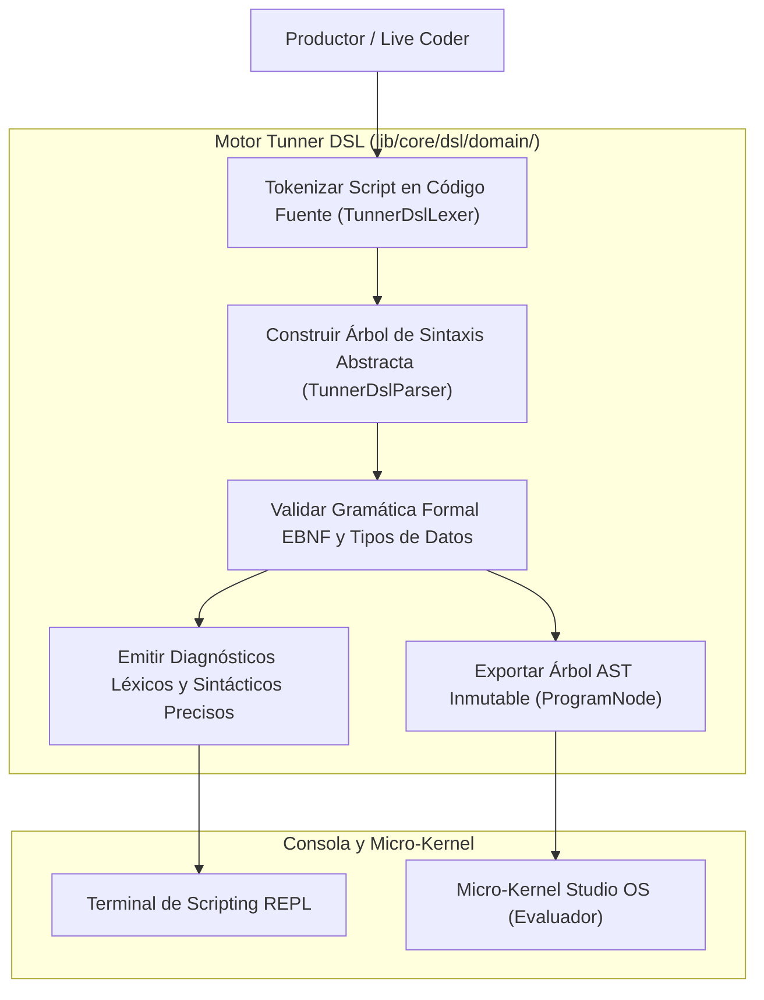

# Caso de Uso 107: Motor de Lenguaje Específico de Dominio (Tunner DSL): Lexer, Parser Recursivo Descendente y AST

---

## Metadatos

- **ID del Caso de Uso:** `UC-107`
- **Nombre:** Motor de Análisis Léxico, Sintáctico y Árbol de Sintaxis Abstracta (AST) para Tunner DSL
- **Módulo:** Core DSL & Scripting Engine
- **Fase Asociada:** Fase 6 (Ecosistema de Plataforma Autónoma y Lenguaje DSL)
- **Actores:** Productor Musical / Live Coder, `TunnerDslLexer`, `TunnerDslParser`, `TunnerAstNode`, `TunnerOsKernel`.
- **Issue Relacionado:** [#34](https://github.com/Nicolas11Leon/Tunner/issues/34)
- **ADR Relacionado:** [ADR 0096](../04_adrs/0096_tunner_dsl_lexer_parser_and_ast_engine.md)
- **Plan Relacionado:** [Plan Épica 6.2](../05_implementation_plans/plan_tunner_dsl_lexer_parser_and_ast_engine.md)

---

## 1. Resumen Ejecutivo

Este caso de uso formaliza el motor léxico (Lexer) y sintáctico descendente recursivo (Recursive Descent Parser) del lenguaje declarativo **Tunner DSL**. 

El lenguaje permite a los productores, desarrolladores y educadores programar partituras, secuencias polifónicas, automatización de parámetros de hardware (`@master.gain`, `@eq.low`) y enrutamiento dinámico (`connect @synth.out -> @master.in`) mediante código conciso, determinista y seguro ante excepciones, ejecutándose en menos de 5 ms en el hilo principal sin bloqueos.

---

## 2. Diagrama de Casos de Uso (Mermaid)



---

## 3. Diagrama de Secuencia (Mermaid)

```mermaid
sequenceDiagram
    autonumber
    actor Dev as Músico / Live Coder
    participant REPL as Terminal / Consola REPL
    participant LEXER as TunnerDslLexer
    participant PARSER as TunnerDslParser
    participant AST as ProgramNode (AST)

    Dev->>REPL: Ingresar script DSL: "tempo 130; note C4 1/4; connect @synth.out -> @master.in;"
    REPL->>LEXER: tokenize(sourceCode)
    LEXER->>LEXER: Escaneo de caracteres y palabras reservadas
    LEXER-->>PARSER: List<TunnerDslToken> (tokens con línea y columna)
    PARSER->>PARSER: parseProgram() mediante descenso recursivo
    alt Error de Sintaxis Detectado
        PARSER-->>REPL: TunnerDslResult con diagnósticos de error
        REPL-->>Dev: Mensaje de error visual resaltando línea y columna
    else Sintaxis 100% Válida
        PARSER->>AST: Instanciar nodos inmutables (Tempo, Note, Connect)
        PARSER-->>REPL: TunnerDslResult(program: ProgramNode, isSuccess: true)
        REPL-->>Dev: Script validado listo para ejecución en tiempo real
    end
```

---

## 4. Precondiciones y Postcondiciones

### 4.1 Precondiciones
1. El script de entrada es una cadena de texto UTF-8 con sentencias delimitadas por punto y coma (`;`).
2. Cero dependencias de librerías nativas externas o paquetes de terceros no deterministas (Dart puro).

### 4.2 Postcondiciones
1. Si el código es sintácticamente correcto, se genera un `ProgramNode` inmutable que puede ser interpretado por el micro-kernel en tiempo $O(N)$ lineal.
2. Si el código contiene errores léxicos o sintácticos, el parser no arroja fallos fatales no controlados; en su lugar retorna una lista estructurada de `TunnerDslDiagnostic` con descripción del error, número de línea y columna.

---

## 5. Especificación de la Gramática Formal (EBNF)

```ebnf
Program         ::= Statement* <EOF>
Statement       ::= TempoStmt | ChannelStmt | ConnectStmt | SetParamStmt | NoteStmt | ChordStmt | RestStmt | TransportStmt
TempoStmt       ::= "tempo" NUMBER ";"
ChannelStmt     ::= "channel" IDENTIFIER ";"
ConnectStmt     ::= "connect" AT_IDENTIFIER "->" AT_IDENTIFIER ";"
SetParamStmt    ::= "set" AT_IDENTIFIER "." IDENTIFIER "=" Value [UNIT] ";"
NoteStmt        ::= "note" IDENTIFIER FRACTION ";"
ChordStmt       ::= "chord" "[" IDENTIFIER ("," IDENTIFIER)* "]" FRACTION ";"
RestStmt        ::= "rest" FRACTION ";"
TransportStmt   ::= ("play" | "pause" | "stop") ";"
Value           ::= NUMBER | STRING | IDENTIFIER
FRACTION        ::= NUMBER "/" NUMBER
```
