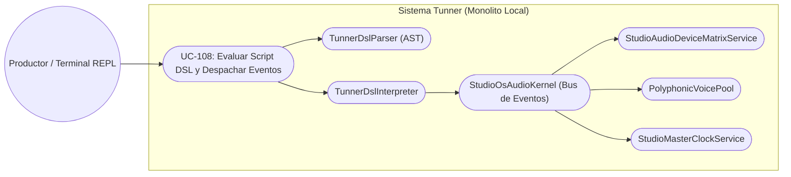
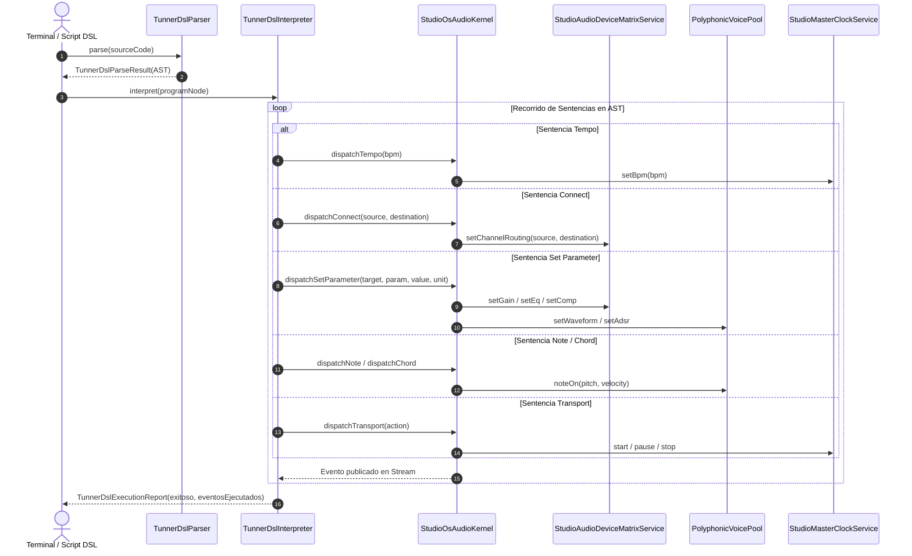

# Caso de Uso Canónico: UC-108-STUDIO-OS-AUDIO-KERNEL-AND-DSL-EVALUATOR

Documento formal de especificación del caso de uso correspondiente al Micro-Kernel de Ejecución Acústica en Proceso, Bus de Eventos en Tiempo Real y Evaluador del Lenguaje Específico de Dominio (Tunner DSL).

---

## Metadatos del Caso de Uso

- **ID del Caso de Uso:** `UC-108-STUDIO-OS-AUDIO-KERNEL-AND-DSL-EVALUATOR`
- **Nombre Canónico:** Ejecutar Scripts Declarativos Tunner DSL y Despachar Eventos Acústicos en Tiempo Real mediante el Micro-Kernel de Tunner Studio OS
- **Fase Asociada:** Fase 6 (Arquitectura de Formato Canónico .tunner, Lenguaje DSL y Studio OS)
- **Actor Principal:** Ingeniero de Sonido / Músico Productor / Terminal REPL
- **Actores Secundarios:** Micro-Kernel Studio OS, Matriz de Dispositivos de Audio, Banco de Osciladores Polifónicos, Reloj Maestro de Transporte
- **Estado:** Approved

---

## 1. Descripción Breve y Propósito

El caso de uso permite interpretar y evaluar en caliente un Árbol de Sintaxis Abstracta (AST) derivado de un script en Tunner DSL, transformando sentencias declarativas de enrutamiento (`connect`), control de parámetros (`set`), transporte (`play`, `pause`, `stop`), tempo (`tempo`) y secuencias melódicas/acórdicas (`note`, `chord`, `rest`, `loop`) en eventos acústicos deterministas despachados con latencia sub-10ms a través del bus de eventos de Tunner Studio OS, garantizando cero interferencias en el flujo de reproducción de audio.

---

## 2. Diagrama de Caso de Uso (Mermaid)

---

## 3. Precondiciones y Postcondiciones

### 3.1 Precondiciones
1. El script fuente ha sido validado léxica y sintácticamente por `TunnerDslParser` con cero errores fatales.
2. El micro-kernel `StudioOsAudioKernel` se encuentra instanciado y conectado al bus reactivo de audio del sistema.
3. Los módulos de hardware y síntesis (`StudioAudioDeviceMatrixService`, `PolyphonicVoicePool`, `StudioMasterClockService`) están inicializados en memoria local sin dependencia de red.

### 3.2 Postcondiciones
1. Las modificaciones de parámetros, conexiones de matriz y eventos de notas se aplican de manera atómica y síncrona/reactiva en el motor de audio.
2. Cada evento evaluado es publicado en `StudioOsAudioKernel.eventStream` para observabilidad en tiempo real por consolas y widgets.
3. Cero bloqueos en el hilo principal de la interfaz de usuario (UI jank = 0) y tiempo de despacho por evento inferior a 1 ms.

---

## 4. Diagrama de Secuencia (Mermaid)

---

## 5. Flujo Principal de Ejecución (Paso a Paso)

1. El usuario o script interactivo suministra código fuente en Tunner DSL.
2. El evaluador `TunnerDslInterpreter` invoca el parser y comprueba la ausencia de diagnósticos de error.
3. El intérprete recorre los nodos del AST utilizando el patrón Visitor inmutable (`TunnerAstVisitor`).
4. Para sentencias de tempo, se notifica al kernel y se calibra el generador de pulsos del reloj maestro.
5. Para sentencias de asignación (`set`), se identifica el dispositivo (`@master`, `@synth`, `@eq`, `@comp`) y se invoca el método correspondiente con clamp estricto.
6. Para sentencias de conexión (`connect`), se mapean las fuentes de salida hacia buses receptores en la matriz de parcheo.
7. Para sentencias de notas y acordes, se calcula la frecuencia tonal exacta en Hz y se instruye al banco de osciladores polifónicos.
8. Para sentencias de transporte, se conmutan los estados de reproducción del sistema.
9. Se emite un `TunnerDslExecutionReport` detallando las sentencias ejecutadas y la telemetría del sistema.

---

## 6. Flujos Alternativos y Excepciones

- **Parámetro o Dispositivo Desconocido:** Si el script referencia un nodo no soportado (ej. `@desconocido.valor = 10`), el intérprete emite una advertencia didáctica en el reporte sin detener la ejecución de las sentencias subsiguientes.
- **Formato Numérico Fuera de Rango:** Si un valor excede los límites físicos (ej. ganancia > +12 dB en EQ), el kernel aplica saturación (*clamping*) al límite seguro y registra un evento de saturación.
- **Error Sintáctico Previo:** Si el parser retorna un programa nulo o con errores críticos, la evaluación es abortada preventivamente sin alterar el estado del hardware de audio.
