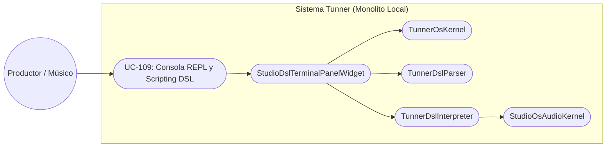
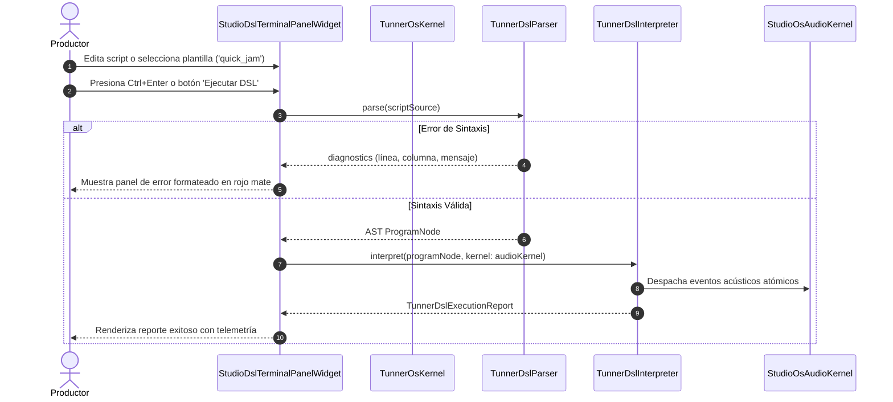

# Caso de Uso Canónico: UC-109-STUDIO-DSL-TERMINAL-REPL

Documento formal de especificación del caso de uso correspondiente a la Terminal REPL y Consola de Scripting Interactiva para Tunner Studio OS.

---

## Metadatos del Caso de Uso

- **ID del Caso de Uso:** `UC-109-STUDIO-DSL-TERMINAL-REPL`
- **Nombre Canónico:** Interactuar, Editar y Ejecutar Macros y Scripts Tunner DSL mediante la Consola Acoplable Studio REPL
- **Fase Asociada:** Fase 6 (Arquitectura de Formato Canónico .tunner, Lenguaje DSL y Studio OS)
- **Actor Principal:** Ingeniero de Sonido / Músico Productor / Live Coder
- **Actores Secundarios:** TunnerOsKernel, TunnerDslParser, TunnerDslInterpreter, StudioOsAudioKernel
- **Estado:** Approved

---

## 1. Descripción Breve y Propósito

El caso de uso provee una interfaz gráfica interactiva de terminal y consola REPL (*Read-Eval-Print Loop*) acoplable para Tunner Studio, con editor multilínea, resaltado visual de sintaxis, atajos de hardware (`Ctrl+Enter` / `Cmd+Enter`), plantillas acústicas precargadas (`quick_jam.tun`, `mastering_chain.tun`), historial navegable y panel de salida con telemetría de ejecución en tiempo real a 60/120 FPS.

---

## 2. Diagrama de Caso de Uso (Mermaid)

---

## 3. Precondiciones y Postcondiciones

### 3.1 Precondiciones
1. El usuario tiene activa la interfaz de Tunner Desktop o Modular Studio Rack.
2. `TunnerOsKernel` se encuentra instanciado con el motor DSL y el micro-kernel de audio acoplados.

### 3.2 Postcondiciones
1. El script editado se compila y ejecuta en menos de 5 ms sin pérdida de frames en el renderizado UI.
2. Los resultados, diagnósticos o advertencias se visualizan con tipografía monoespaciada de alta precisión.
3. El historial de scripts ejecutados se persiste en memoria para navegación inmediata mediante teclas de dirección.

---

## 4. Diagrama de Secuencia (Mermaid)

---

## 5. Flujo Principal de Ejecución

1. El usuario abre el panel REPL desde la barra de herramientas o el atajo de teclado.
2. El usuario introduce sentencias en Tunner DSL o presiona un botón de plantilla predeterminada.
3. Al accionar `Ctrl+Enter` o pulsar `Ejecutar`:
   - El widget valida el código fuente mediante `TunnerDslParser`.
   - Si no hay errores, delega al intérprete `TunnerDslInterpreter`.
   - Cada evento es aplicado en tiempo real a los osciladores y la matriz de mezcla.
4. El panel de salida muestra el número de sentencias ejecutadas, tiempo de compilación y eventos despachados.
5. El script ejecutado se almacena en el historial para posterior recuperación con `ArrowUp` / `ArrowDown`.

---

## 6. Flujos Alternativos y Excepciones

- **Script con Errores de Sintaxis:** La consola muestra cada diagnóstico con sus coordenadas de línea y columna, resaltando la instrucción errónea sin alterar los parámetros de audio.
- **Limpieza de Consola:** El comando o botón `Limpiar` vacía el búfer de salida visual sin reiniciar el estado de los instrumentos de audio.
