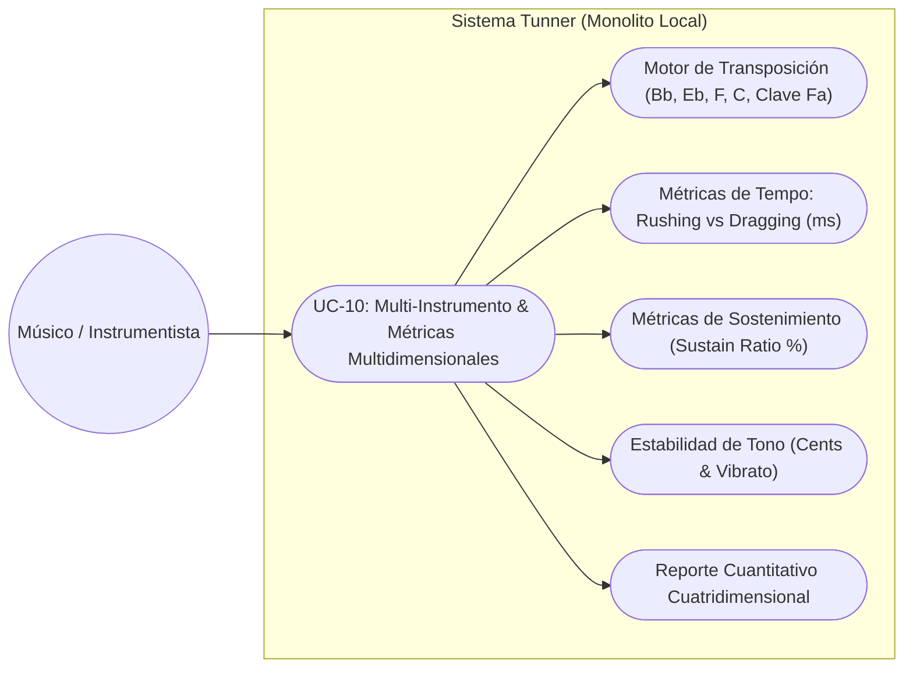
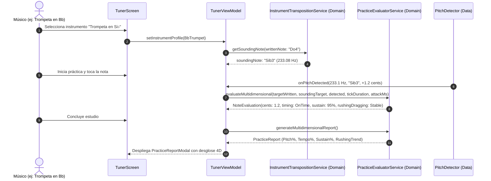

# Use Case: UC-10 Multi-Instrument Transposition & Multi-Dimensional Interpretation Analytics

Este documento formaliza el caso de uso para la transposición automática multi-instrumento (Bb, Eb, F, C, Bass) y el cálculo analítico multidimensional de afinación, tempo (rushing/dragging) y sostenimiento rítmico en **Tunner**.

---

## Metadatos del Caso de Uso

- **ID del Caso de Uso:** `UC-10-MULTI-INSTRUMENT-AND-MULTIDIMENSIONAL-METRICS`
- **Nombre Canónico:** `Transponer por Instrumento y Evaluar Múltiples Dimensiones Interpretativas`
- **Fase Asociada:** `Fase 3 & Fase 4`
- **Actor Principal:** `Estudiante / Músico Multidisciplinario`
- **Actores Secundarios:** `Motor de Detección de Frecuencia (Data), Reloj de Metrónomo (Data), Canvas de Partitura (Presentation)`
- **Estado:** `Approved`

---

## 1. Descripción Breve y Propósito

Permite a cualquier instrumentista (maderas, metales, cuerdas, voz) seleccionar su instrumento específico. Tunner ajusta automáticamente:
1. **Transposición Armónica:** Mapea la nota escrita en la partitura a la frecuencia física esperada en el micrófono (ej. para Trompeta en Si♭, un Do4 escrito exige captar un Si♭3 sonando a $233.08\text{ Hz}$).
2. **Evaluación de Tempo y Tendencia Rítmica:** Mide la latencia temporal del ataque en milisegundos ($\Delta\text{ms}$) e identifica cuantitativamente si el músico tiende al apresuramiento (*rushing*) o al retraso (*dragging*).
3. **Duración y Sostenimiento de Figura (Sustain Ratio):** Evalúa si la nota fue sostenida durante todo su valor rítmico o cortada prematuramente.
4. **Estabilidad Tonal:** Evalúa si la embocadura se mantuvo firme o presentó oscilaciones erráticas (*pitch wobble / jitter*).

---

## 2. Diagrama de Caso de Uso (Mermaid)

---

## 3. Precondiciones y Postcondiciones

### 3.1 Precondiciones
1. El usuario selecciona su instrumento en el catálogo disponible o conserva el instrumento en Do por defecto.
2. La partitura contiene notas musicales con duraciones rítmicas definidas.
3. El micrófono y metrónomo se encuentran disponibles.

### 3.2 Postcondiciones
1. Las notas de partitura se contrastan contra la frecuencia real transpuesta del instrumento sin requerir cálculo mental del músico.
2. Cada evento musical registra: desvío en cents, latencia temporal ($\Delta\text{ms}$), categoría de tendencia rítmica (*On-Time*, *Rushing*, *Dragging*) y porcentaje de sostenimiento completado.
3. El reporte post-estudio detalla las 4 dimensiones de forma separada y ponderada.

---

## 4. Diagrama de Flujo y Secuencia (Mermaid)

---

## 5. Flujo Principal de Eventos (Happy Path)

1. El usuario escoge su instrumento (ej. Saxofón Alto en Mi♭).
2. El sistema aplica una transposición de $-3$ semitonos (o $+9$ según octava de registro).
3. Al tocar, el detector de tono captura la nota sonora acústica.
4. El evaluador calcula simultáneamente:
   - **Afinación:** Desvío exacto respecto a la nota sonora transpuesta.
   - **Tempo:** Diferencia de milisegundos con el tick ideal ($\Delta\text{ms}$).
   - **Sustain:** Proporción de ticks que la nota se mantuvo activa.
5. Al completar la pieza, se compilan los indicadores de *Rushing/Dragging* y duraciones.

---

## 6. Criterios de Calidad y No Negociables
- **Transposición Exacta:** Cálculo semitonal conforme a afinación temperada universal ($A_4 = 440\text{ Hz}$).
- **Cero Latencia Agregada:** El cálculo de transposición y métricas de sostenimiento se ejecuta en tiempo $O(1)$ sin asignaciones de memoria pesadas.
