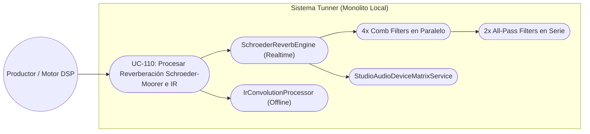
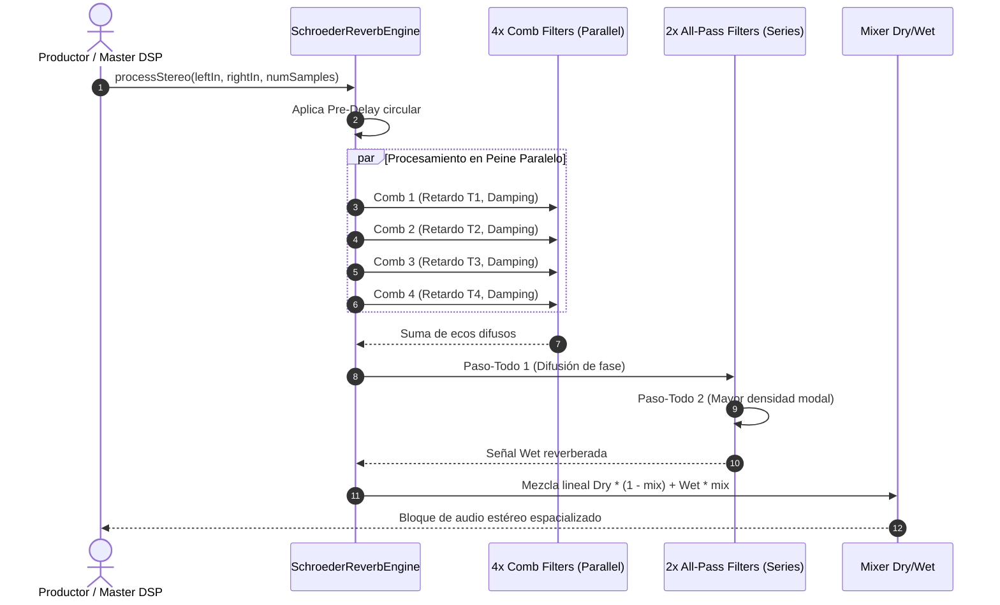

# Caso de Uso Canónico: UC-110-SCHROEDER-MOORER-REVERB-AND-CONVOLUTION

Documento formal de especificación del caso de uso correspondiente al Procesador de Reverberación Algorítmica Schroeder-Moorer y Convolución de Respuesta al Impulso (IR) 100% Offline.

---

## Metadatos del Caso de Uso

- **ID del Caso de Uso:** `UC-110-SCHROEDER-MOORER-REVERB-AND-CONVOLUTION`
- **Nombre Canónico:** Procesar Espacialización y Reverberación Acústica Algorítmica Schroeder-Moorer y Convolución IR Offline
- **Fase Asociada:** Fase 7 (Procesamiento de Señal Acústica Avanzado y Espacialización 3D)
- **Actor Principal:** Ingeniero de Sonido / Músico Productor / Motor DSP de Masterización
- **Actores Secundarios:** SchroederReverbEngine, IrConvolutionProcessor, StudioAudioDeviceMatrixService, TunnerOsKernel
- **Estado:** Approved

---

## 1. Descripción Breve y Propósito

El caso de uso provee emulación acústica de salas (*Room Simulation*) en tiempo real y offline mediante dos topologías complementarias en Dart puro:
1. **Reverberador Algorítmico Schroeder-Moorer:** 4 filtros en peine (*Feedback Comb Filters*) con retardos primos relativos y amortiguación paso-bajo en el lazo de realimentación, sumados a 2 filtros paso-todo (*All-Pass Filters*) en serie para incrementar la densidad modal sin coloración de fase.
2. **Procesador de Convolución IR Offline:** Aplica respuestas al impulso acústicas reales (grabadas en auditorios, catedrales o cámaras anecoicas) a pistas WAV o stems completos de forma matemáticamente exacta sin deriva numérica.

---

## 2. Diagrama de Caso de Uso (Mermaid)

---

## 3. Precondiciones y Postcondiciones

### 3.1 Precondiciones
1. El búfer de audio estéreo de entrada se encuentra normalizado en valores flotantes $[-1.0, 1.0]$.
2. La frecuencia de muestreo está configurada (por defecto 44100 Hz o 48000 Hz).
3. Los filtros circulares de memoria estática (`Float32List`) están preasignados para evitar *garbage collection* en el hilo de audio.

### 3.2 Postcondiciones
1. La señal procesada conserva rango dinámico sin distorsión por saturación mediante normalización interna y limitación suave.
2. Latencia de procesamiento por bloque inferior a 2 ms, cumpliendo holgadamente el objetivo sub-10ms.
3. Posibilidad de modular Room Size, Damping, Pre-Delay y mezcla Dry/Wet en caliente sin artefactos auditivos (*clicks* o *zipper noise*).

---

## 4. Diagrama de Secuencia (Mermaid)

---

## 5. Especificaciones Matemáticas de los Filtros

1. **Filtro en Peine con Amortiguación (Comb Filter with Low-pass Damping):**
   $$y[n] = x[n - D] + g \cdot s[n]$$
   $$s[n] = (1 - d) \cdot y[n] + d \cdot s[n - 1]$$
   Donde $D$ es el retardo en muestras, $g$ es la ganancia de realimentación (derivada del Room Size) y $d$ es el coeficiente de amortiguación (Damping).

2. **Filtro Paso-Todo (Schroeder All-Pass Filter):**
   $$y[n] = -a \cdot x[n] + x[n - D] + a \cdot y[n - D]$$
   Garantiza $|H(e^{j\omega})| = 1$ para todas las frecuencias, aportando dispersión temporal pura sin alterar la curva espectral global.
