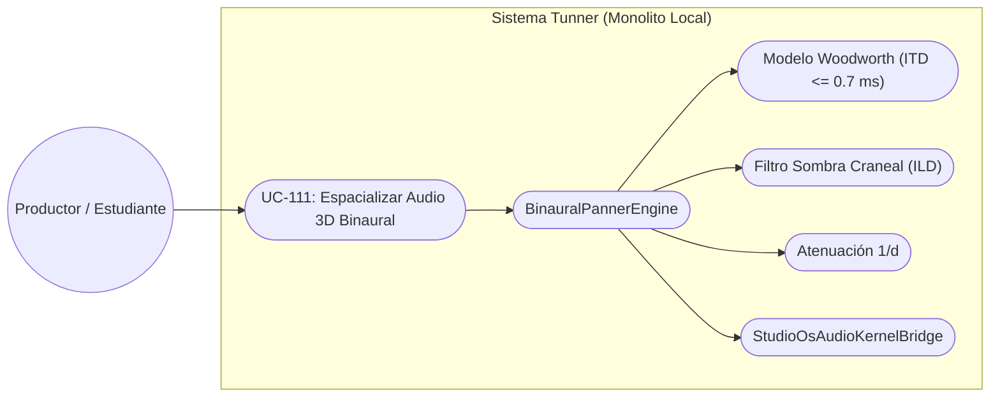
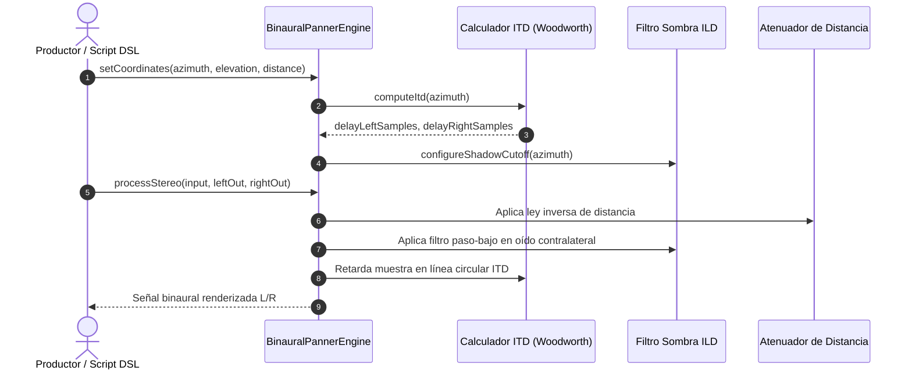

# Caso de Uso Canónico: UC-111-BINAURAL-HRTF-3D-SPATIAL-PANNER

Documento formal de especificación del caso de uso correspondiente a la Matriz de Paneo Binaural y Espacialización 3D para Auriculares basada en aproximaciones de HRTF (Head-Related Transfer Function).

---

## Metadatos del Caso de Uso

- **ID del Caso de Uso:** `UC-111-BINAURAL-HRTF-3D-SPATIAL-PANNER`
- **Nombre Canónico:** Espacializar Señales de Audio en Coordenadas Esféricas 3D Mediante Paneo Binaural ITD/ILD para Auriculares
- **Fase Asociada:** Fase 7 (Procesamiento de Señal Acústica Avanzado y Espacialización 3D)
- **Actor Principal:** Ingeniero de Sonido / Músico Productor / Estudiante de Entrenamiento Auditivo
- **Actores Secundarios:** BinauralPannerEngine, HeadShadowFilter, StudioAudioDeviceMatrixService, TunnerOsKernel
- **Estado:** Approved

---

## 1. Descripción Breve y Propósito

El caso de uso permite situar fuentes sonoras en un espacio tridimensional virtual (azimut de $-180^\circ$ a $+180^\circ$, elevación de $-90^\circ$ a $+90^\circ$ y distancia) para su escucha inmersiva en auriculares convencionales, modelando con rigor psicoacústico el retardo interaural de tiempo (ITD) según el modelo esférico de Woodworth y la diferencia interaural de nivel (ILD) mediante filtros dinámicos de sombra acústica craneal (*Head Shadow*).

---

## 2. Diagrama de Caso de Uso (Mermaid)

---

## 3. Precondiciones y Postcondiciones

### 3.1 Precondiciones
1. La señal de audio monoaural o estéreo de entrada se encuentra normalizada.
2. El motor se ejecuta a una frecuencia de muestreo establecida (44.1 kHz o 48 kHz).
3. Parámetros físicos configurados: radio craneal promedio $r \approx 0.0875\text{ m}$, velocidad del sonido $c \approx 343\text{ m/s}$.

### 3.2 Postcondiciones
1. La salida estéreo genera una ilusión psicoacústica de localización espacial clara en auriculares.
2. El retardo ITD no supera los $0.7\text{ ms}$ físicos para evitar desdoblamientos o ecos no naturales (*Haas effect threshold*).
3. Tiempo de procesamiento por bloque estéreo inferior a 0.5 ms (latencia sub-10ms garantizada).

---

## 4. Diagrama de Secuencia (Mermaid)

---

## 5. Fundamentación Psicoacústica y Matemática

1. **Retardo Interaural Temporal (ITD - Woodworth Formula):**
   Para un ángulo azimutal $\theta \in [-\pi, \pi]$ en radianes:
   $$\text{ITD}(\theta) = \begin{cases} \frac{r}{c} (\theta + \sin\theta) & \text{si } 0 \le |\theta| \le \frac{\pi}{2} \\ \frac{r}{c} (\pi - |\theta| + \sin|\theta|) & \text{si } \frac{\pi}{2} < |\theta| \le \pi \end{cases}$$
   Donde $r = 0.0875\text{ m}$ y $c = 343\text{ m/s}$, produciendo un retardo máximo de $\sim 0.66\text{ ms}$ a $\pm 90^\circ$.

2. **Diferencia Interaural de Nivel (ILD):**
   Filtro paso-bajo de un polo para el oído contralateral:
   $$y[n] = (1 - \alpha) x[n] + \alpha y[n-1]$$
   Donde $\alpha$ se ajusta dinámicamente reduciendo la frecuencia de corte hacia $1.5\text{ kHz}$ cuando el sonido proviene del extremo opuesto, emulando la difracción craneal.
