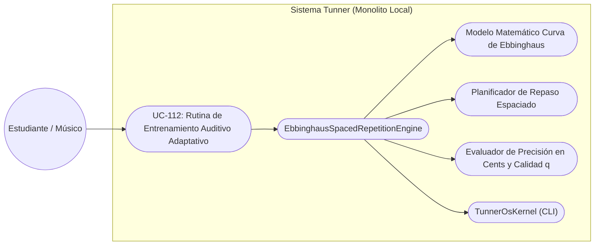
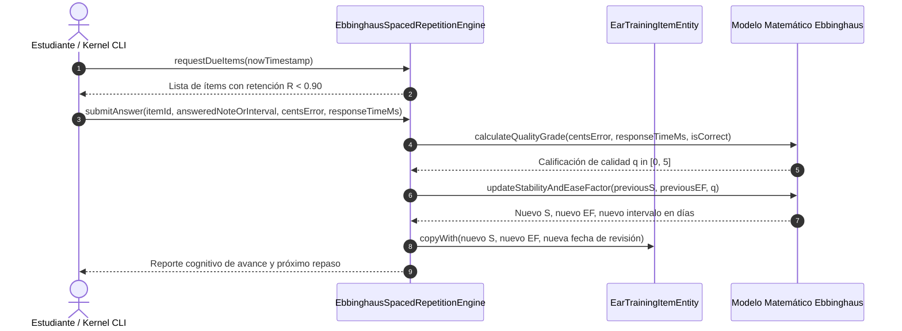

# Caso de Uso Canónico: UC-112-ADAPTIVE-EBBINGHAUS-EAR-TRAINING-ENGINE

Documento formal de especificación del caso de uso correspondiente al Generador de Rutinas Adaptativas de Entrenamiento Auditivo basado en la Curva de Retención y Olvido de Hermann Ebbinghaus.

---

## Metadatos del Caso de Uso

- **ID del Caso de Uso:** `UC-112-ADAPTIVE-EBBINGHAUS-EAR-TRAINING-ENGINE`
- **Nombre Canónico:** Generar y Adaptar Rutinas de Entrenamiento Auditivo e Intervalos mediante Repetición Espaciada Ebbinghaus
- **Fase Asociada:** Fase 8 (Suite Pedagógica y Analítica Cognitiva)
- **Actor Principal:** Estudiante de Música / Docente de Conservatorio
- **Actores Secundarios:** EbbinghausSpacedRepetitionEngine, EarTrainingItemEntity, TunnerOsKernel
- **Estado:** Approved

---

## 1. Descripción Breve y Propósito

El caso de uso permite al estudiante o instrumentista realizar sesiones de entrenamiento auditivo (identificación de intervalos armónicos y melódicos, reconocimiento microtonal y tríadas) con una cadencia de práctica optimizada matemáticamente. El sistema evalúa la precisión acústica (en microcents) y el tiempo de reacción para modular la estabilidad del recuerdo $S$ y reprogramar los intervalos críticos antes de que la probabilidad de retención decaiga por debajo del umbral pedagógico óptimo ($R < 0.90$).

---

## 2. Diagrama de Caso de Uso (Mermaid)

---

## 3. Precondiciones y Postcondiciones

### 3.1 Precondiciones
1. El estudiante inicia una sesión de entrenamiento auditivo seleccionando un banco de ítems (intervalos musicales o microtonos).
2. Cada ítem auditivo dispone de parámetros iniciales de estabilidad ($S$), factor de facilidad ($\text{EF} \ge 1.30$) y fecha de última revisión.

### 3.2 Postcondiciones
1. Cada respuesta evaluada actualiza el factor de facilidad ($\text{EF}$) y la nueva estabilidad temporal ($S$).
2. Se genera la fecha y hora de la próxima revisión óptima ($t_{\text{next}}$) calculada mediante la inversión de la curva de retención:
   $$t_{\text{next}} = -S \cdot \ln(R_{\text{target}})$$
   con $R_{\text{target}} = 0.90$.
3. Se almacena el historial acumulado de aciertos, fallos y desviación cuadrática media en cents.

---

## 4. Diagrama de Secuencia (Mermaid)

---

## 5. Fundamentación Matemática y Algorítmica

### 5.1 Curva de Retención de Ebbinghaus
La probabilidad de recuerdo $R(t)$ tras un tiempo transcurrido $t$ viene modelada por:
$$R(t) = e^{-\frac{t}{S}}$$
donde:
- $t$: Tiempo transcurrido desde la última revisión exitosa (expresado en días o minutos).
- $S$: Estabilidad de la memoria (fuerza del recuerdo en unidades de tiempo).

### 5.2 Determinación del Grado de Calidad $q$
La calidad de la respuesta $q \in [0, 5]$ sintetiza la exactitud interválica y la afinación en microcents:
- $q = 5$: Identificación perfecta instantánea ($< 2.0\text{ s}$) con desviación $|\Delta \text{cents}| \le 5\text{ cents}$.
- $q = 4$: Identificación correcta con vacilación menor ($2.0\text{ s} - 4.0\text{ s}$) o desviación $|\Delta \text{cents}| \le 15\text{ cents}$.
- $q = 3$: Identificación correcta con esfuerzo significativo ($> 4.0\text{ s}$) o desviación $|\Delta \text{cents}| \le 30\text{ cents}$.
- $q = 2$: Identificación incorrecta pero cercana (error de semitono o inversión).
- $q = 1$: Identificación incorrecta con noción errada.
- $q = 0$: Fallo total o tiempo agotado.

### 5.3 Actualización del Factor de Facilidad ($\text{EF}$) y Estabilidad ($S$)
Inspirado en la formulación SM-2/Anki adaptada al entrenamiento auditivo continuo:
$$\text{EF}' = \max\left(1.30, \;\text{EF} + \left(0.1 - (5 - q) \cdot (0.08 + (5 - q) \cdot 0.02)\right)\right)$$
Si la respuesta es exitosa ($q \ge 3$):
- Para repaso 1: $I_1 = 1\text{ día}$
- Para repaso 2: $I_2 = 3\text{ días}$
- Para repaso $n > 2$: $I_n = I_{n-1} \cdot \text{EF}'$
Si la respuesta es fallida ($q < 3$):
- El ítem se resetea a revisión inmediata ($I_0 = 0.1\text{ días} \approx 2.4\text{ horas}$) manteniendo historial de fallas.

---

## 6. Flujo Principal y Flujos Alternativos

### 6.1 Flujo Principal
1. El usuario solicita los ejercicios pendientes del día mediante `train review` o a través del motor pedagógico.
2. El motor filtra los ítems cuya retención teórica $R(t) \le 0.90$.
3. El usuario responde al estímulo auditivo emitido.
4. El motor computa la calificación $q$, actualiza $\text{EF}$, $S$ y reprograma la fecha de vencimiento.
5. El sistema entrega retroalimentación inmediata con el porcentaje de retención proyectado.

### 6.2 Flujos Alternativos
- **A1. Banco de ejercicios nuevo sin historial:** Los ítems nuevos reciben estabilidad inicial $S_0 = 1.0$, $\text{EF} = 2.50$ y entran en cola de aprendizaje inicial.
- **A2. Respuesta fallida consecutiva (ítem crítico):** El motor clasifica el ítem como "zona de refuerzo acústico" y reduce temporalmente la velocidad de reproducción o añade armónicos de referencia para anclar el timbre.
