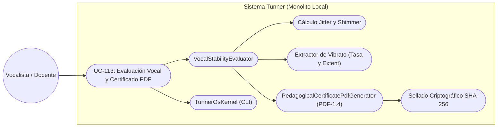
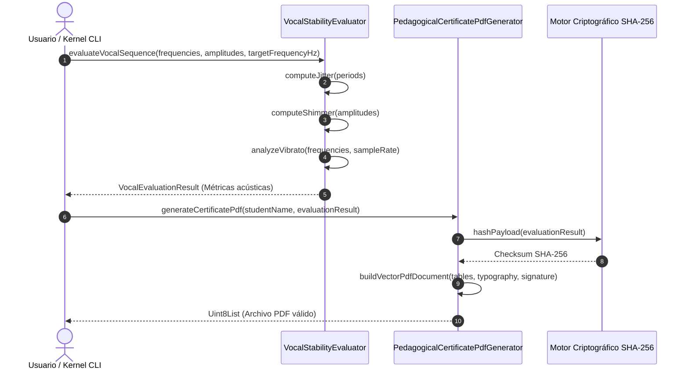

# Caso de Uso Canónico: UC-113-VOCAL-EVALUATION-AND-PDF-CERTIFICATES

Documento formal de especificación del caso de uso correspondiente al Asistente de Evaluación de Afinación y Emisión Vocal con Certificados PDF Canónicos.

---

## Metadatos del Caso de Uso

- **ID del Caso de Uso:** `UC-113-VOCAL-EVALUATION-AND-PDF-CERTIFICATES`
- **Nombre Canónico:** Evaluar Estabilidad Vocal (Jitter, Shimmer, Vibrato) y Generar Certificados de Conservatorio en PDF
- **Fase Asociada:** Fase 8 (Suite Pedagógica y Analítica Cognitiva)
- **Actor Principal:** Estudiante de Canto / Docente de Técnica Vocal
- **Actores Secundarios:** VocalStabilityEvaluator, PedagogicalCertificatePdfGenerator, TunnerOsKernel
- **Estado:** Approved

---

## 1. Descripción Breve y Propósito

El caso de uso permite analizar secuencias de audio cantado o entonado para cuantificar la estabilidad biomecánica de las cuerdas vocales (jitter de periodo fundamental, shimmer de amplitud y tasa/profundidad de vibrato), correlacionar la afinación media con la escala activa en cents y compilar un certificado pedagógico formal en formato PDF ISO 32000-1 sellado criptográficamente con SHA-256.

---

## 2. Diagrama de Caso de Uso (Mermaid)

---

## 3. Precondiciones y Postcondiciones

### 3.1 Precondiciones
1. Se suministra un flujo de muestras de audio monofónico (Float32List o serie de estimaciones de frecuencia y amplitud) obtenido de una toma vocal continua.
2. El tono o registro vocal nominal de referencia se encuentra configurado (frecuencia target en Hz o nota musical).

### 3.2 Postcondiciones
1. Se genera la entidad `VocalEvaluationResult` con métricas acústicas cuantitativas (Jitter %, Shimmer %, Vibrato Rate Hz, Vibrato Depth cents, Error medio de afinación en cents y Puntuación global de 0 a 100).
2. Se genera el documento binario PDF estándar conforme a la norma PDF-1.4, conteniendo el desglose pedagógico, tablas de rendimiento y el sello SHA-256 inmutable.

---

## 4. Diagrama de Secuencia (Mermaid)

---

## 5. Fundamentación Matemática y Acústica

### 5.1 Jitter Tonal (Variación Ciclo a Ciclo de Frecuencia)
Mide la irregularidad en la duración de los ciclos fonatorios fundamentales $T_i$:
$$\text{Jitter}(\%) = \frac{\frac{1}{N-1} \sum_{i=1}^{N-1} |T_i - T_{i+1}|}{\frac{1}{N} \sum_{i=1}^{N} T_i} \times 100\%$$
En una voz sana y afinada de conservatorio, el jitter típicamente se mantiene $\le 1.0\%$.

### 5.2 Shimmer de Amplitud (Variación Ciclo a Ciclo de Intensidad)
Mide la perturbación en las amplitudes pico $A_i$ de los ciclos fonatorios:
$$\text{Shimmer}(\%) = \frac{\frac{1}{N-1} \sum_{i=1}^{N-1} |A_i - A_{i+1}|}{\frac{1}{N} \sum_{i=1}^{N} A_i} \times 100\%$$
En emisión vocal limpia, el shimmer se mantiene $\le 3.5\%$.

### 5.3 Modulación de Vibrato (Tasa y Extensión)
El vibrato fisiológico se modela como modulación de frecuencia sinusoidal:
$$f(t) = f_0 + \Delta f \cdot \sin(2\pi f_v t)$$
- **Tasa de vibrato ($f_v$):** Óptima entre $4.5\text{ Hz}$ y $7.0\text{ Hz}$.
- **Extensión de vibrato ($\Delta \text{cents}$):** Profundidad típica entre $\pm 25\text{ cents}$ y $\pm 75\text{ cents}$ (un semitono total o medio semitono).

---

## 6. Flujo Principal y Flujos Alternativos

### 6.1 Flujo Principal
1. El usuario ejecuta `vocal eval <target_hz>` o aporta los registros fonatorios.
2. El evaluador calcula las series temporales de periodos, amplitudes y espectro de vibrato.
3. Se ponderan las métricas para generar una puntuación de estabilidad técnica de 0 a 100.
4. El generador PDF ensambla el certificado oficial con tablas formateadas y el hash SHA-256.
5. El sistema entrega la telemetría en terminal y el archivo PDF listo para su archivo o impresión.

### 6.2 Flujos Alternativos
- **A1. Señal con silencio prolongado o fluctuaciones erráticas:** Se filtran automáticamente los fotogramas donde la amplitud está por debajo del umbral de ruido acústico (-40 dB).
- **A2. Emisión vocal sin vibrato (Straight Tone):** La tasa de vibrato se marca en 0 Hz y no se penaliza si la desviación de afinación en cents es mínima.
