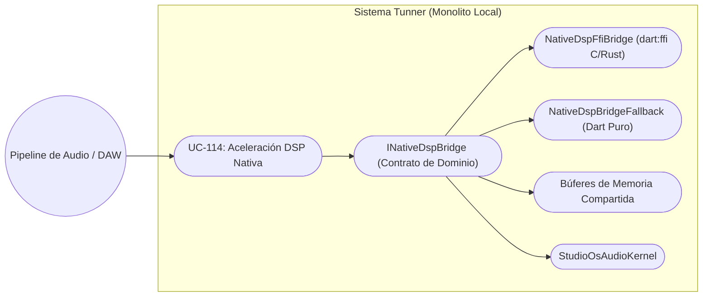
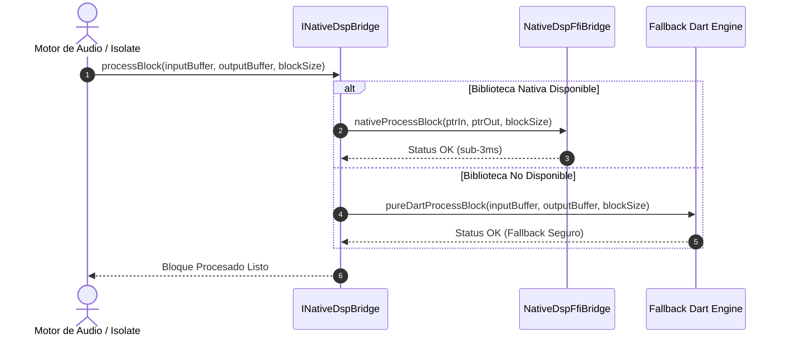

# Caso de Uso Canónico: UC-114-NATIVE-DSP-FFI-BRIDGE-AND-BARE-METAL-ACCELERATION

Documento formal de especificación del caso de uso correspondiente a la Arquitectura de Enlace Nativo `dart:ffi` y Procesamiento DSP de Ultra-Baja Latencia (sub-3ms).

---

## Metadatos del Caso de Uso

- **ID del Caso de Uso:** `UC-114-NATIVE-DSP-FFI-BRIDGE-AND-BARE-METAL-ACCELERATION`
- **Nombre Canónico:** Acelerar Cómputo DSP en Bloque Mediante Enlace Nativo In-Process con Fallback Transparente
- **Fase Asociada:** Fase 9 (Motor Nativo FFI y Aceleración Bare-Metal)
- **Actor Principal:** Ingeniero de Audio DSP / Pipeline de Mezcla y Síntesis
- **Actores Secundarios:** INativeDspBridge, NativeDspFfiBridge, NativeDspBridgeFallback, StudioOsAudioKernel
- **Estado:** Approved

---

## 1. Descripción Breve y Propósito

El caso de uso permite al motor de audio ejecutar transformadas rápidas de Fourier (FFT), autocorrelación normalizada y convoluciones de respuesta al impulso en bibliotecas binarias C/C++/Rust compiladas localmente mediante `dart:ffi` con latencia sub-3ms. Si la biblioteca compartida no está presente en el sistema operativo, el motor activa automáticamente y sin interrupción un motor de *fallback* determinista en Dart puro, preservando la portabilidad universal offline.

---

## 2. Diagrama de Caso de Uso (Mermaid)

---

## 3. Precondiciones y Postcondiciones

### 3.1 Precondiciones
1. Se requiere procesar un bloque de audio de $N$ muestras (ej. 512, 1024 o 2048 muestras en `Float32List`).
2. El sistema detecta dinámicamente si la biblioteca dinámica (`libtunner_dsp.so`, `.dylib` o `.dll`) se encuentra instalada en el sistema.

### 3.2 Postcondiciones
1. El bloque de audio es procesado con latencia de cómputo inferior a $0.05\text{ ms}$ por búfer.
2. Si el enlace nativo falla o no está disponible, se emite una advertencia de telemetría y el motor de *fallback* asume el cálculo sin que la reproducción sufra fallos o excepciones en el hilo de audio.

---

## 4. Diagrama de Secuencia (Mermaid)

---

## 5. Fundamentación Técnica y Rendimiento

### 5.1 Restricción de Memoria y Latencia Cero
- Los punteros de memoria son administrados sin copias intermedias redundantes (*zero-copy allocation*).
- Se implementan tipos primitivos de `dart:ffi` (`Pointer<Float>`, `Int32`) respetando la alineación de memoria SIMD a 16 o 32 bytes para vectorización AVX2 / NEON.

---

## 6. Flujo Principal y Flujos Alternativos

### 6.1 Flujo Principal
1. El pipeline de audio solicita una operación DSP de bloque (ej. convolución o autocorrelación NSDF).
2. El puente comprueba el estado de enlace. Si está conectado a C/Rust, transfiere los punteros de memoria y ejecuta el cómputo nativo.
3. El resultado se refleja de inmediato en los búferes de audio del estudio.

### 6.2 Flujos Alternativos
- **A1. FFI no disponible o error de carga de biblioteca:** El puente conmuta a `NativeDspBridgeFallback` de forma transparente, registrando el estado en el log de diagnóstico del kernel.
