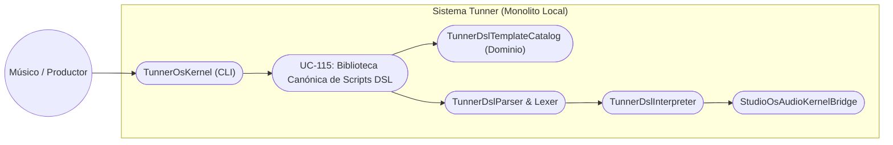
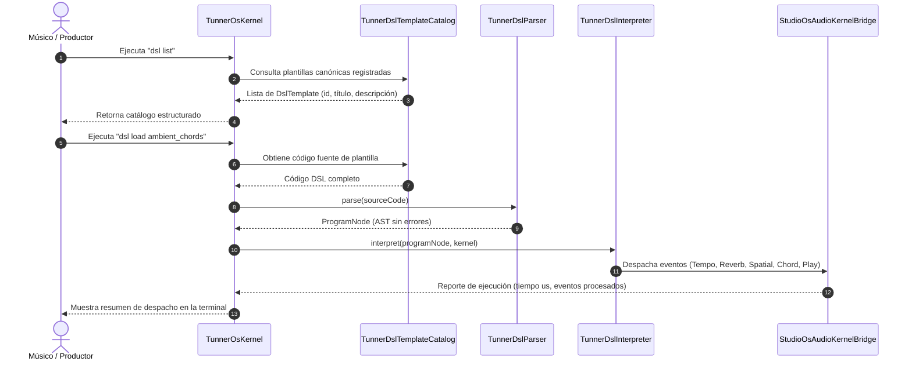

# Caso de Uso: UC-115-CANONICAL-TUNNER-DSL-SCRIPTS-LIBRARY

Este documento define la especificación canónica del caso de uso para la biblioteca de plantillas declarativas de scripts Tunner DSL (`.tun`), su catálogo tipado en Dominio y su integración interactiva en la terminal Tunner OS.

---

## Metadatos del Caso de Uso

- **ID del Caso de Uso:** `UC-115-CANONICAL-TUNNER-DSL-SCRIPTS-LIBRARY`
- **Nombre Canónico:** `Proveer e interpretar biblioteca canónica de scripts declarativos Tunner DSL`
- **Fase Asociada:** `Fase 6 (Consolidación DSL) / Fase 9 (Comunidad y Ecosistema)`
- **Actor Principal:** `Músico / Productor / Estudiante de Audio`
- **Actores Secundarios:** `Terminal Tunner OS / Intérprete Tunner DSL / Motor de Audio`
- **Estado:** `Approved`

---

## 1. Descripción Breve y Propósito

Proveer a los usuarios y creadores una biblioteca estructurada de scripts declarativos canónicos (`.tun`) almacenados como recursos nativos del sistema y expuestos a través de un catálogo tipado de Dominio en Dart puro. Estos scripts permiten activar de forma determinista configuraciones complejas de audio: progresiones armónicas espaciales con reverberación Schroeder-Moorer (`ambient_chords.tun`), líneas de bajo ácidas a 135 BPM con envolventes sintetizadas rápidas (`acid_bassline.tun`) y rutinas pedagógicas de calentamiento vocal diatónico (`vocal_warmup_routine.tun`).

---

## 2. Diagrama de Caso de Uso (Mermaid)

---

## 3. Precondiciones y Postcondiciones

### 3.1 Precondiciones
1. El analizador sintáctico descendente recursivo `TunnerDslParser` y el intérprete `TunnerDslInterpreter` se encuentran operativos y validados.
2. La terminal `TunnerOsKernel` está inicializada con acceso al kernel de eventos `StudioOsAudioKernel`.

### 3.2 Postcondiciones
1. Los tres scripts canónicos residen en `assets/dsl/` y en `TunnerDslTemplateCatalog` sin errores sintácticos ni léxicos.
2. La terminal ofrece los comandos interactivos `dsl list` (o `dsl templates`) y `dsl load <nombre>` para explorar y despachar las plantillas de forma inmediata.
3. Se conservan cero bucles de espera activa y cero dependencias de UI en la capa de Dominio.

---

## 4. Diagrama de Flujo y Secuencia (Mermaid)

---

## 5. Flujos del Sistema

### 5.1 Flujo Principal (Listado y Ejecución Canónica)
1. El usuario invoca `dsl list` o `dsl templates` en la terminal CLI.
2. El sistema despliega el catálogo canónico con identificador, tempo de referencia, descripción didáctica y categoría.
3. El usuario invoca `dsl load ambient_chords`.
4. El sistema valida el identificador en el catálogo de Dominio.
5. El sistema procesa el código fuente a través del lexer y parser generando el AST.
6. El intérprete evalúa las sentencias, modulando parámetros de reverberación, audio espacial, envolventes ADSR y progresiones armónicas polifónicas.
7. La terminal retorna un resumen confirmando el éxito del despacho y la cantidad de sentencias evaluadas.

### 5.2 Flujos Alternativos y Manejo de Errores
- **FA-01 (Identificador Inexistente):** Si el usuario invoca `dsl load plantilla_invalida`, el sistema retorna un error amigable listando los identificadores disponibles (`ambient_chords`, `acid_bassline`, `vocal_warmup_routine`).
- **FA-02 (Sintaxis Inválida o Carácter Extraño):** Si una plantilla personalizada contiene errores de sintaxis, el parser captura los diagnósticos con línea y columna sin propagar excepciones no controladas.
