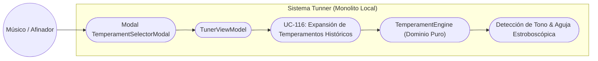
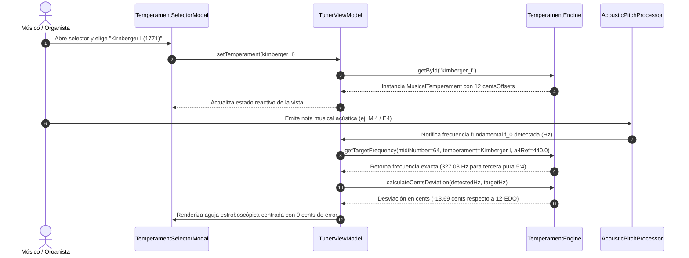

# Caso de Uso: UC-116-HISTORICAL-TEMPERAMENTS-EXPANSION

Este documento especifica el caso de uso para la ampliación analítica del motor de temperamentos históricos de Tunner, incorporando los sistemas Werckmeister IV (Septenarius), Kirnberger I y Neidhardt (1724) con derivaciones acústicas exactas en cents relativas a 12-TET.

---

## Metadatos del Caso de Uso

- **ID del Caso de Uso:** `UC-116-HISTORICAL-TEMPERAMENTS-EXPANSION`
- **Nombre Canónico:** `Expandir catálogo de afinaciones y temperamentos históricos barrocos y clásicos`
- **Fase Asociada:** `Fase 1 (Núcleo Acústico) / Fase 9 (Comunidad y Ecosistema)`
- **Actor Principal:** `Músico de Música Antigua / Organista / Afinador / Estudiante de Conservatorio`
- **Actores Secundarios:** `Aguja Estroboscópica UI / TunerViewModel / Motor Acústico TemperamentEngine`
- **Estado:** `Approved`

---

## 1. Descripción Breve y Propósito

Permitir al usuario seleccionar y calibrar su instrumento utilizando temperamentos históricos no-iguales avanzados del periodo barroco y clásico:
1. **Werckmeister IV (Septenarius, 1691):** Basado en la subdivisión del monocordio en 7 partes proporcionales con quintas compensadas.
2. **Kirnberger I (1771):** Sistema purista que conserva cuatro quintas mesotónicas y una tercera mayor C-E acústicamente pura (5:4, 386.31 cents) concentrando la coma sintónica en la quinta D-A.
3. **Neidhardt (1724):** Temperamento circulante para grandes órganos de iglesia barrocos ("Grosse Stadt") que permite transitar armónicamente por las 24 tonalidades mayores y menores sin acordes lobo disonantes.

El cálculo se ejecuta en tiempo real en la capa de Dominio en Dart puro, garantizando complejidad $O(1)$, latencia nula y precisión superior a 0.01 cents.

---

## 2. Diagrama de Caso de Uso (Mermaid)

---

## 3. Precondiciones y Postcondiciones

### 3.1 Precondiciones
1. El motor de afinación `TemperamentEngine` está instanciado y vinculado a `TunerViewModel`.
2. La frecuencia de concierto $A_4$ de referencia (por ejemplo 440 Hz, 415 Hz barroco o 432 Hz) está definida en el sistema.

### 3.2 Postcondiciones
1. El catálogo de temperamentos dispone de 11 afinaciones históricas canónicas (8 iniciales + 3 nuevas).
2. Cada temperamento contiene 12 desviaciones en cents relativas a 12-TET ordenadas cromáticamente a partir de la tónica (C = índice 0 a B = índice 11).
3. La aguja estroboscópica y el indicador de cents visualizan la desviación instantánea respecto a la frecuencia temperada exacta calculada para la nota activa.
4. Cero dependencias externas o de UI en la capa de Dominio.

---

## 4. Diagrama de Flujo y Secuencia (Mermaid)

---

## 5. Flujos del Sistema

### 5.1 Flujo Principal (Selección e Inspección de Temperamento)
1. El usuario abre el modal `TemperamentSelectorModal` desde la pantalla del afinador estroboscópico.
2. El sistema lista las 11 afinaciones disponibles ordenadas cronológicamente, incluyendo Werckmeister IV, Kirnberger I y Neidhardt (1724).
3. El usuario selecciona `Neidhardt (1724)`.
4. El sistema actualiza el temperamento activo en el `TunerViewModel`.
5. Todas las lecturas subsiguientes de tono acústico ajustan su frecuencia objetivo según la tabla de cents del temperamento y la tónica seleccionada.

### 5.2 Flujos Alternativos y Manejo de Errores
- **FA-01 (Tónica Modulada):** Si el usuario conmuta la nota raíz de afinación (por ejemplo a Re = 2), el método `getCentsOffset` aplica modulación circular determinista: `(noteIndex - rootKey + 12) % 12` sin alterar la inmutabilidad de la tabla de cents original.
- **FA-02 (Frecuencia Inválida o Silencio):** Si la frecuencia detectada es menor o igual a 0 Hz, `calculateCentsDeviation` retorna de forma segura 0.0 cents sin divisiones por cero ni excepciones de punto flotante.
