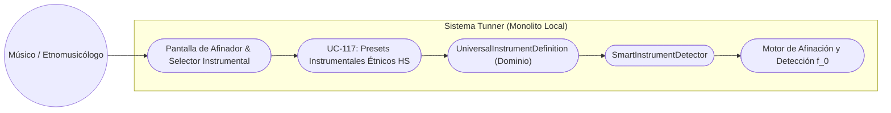
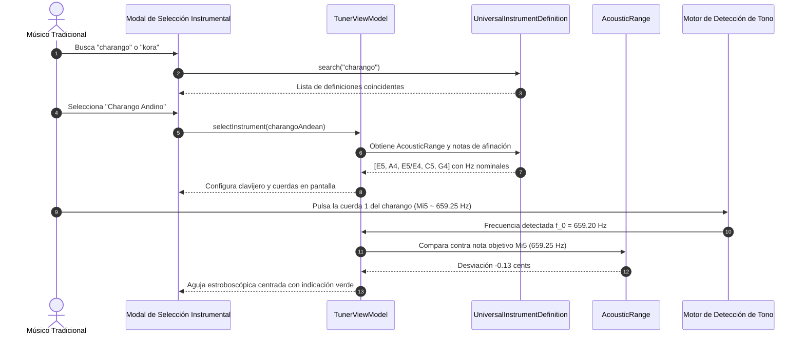

# Caso de Uso: UC-117-ETHNIC-INSTRUMENTS-HORNBOSTEL-SACHS

Este documento define la especificación canónica del caso de uso para la incorporación de instrumentos étnicos y tradicionales del mundo al catálogo universal de Tunner (`UniversalInstrumentDefinition`), estructurados según el sistema taxonómico de conservatorio Hornbostel-Sachs (HS).

---

## Metadatos del Caso de Uso

- **ID del Caso de Uso:** `UC-117-ETHNIC-INSTRUMENTS-HORNBOSTEL-SACHS`
- **Nombre Canónico:** `Clasificar, calibrar y afinar instrumentos étnicos según la taxonomía Hornbostel-Sachs`
- **Fase Asociada:** `Fase 1 (Núcleo Acústico) / Fase 9 (Comunidad y Ecosistema)`
- **Actor Principal:** `Músico Tradicional / Etnomusicólogo / Estudiante de Instrumentos del Mundo`
- **Actores Secundarios:** `Catálogo Universal de Instrumentos / Afinador Inteligente / TunerViewModel`
- **Estado:** `Approved`

---

## 1. Descripción Breve y Propósito

Permitir al usuario seleccionar, afinar y estudiar instrumentos de diversas tradiciones musicales del mundo bajo una clasificación organológica rigurosa. Se incorporan:
1. **Kora de África Occidental:** Cordófono tipo arpa-laúd (HS 321) con 21 cuerdas y afinaciones modales Sawuta y Tomora.
2. **Sitar de la India:** Cordófono tipo laúd de mástil largo (HS 321) con trastes curvos móviles y cuerdas simpáticas.
3. **Shakuhachi de Japón:** Aerófono de bambú longitudinal de extremo abierto (HS 421) con afinación pentatónica fundamental en D4 y digitaciones microtonales.
4. **Charango Andino:** Cordófono tradicional latinoamericano (HS 321) con 5 órdenes dobles y afinación reentrante en temple natural.
5. **Cuatro Tradicional Venezolano:** Cordófono de cuatro cuerdas (HS 321) con afinación reentrante ("Cambur Pintón").

Cada instrumento define sus frecuencias nominales en Hz, notas de afinación canónicas, rango acústico, envolvente tímbrica ADSR y perfil visual de emulación en tiempo real.

---

## 2. Diagrama de Caso de Uso (Mermaid)

---

## 3. Precondiciones y Postcondiciones

### 3.1 Precondiciones
1. El catálogo `UniversalInstrumentDefinition` está compilado en la capa de Dominio en Dart puro.
2. La taxonomía `HornbostelSachsCategory` y las subfamilias musicales están definidas.

### 3.2 Postcondiciones
1. El catálogo maestro cuenta con los 5 nuevos instrumentos étnicos con sus códigos taxonómicos jerárquicos normalizados (`[categoria].[subfamilia].[id]`).
2. Las tablas de afinación de cuerdas y digitaciones base registran las frecuencias en Hz y notas nominales.
3. El buscador rápido por palabras clave (`searchKeywords`) localiza los instrumentos en español, inglés y sus denominaciones vernáculas.
4. Cero dependencias externas en la capa de Dominio.

---

## 4. Diagrama de Flujo y Secuencia (Mermaid)

---

## 5. Flujos del Sistema

### 5.1 Flujo Principal (Búsqueda y Calibración de Instrumento Étnico)
1. El usuario accede al selector de instrumentos en el afinador inteligente.
2. Ingresa un término de búsqueda vernáculo (e.g. "shakuhachi", "cambur pinton", "sitar", "arpa laúd").
3. El sistema filtra y despliega la ficha organológica detallando la clasificación Hornbostel-Sachs, tesitura, afinación canónica y transposición.
4. El usuario confirma la selección.
5. El afinador adapta sus umbrales de captura, rango acústico permitido y notas de referencia estroboscópica al instrumento configurado.

### 5.2 Flujos Alternativos y Manejo de Errores
- **FA-01 (Afinación Reentrante):** En instrumentos con afinaciones no lineales como el Charango (orden central octavado) o el Cuatro Venezolano, el detector acústico identifica la frecuencia exacta sin forzar un orden monotónico creciente de tonos.
- **FA-02 (Búsqueda Vacía):** Si la consulta no produce coincidencias, el sistema retorna la totalidad del catálogo maestro sin lanzar excepciones.
