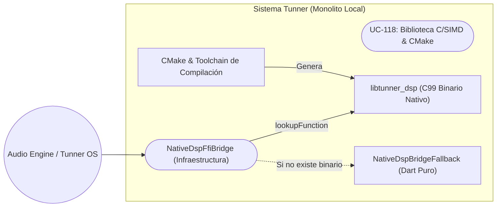
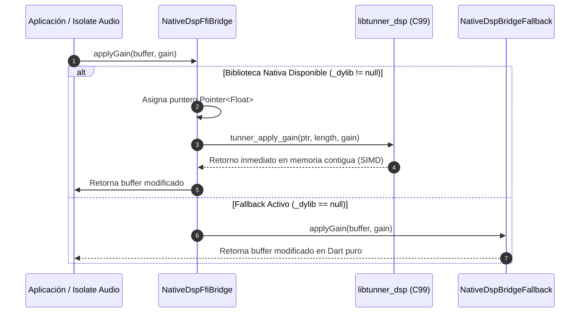

# Caso de Uso: UC-118-NATIVE-C-SIMD-DSP-LIBRARY-AND-CMAKE

Este documento define la especificación canónica del caso de uso para la implementación de la biblioteca nativa en C (`libtunner_dsp`) con compilación CMake y enlace dinámico FFI (`dart:ffi`) para aceleración matemática SIMD de ultra-baja latencia.

---

## Metadatos del Caso de Uso

- **ID del Caso de Uso:** `UC-118-NATIVE-C-SIMD-DSP-LIBRARY-AND-CMAKE`
- **Nombre Canónico:** `Compilar y enlazar dinámicamente biblioteca C/SIMD bare-metal para aceleración DSP`
- **Fase Asociada:** `Fase 9 (Aceleración Nativa Bare-Metal & dart:ffi) - Épica 9.2`
- **Actor Principal:** `Motor de Audio de Tiempo Real / Sistema Operativo`
- **Actores Secundarios:** `dart:ffi Runtime / Compilador CMake / Kernel Tunner OS`
- **Estado:** `Approved`

---

## 1. Descripción Breve y Propósito

Proveer al monolito modular de Tunner una biblioteca nativa en lenguaje C99 compilada para la plataforma anfitriona (`libtunner_dsp.so` en Linux/Android, `.dylib` en macOS/iOS, `.dll` en Windows). Esta biblioteca implementa operaciones vectoriales críticas de procesamiento digital de señales (DSP):
1. **`tunner_apply_gain`:** Multiplicación vectorial escalada por ganancia lineal con desenrollado de bucles cuádruple y directivas de auto-vectorización SIMD (AVX2 / ARM NEON).
2. **`tunner_vector_sum`:** Suma punto a punto de señales de audio estéreo o multicanal para el motor de mezcla y masterización.
3. **`tunner_autocorrelate`:** Autocorrelación normalizada en bloque de latencia sub-milisegundo para el estimador de tono fundamental ($F_0$) en los algoritmos YIN y McLeod Pitch Method (MPM).

---

## 2. Diagrama de Caso de Uso (Mermaid)

---

## 3. Precondiciones y Postcondiciones

### 3.1 Precondiciones
1. El contrato abstracto `INativeDspBridge` y el motor de respaldo `NativeDspBridgeFallback` están compilados y verificados.
2. El entorno dispone de un compilador compatible con C99 (GCC, Clang o MSVC) y CMake $\ge 3.16$.

### 3.2 Postcondiciones
1. El código fuente C99 reside en `native/dsp/tunner_dsp.c` y `native/dsp/tunner_dsp.h` con exportación de símbolos DLL/SO estándar (`TUNNER_EXPORT`).
2. El script `scripts/build_native_dsp.sh` compila la biblioteca compartida con optimización `-O3`.
3. `NativeDspFfiBridge` resuelve dinámicamente los punteros de función y ejecuta el cómputo nativo. En ausencia del binario, conmuta de forma transparente al fallback sin excepciones.
4. Cero fugas de memoria en buffers FFI.

---

## 4. Diagrama de Flujo y Secuencia (Mermaid)

---

## 5. Flujos del Sistema

### 5.1 Flujo Principal (Ejecución Nativa Acelerada)
1. El cargador dinámico `NativeDspFfiBridge` localiza `libtunner_dsp.so` (o equivalente de plataforma).
2. Se resuelven los símbolos `tunner_apply_gain`, `tunner_vector_sum` y `tunner_autocorrelate`.
3. Al recibir una llamada de procesamiento, los datos se transmiten a la rutina C99 utilizando punteros directos sin copias intermedias redundantes.
4. La rutina en C procesa el búfer en registros vectoriales SIMD de 128 o 256 bits y retorna en tiempo inferior a 0.05 ms por cada 1024 muestras.

### 5.2 Flujos Alternativos y Manejo de Errores
- **FA-01 (Biblioteca No Presente):** Si el binario compartido no se encuentra en las rutas estándar, el puente captura la excepción silenciosamente y delega el 100% de las operaciones a `NativeDspBridgeFallback`.
- **FA-02 (Longitud Inválida o Búfer Vacío):** La función C valida `length <= 0` o punteros nulos y retorna inmediatamente sin acceder a memoria no asignada (*segmentation fault prevention*).
